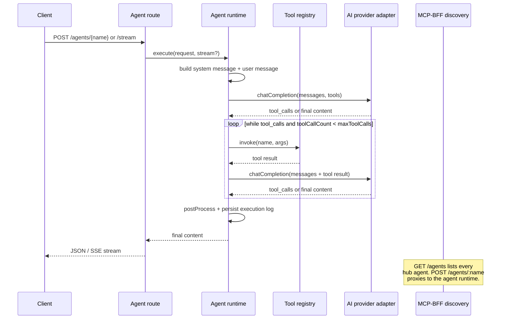

# Agent hub

The **agent hub** (`agentHub`) is a project-level system service. It hosts your project's
AI agents, gives them tools drawn from **any** service in the project, manages conversation
history, can be reconfigured at runtime, and can optionally let end-users create and run
their own agents. Configure it once on the project root and the compiler emits a dedicated
agent runtime for it.

Agents are **defined under `agentHub`**: `agentHub.aiAgents[]`. Each agent has its own
model config, system prompt, input/output pipeline, optional tools, and is exposed as a REST
and/or SSE endpoint. Agents may also be invoked by other agents as tools, by business-API
workflows through [`AgentCallAction`](../../spec/AgentCallAction.md), or driven by a Kafka
topic.

> **Define agents under `agentHub`, not per-service.** A `services[].aiAgents[]` slot still
> exists for backward compatibility (older projects that authored agents on a service) and
> is reserved for a future "smart API" direction, but it is hidden from authors. Author
> every new agent under `agentHub.aiAgents[]`.

## Where the hub fits

Three surfaces consume agents:

| Surface | Description |
|---|---|
| Agent hub runtime | The generated agent runtime that hosts every agent declared under `agentHub`. Provides the REST + SSE endpoints, Kafka listeners, conversation store, cross-service tool registry, and the programmatic entry point used by `AgentCallAction`. |
| [MCP-BFF agents catalogue](mcpbff.md) | The project-level MCP-BFF `GET /agents` lists every discoverable agent, and `POST /agents/:name` proxies an invocation through to its host. |
| [MCP-BFF native chat agent](mcpbff.md) | The MCP-BFF service hosts its own in-process chat agent (`POST /chat`) that runs the same tool loop over the project-wide MCP tool registry. Distinct from author-defined `AIAgent` entries; see [below](#mcp-bff-native-chat-agent). |

## Configuring the hub

`agentHub` is an `AgentHubConfig` on the project root. Its two main parts are the hub
settings and the agent list:

```json
"agentHub": {
  "hubSettings": {
    "hubBasics": {
      "description":              "Customer-facing AI hub",
      "enableDynamicAgents":      false,
      "dynamicAgentRoles":        [],
      "maxDynamicAgents":         50,
      "toolRefreshIntervalMinutes": 5
    },
    "toolSources": [
      { "serviceName": "*" }
    ]
  },
  "aiAgents": [ "..." ]
}
```

### Hub settings

| Field | Default | Notes |
|---|---|---|
| `hubBasics.description` | `"AI Agent Hub"` | Human-readable label for the hub. |
| `hubBasics.enableDynamicAgents` | `false` | When true, users with the listed roles can create, configure, and run their **own** agents at runtime, not just the design-time agents in the blueprint. |
| `hubBasics.dynamicAgentRoles` | `[]` | Roles allowed to create and manage dynamic agents at runtime. Empty means the platform operators of the project's tenancy: `superAdmin` + `admin` single-tenant, `superAdmin` + `saasAdmin` multi-tenant (a multi-tenant project has no role named `admin`). A multi-tenant blueprint that still carries the old default `["superAdmin","admin"]` gets the warning `MULTI_TENANT_ADMIN_ROLE_LEGACY_DEFAULT`; any other `admin` there is the error `MULTI_TENANT_ADMIN_ROLE_REFERENCE`. |
| `hubBasics.approvalRoles` | `[]` | Roles allowed to list and decide human-in-the-loop approvals (paused agent runs: approval-required tools and draft outputs). Resolves like `dynamicAgentRoles` when empty. |
| `hubBasics.maxDynamicAgents` | `50` | Upper bound on runtime-created agents: prevents unbounded growth. Must be at least 1 (`AGENT_HUB_INVALID_MAX_AGENTS`). |
| `hubBasics.toolRefreshIntervalMinutes` | `5` | How often the hub re-discovers tools from project services. Tools can also be refreshed manually. Must be at least 1 (`AGENT_HUB_INVALID_REFRESH_INTERVAL`). |
| `hubBasics.httpPort` | platform default | The HTTP port the generated hub service listens on, like a normal service's `serviceOptions.httpPort`. |
| `hubBasics.frontendDocument` | none | UX prompt for the generated UI describing how the agent-chat surface should be presented. |

See [`AgentHubConfig`](../../spec/AgentHubConfig.md), [`AgentHubSettings`](../../spec/AgentHubSettings.md)
and [`AgentHubBasics`](../../spec/AgentHubBasics.md).

### Tool sources: cross-service tool discovery

`hubSettings.toolSources[]` declares which services the hub harvests tools from. Each entry
is an [`AgentHubToolSource`](../../spec/AgentHubToolSource.md):

| Field | Description |
|---|---|
| `serviceName` | The service to discover tools from. Use `"*"` for **all** project services, or a specific name (for example `"taskManagement"`) to target one. Names must be distinct. |
| `includeApis` | Comma-separated API names to include as tools. `"*"` (or null) = all. |
| `excludeApis` | Comma-separated API names to exclude. Applied after `includeApis`: useful when `includeApis` is `"*"` but you want to hide internal APIs. |

A source `"*"` declared alongside specific services warns (`AGENT_HUB_REDUNDANT_TOOL_SOURCES`).

This is what makes the hub project-wide: an agent in the hub can call a BusinessApi from
*any* service, not just one. The hub re-discovers these tools on the
`toolRefreshIntervalMinutes` cadence, so a newly deployed service's APIs become available
without redefining the hub. Discovery reads each service's public
[`GET /tools` registry](application-mcp.md); an API with `apiOptions.blockMcp: true` is not
in it.

**A source that does not answer keeps its tools.** The hub often boots while its tool
sources are still restarting. A source's `GET /tools` fetch counts as failed when it
answers a non-2xx status, a body that is not JSON (for example an HTML proxy page), JSON
without the registry's `tools` array, or when it errors or times out. A failed source is
not treated as a source with no tools: its tools from the previous refresh stay in the
catalogue, at boot its tools are loaded from the hub's stored catalogue rows, and its stored
rows are never deleted. A source that answers with an empty `tools` array did answer: it
has no tools. Every generated service serves `GET /tools` (the agent hub excepted), and a
service with no tool answers the empty registry `{ "service": "<name>", "tools": [] }` with
a 200. A peer that serves no `GET /tools` route at all may answer a JSON `404`, which also
means "publishes no tool registry"; an HTML or text `404` is a failed fetch (it is what a
proxy answers while the peer restarts). After a refresh with a failed source, the hub
refreshes again sooner than the regular cycle: after 30 seconds, then doubling up to at most
5 minutes, until every source answers. Only one refresh runs at a time: a refresh requested
while another is running waits for the running one and gets its result. How the catalogue
is stored and synchronised across replicas is compiler behaviour; see
[the compiler specification](../../compiler/index.md).

## Project-level providers

Configure the model backends once at the project root:

```json
"projectSettings": {
  "aiProvidersSettings": {
    "aiProviders": [
      {
        "name":     "mainOpenai",
        "provider": "openai",
        "configuration": [
          { "name": "apiKey",       "value": "ENTER_CREDENTIAL", "secret": true },
          { "name": "defaultModel", "value": "gpt-4o-mini" }
        ]
      },
      {
        "name":     "claude",
        "provider": "anthropic",
        "configuration": [
          { "name": "apiKey",       "value": "ENTER_CREDENTIAL", "secret": true },
          { "name": "defaultModel", "value": "claude-sonnet-4-6" }
        ]
      }
    ]
  }
}
```

`aiProvidersSettings.aiProviders[]` is an **array of named providers**: a project can
declare multiple entries of the same provider type (for example two OpenAI accounts on
different orgs). Each entry produces `AI_PROVIDER_<NAME>_<KEY>` environment values for the
generated service. Agents bind to a provider by `modelSettings.providerName`.
`configuration` items are `{ name, value }` pairs; a secret is never written into the
blueprint (it is a reference: `$ENV:NAME`, or the `ENTER_CREDENTIAL` placeholder while the
value is not provided yet; see [Secrets in a blueprint](../blueprint/secrets.md)). Provider names must be unique (`UNIQUE_AI_PROVIDER_NAME`). Required
`configuration` keys per provider are listed on the [`AiProvider`](../../spec/AiProvider.md)
page.

An entry can also run on a key each tenant, workspace record or user stores
(`credentialScopes`): hub agents resolve it user, then workspace (resource), then tenant,
then the entry's own key (a Kafka-triggered run has no user level; it takes the workspace
level only for a human event author), and a `required` scope with no stored key answers
`428 AI_PROVIDER_CREDENTIAL_REQUIRED`. See
[`AiProviderCredentialScopes`](../../spec/AiProviderCredentialScopes.md).

### Self-hosted / custom inference endpoints

For Ollama, vLLM, OpenRouter, Together.ai, any other local inference server, or any other OpenAI- or
Anthropic-compatible endpoint without a dedicated adapter, use `provider: "custom"`:

```json
{
  "name":     "localOllama",
  "provider": "custom",
  "configuration": [
    { "name": "apiFormat",    "value": "openai" },
    { "name": "baseUrl",      "value": "http://localhost:11434/v1" },
    { "name": "apiKeyEnvVar", "value": "OLLAMA_API_KEY" },
    { "name": "defaultModel", "value": "llama3.1:70b" }
  ]
}
```

`apiFormat` selects which delegate adapter wraps the endpoint: `"openai"` (chat
completions), `"anthropic"` (Messages API), or `"raw"` (falls back to the OpenAI adapter).
Agents reference a project-level `custom` provider entry via `modelSettings.providerName`.

## Defining an agent

The hub stores a scope-masked copy of dynamic-agent inbound input in its run row: known
password, credential/token, card-number, e-mail and phone fields become `[REDACTED]`; other
fields remain verbatim. The live request and execution output stay unchanged. This uses the
same persist mask as design-time agent runs.

```json
"agentHub": {
  "aiAgents": [
    {
      "agentBasics": {
        "name":            "supportBot",
        "description":     "Answers customer questions about their orders.",
        "executionMode":   "chat",
        "modality":        "text",
        "assignedService": null
      },
      "modelSettings": {
        "providerName":  "mainOpenai",
        "model":         "gpt-4o-mini",
        "systemPrompt":  "You are a helpful support agent...",
        "temperature":   0.3,
        "responseFormat": "text"
      },
      "inputSettings":  {
        "promptTemplate": { "js": "this.request.body.message" },
        "acceptsUpload": false
      },
      "endpointSettings": {
        "hasRestEndpoint": true,
        "hasSseEndpoint":  true,
        "authRequired":    true
      }
    }
  ]
}
```

Required sections: `agentBasics`, `modelSettings`, `inputSettings`, `endpointSettings`.
Everything else (`outputSettings`, `toolSettings`, `chatSettings`, `orchestrationSettings`,
modality settings, `guardrails`, `kafkaControllers`, `evalSettings`) is optional. See
[`AIAgent`](../../spec/AIAgent.md) for the full property list and its validation codes.

An agent declares **only sections**: every setting lives inside one of them, never loose on
the agent itself. `agentBasics.assignedService` names the service a project-level hub agent
also fans out into; it used to sit directly on the agent, and that flat spelling is now
refused at design time with `PROPERTY_MOVED`, naming `agentBasics.assignedService` as the
replacement.

### `executionMode`

- `task`: one-shot. Returns a single response per call. No history.
- `chat`: multi-turn with history (configured via `chatSettings`). Sessions are keyed by
  `sessionId` in the request body or params and persisted by the hub's conversation store.
- `orchestrator`: coordinates sub-agents: the declared
  `orchestrationSettings.orchestrationSteps` (see [Orchestrator mode](#orchestrator-mode)),
  or, without steps, the agents listed in `toolSettings.agentTools`.

### `modality`

| Modality | Input | Output | Tool calls | Required block |
|---|---|---|---|---|
| `text` | text | text or JSON | yes | none |
| `vision` | text + image | text or JSON | yes | `inputSettings.acceptsUpload = true` |
| `image` | text prompt | image URL(s) | no | `imageSettings` |
| `audio` | text or audio | audio URL or text | no | `audioSettings` |
| `video` | text or image prompt | video URL | no | `videoSettings` |

Modality-specific blocks are only honoured when `modality` matches.

## Conversation history

`chat`-mode agents keep multi-turn history through the hub's conversation store. Sessions
are keyed by `sessionId` (request body or params); each turn appends the user message, any
tool calls, and the assistant reply, so the next turn carries prior context.
[`chatSettings`](../../spec/AgentChatSettings.md) controls how much history a turn carries
and where it is stored (`historyStorage`, `maxHistoryMessages`, `summarizeAfter`);
`maxHistoryMessages` is a read window over a COUNT of messages, not an age. With
`historyStorage: database` a user can list and delete their own conversations, and
`retentionDays` erases conversations by age (see
[Conversation retention and erasure](#conversation-retention-and-erasure)). `task`-mode
agents are stateless: every call starts fresh.

The history window (`maxHistoryMessages`, default 100) counts messages, and a tool call and
its result are two of them. The window never splits such a pair. It always starts on a user
turn, so a cut inside a tool call moves forward to the next user message. When the newest
turn alone is longer than the window (a long tool loop), that whole turn is kept. A stored
history is cleaned the same way when it is read, so a row written before this rule cannot
start on an orphaned tool result. Providers reject a history that starts on one.

With `historyStorage: database` a session is one stored conversation, and its messages are
appended rows (see [Transcript rows](#transcript-rows)). A turn appends its new messages; it
never rewrites earlier ones. Nothing is trimmed when a turn is saved: `maxHistoryMessages`
is the number of most recent stored messages a new run READS into its history, with the cut
rules above. Older messages stay stored, so a long conversation keeps growing until its user
deletes it or its retention window passes. Only a chat run that finished successfully joins
the session history; a failed, rejected or still-paused run does not, and the history is
ordered by the moment each run finished. A paused run's messages therefore never interleave
with a turn that finished while it waited. `chatSettings.maxToolResultCharsInHistory` is
applied when the history is read: the stored rows keep the tool results the run saw. A run
that summarized its history (`summarizeAfter`) stores the summary and the next turn's
history starts at that summary; the messages it replaced stay stored. A save that fails does
not fail the run, but it is logged at error level, because a store that cannot write makes
the agent forget every earlier turn.

With `historyStorage: memory` the history stays in the process, at most
`maxHistoryMessages` messages per session, and is lost on restart.

### Transcript rows

Every service that hosts agents (the agent hub included) stores the transcript of each run
as append-only rows, one row per entry:

| `kind` | Row |
|---|---|
| `message` | A message the tool loop appended (user, assistant or tool), exactly as the run saw it. A serialized-body user turn is stored masked. |
| `journal` | A tool-journal entry with the tool result. A resumed run replays it instead of running the tool again. |
| `summary` | A compaction summary of earlier turns. |
| `commit` | Written when a chat run finishes successfully: its messages join the session history. |

Rows belong to a thread: the conversation for a database-history chat run, the run itself
for every other run. Rows are inserted once and never updated, are never indexed for search,
and publish no events. The run row carries only counters and markers, so a checkpoint writes
a fixed-size patch whatever the length of the history. A resumed run is rebuilt from its
rows (a tool-journal row that landed means the tool ran, and it is replayed, not run again).
The hub's admin api `listAgentMessages` reads the rows in order, filtered by thread, run,
kind, agent or user, for the same readers as the run log. The storage layout is compiler
behaviour; see [the compiler specification](../../compiler/index.md).

### Conversation retention and erasure

A conversation of an agent with `historyStorage: database` is stored in four places, all on
the service that hosts the agent (the agent hub for its own agents): the session row (owner:
`userId`, plus the tenant in a multi-tenant project), the session thread of messages, one
run row per turn (with the turn's stored input and output), and the run event log of those
runs. A business service that hosts only agents assigned from the hub receives the same
agent storage and retention behaviour.

**Kafka chat history.** A synthetic `system:kafka:...` actor stores conversation and
transcript rows with a null `userId`. The conversation key uses a reserved internal
namespace derived from the external `sessionId`, agent name and verified tenant: two turns
for the same agent, tenant and external id share history; ordinary guests, other agents and
other tenants get separate threads. Ordinary clients cannot open this namespace or delete
its rows through the own-conversation routes. Configured retention still erases eligible
system conversations.

**Erasure.** Erasing a conversation hard-deletes all of it: the runs of the conversation and
their local child runs (to any depth) with their run events and run threads, then every row
of the session thread, then the session row. The session row goes last, so an erasure that
stops half way (a crash, a lost connection, the per-call bound) leaves a conversation that
the next request or sweep finds and finishes. Child runs served by another service are not
reached. A conversation whose run tree has more than 50000 runs is not touched and answers
as incomplete.

**Busy conversations.** A conversation with a run that is `running`, `paused_approval`, or
an `orphaned` run updated no more than 24 hours ago, at any depth of its run tree, is not
erased: nothing of it is deleted. A run paused for an approval keeps its conversation until
the run is approved, rejected or expires under a configured approval window. An older orphan
is erased with its run events and run thread. Running and paused runs keep blocking
regardless of age. The check is repeated right before the session thread and the session row
are deleted, so a turn that starts during an erasure keeps the session.

**Approval expiry.** Set the top-level `approvalExpiryDays` on the agent to a positive
integer number of days. New agents start at 30 days through the new-instance defaults;
stored agents with null or no field keep waiting indefinitely. Validation refuses a
configured window on any host whose compiler target does not support it
(`AGENT_APPROVAL_EXPIRY_LANGUAGE_NOT_SUPPORTED`), including via
`agentBasics.assignedService`. This one duration covers both gated tools and draft outputs.
When an approval window is configured, a pause older than that window becomes terminal
`expired`, with status `rejected`, error code `AGENT_APPROVAL_EXPIRED`, no pending approval
and no output. The pending tool is never run and a held draft is never released. Run polling
shows the terminal result; both approve and reject answer 410 `AGENT_APPROVAL_EXPIRED`.
Without a configured window, approvals keep waiting indefinitely. Expired runs no longer
block retention or user deletion. An hourly sweep expires old pauses on one replica; age is
measured from the pause checkpoint (exactly the window still waits), and a human decision
accepted before the deadline refreshes the pause. A decision after the deadline expires the
run immediately, before any provider or tool work.

**Audit.** Every erasure that deleted rows writes one `AgentConversationErased` log record
with the actor (`sweep`, the user id or `guest`), the trigger (`user`, `user-all` or
`retention`), the agent, the tenant, the session row id, the result (`erased`, or `busy` /
`incomplete` when it stopped part way, or `failed` when the store failed after some rows were
already deleted, with the error code and message) and the rows deleted per table. It never
carries a message, a prompt or the session id (a chat-surface session id contains the
sender's phone number or chat id).

**The caller's own conversations.** Every agent with `historyStorage: database` and a REST
or SSE route gets three routes under its `basePath`. An `authRequired` agent resolves the
session first, exactly as its chat route does. The routes act on the caller's own
conversations of that agent: the user id AND the verified session tenant of the caller,
never a tenant from the request. A machine (M2M) session is not a user and gets 403
`AGENT_CONVERSATION_USER_ONLY`.

| Route | Who | Answer |
|---|---|---|
| `GET <basePath>/conversations?page=&pageSize=` | An authenticated user (a guest gets 401). | `{ success, page, pageSize, total, conversations: [{ conversationId, createdAt, lastActivityAt }] }`, newest activity first. `conversationId` is the session id the client chats with. `pageSize` defaults to 20 and is capped at 100; a page or page size that is not an integer of at least 1 is 400 `AGENT_CONVERSATION_BAD_REQUEST`. No message content. The ranking covers the caller's 1000 most recently created conversations of the agent; `truncated: true` says there are more. |
| `DELETE <basePath>/conversations/:conversationId` | The owner. On an agent with `authRequired: false` a guest may delete the guest conversation of the session id it chats with; an `authRequired` agent answers a guest 401. | 200 `{ success, conversationId, deleted: {...} }` with the rows deleted per table. 404 `AGENT_CONVERSATION_NOT_FOUND` for a conversation that does not exist, belongs to another user, another tenant or another agent: the same body in every case. 409 `AGENT_CONVERSATION_BUSY` while a run of it is alive. 503 `AGENT_CONVERSATION_ERASE_INCOMPLETE` when a very large conversation was only partly deleted: repeat the request. |
| `DELETE <basePath>/conversations` | An authenticated user (a guest gets 401). | `{ success, deleted, busy, remaining }`: `deleted` conversations erased, the session ids of the `busy` ones kept (at most 100 listed), and `remaining: true` when more conversations are left for another request. One request erases at most 50 conversations. |

A store that is not available answers 503 `AGENT_CONVERSATION_STORE_UNAVAILABLE`. An agent
with `historyStorage: memory` gets no routes: its history lives in one process and is gone
at restart. Not every compiler target serves these routes yet.

**Retention.** `chatSettings.retentionDays` (whole days, at least 1; unset means
conversations never expire) erases every conversation of that agent whose last activity is
older than the window. Last activity is the newest row of the session thread, or the session
row's creation when the thread is empty. A service hosting such an agent gets an hourly
`agentConversationRetention` job, selecting one replica per tick, visible to platform
operators in the cron-job list, bounded in time and in batches per tick (the next tick
continues where it stopped). Busy conversations are skipped. A project without
`retentionDays` has no such job. `retentionDays` needs `historyStorage: database`, and not
every compiler target generates it.

A separate run-log purge (see [Payloads and retention](#payloads-and-retention)) deletes old
run events and finished run rows, never a session row or the session thread. With both set,
the shorter one decides how long a run's events live, and the conversation retention decides
how long the conversation's messages live.

## Confidential conversations

A chat agent with `chatSettings.confidential: true` keeps its conversations readable by their
owner only: the user who started the conversation. Every row its runs write (the run, its
events, its transcript rows and the session row) is marked confidential at creation, and so is
every run it starts (a sub-agent, an orchestration step, a step on another service).

The owner reads the run (`<basePath>/runs/:runId`), its event timeline
(`<basePath>/runs/:runId/events`, payloads included, a model call without the system prompt and
tool definitions) and its own conversation list. Anyone else, administrators and platform
operators included, sees metadata only on the run log (ids, states, lineage, tokens, cost, tool
names): no input, output, error text, event payloads, pending tool arguments or held draft. The
hub's conversation, execution and message reads do not list such a row for another user and a
read by id answers 404. No role bypasses this. The result event of the agent carries no preview.

Validation refuses a confidential agent that sets `guardrails.logPreviewChars` above 0, gates
tools behind approval (`toolSettings.approvalRequiredTools`), holds its answers for approval
(`outputSettings.requiresApproval`), whose run and conversation objects have a db-event consumer
in the project, or whose generator does not enforce the mark yet.

This is application-level confidentiality, not encryption at rest. Independently of the flag,
the content columns of every agent's runs and sessions are not written to the search index.

## Runtime reconfiguration and dynamic agents

The hub is reconfigurable at runtime: you do not have to regenerate and redeploy to change
agents:

- **Tool refresh.** The hub re-discovers tools from its `toolSources` on the
  `toolRefreshIntervalMinutes` cadence (and on demand), so APIs from newly deployed services
  appear automatically.
- **Dynamic agents.** When `hubBasics.enableDynamicAgents` is `true`, users holding one of
  `dynamicAgentRoles` can create, configure, and run their own agents at runtime, up to
  `maxDynamicAgents`. These live alongside the design-time agents from the blueprint and draw
  on the same tool registry.

## Agent execution loop



**Tool results in the conversation.** A tool result larger than
`guardrails.maxToolResultChars` (default 16,000 characters) is cut before the model sees it
(the client still gets the full result on the SSE `tool_result` event). A JSON list, or an
object whose largest top-level array holds the rows (`{ "data": [...], "totalCount": 500 }`),
is cut by whole rows: the model gets valid JSON with the leading rows that fit and the note
`N more rows omitted (K of M shown); refine the query or page`, so it can page or filter
instead of guessing. The model never gets an empty row list: when not even the first row
fits whole, that one row is kept and clipped inside it, with its long strings shortened to a
`…[clipped]` marker and its nested arrays cut (`…[N more items clipped]`), still valid JSON
with every field name. Any other payload, and a row that does not fit even clipped, keeps
its head and tail with an elision marker. All results of one tool turn together get at most
three times the cap: a result that comes after the turn's share is spent is cut to 1,000
characters.

**Older tool results (elision, off by default).** Every provider call re-sends the whole
conversation, so a long tool loop that reads large lists grows its input superlinearly. With
`guardrails.elideToolResultsAfter: N` the runtime keeps the newest N tool results whole
before each provider call and replaces the content of every older one with a one-line stub,
for example `[result of listOrders elided: 140 rows, 58213 chars; call the tool again if you
need it]`. `guardrails.elideToolResultsOverChars: K` elides only results longer than K
characters (with both set, a result must be older than the newest N AND longer than K). The
results of the latest tool turn are never elided, the tool call keeps its answer block (no
provider rejects the sequence), and a stub is never elided again. The elided conversation is
what the run checkpoints and what a chat agent stores; the SSE client and the run event log
still get the full results. Each provider call that elides records a `compaction` run event
with status `toolResultsElided`. `chatSettings.maxToolResultCharsInHistory: K` (off by
default) cuts every tool result of the stored chat history to K characters, row-aware like
the live cap, so later turns do not replay old bulk results.

**Input growth warning.** When one provider call's input reaches four times the run's first
call (from the third call on, after at least 50,000 input tokens), the runtime logs one
`AgentRunInputGrowth` warning per run with the first, last and cumulative input tokens.
Nothing else changes; `guardrails.maxTokenBudget` is what stops a run. Validation warns
`AGENT_CHAT_MANY_API_TOOLS_NO_DELEGATION` for a chat agent with 8 or more `apiTools` and no
`toolSettings.agentTools`: delegate the bulk work to a worker agent (it runs in a fresh
context), set `chatSettings.summarizeAfter`, the elision settings and a token budget.

**The context window.** Before every provider call the conversation is fitted to 80% of the
model's context window, and never to more than the window minus `modelSettings.maxTokens`,
because the window holds the answer too. JSON (tool calls, tool results) is estimated at 3
characters per token and prose at 4.

**Provider stream failures.** On the SSE path, an error the provider sends inside the stream
(an overload error, an error chunk) and a stream that ends before its terminal event are
provider failures, not an empty answer: they are retried with backoff and fall back down the
provider chain like an HTTP error, as long as no answer token reached the client yet.

The loop runs only for `text` and `vision` modalities. `image`, `audio`, `video` agents take
a single prompt and return media URLs or binary data with no tool-call loop. The loop
terminates when the model emits a final assistant message with no `tool_calls`, when
`guardrails.maxToolCalls` is hit, when `guardrails.timeout` expires, or when
`guardrails.maxTokenBudget` is reached.

Reaching the token budget does not abort a run that has already produced a model turn. The
run finishes: no further model turn is issued (tool calls the last model turn already
requested still complete), and the caller receives a partial result on the same surfaces a
normal finish uses (the `data` of the API response, the SSE `done` event, the `output` of the
run row, whose `status` stays `success`):

```json
{
  "truncated": true,
  "truncatedReason": "tokenBudget",
  "partial": "Found two sources so far; reading the third.",
  "tokenBudget": { "budget": 8000, "used": 8421, "estimated": 950 }
}
```

`partial` is the last assistant text of the run (or null). It is not schema-validated,
`responseProperty` does not unwrap it and `postProcess` does not run on it. When the budget
runs out before a structured-output or `outputValidation` repair turn, the result also
carries the `validationErrors` of the last answer; that partial is never handed to
`outputValidation` and never reported as `AGENT_OUTPUT_VALIDATION_FAILED`. Only the FIRST
provider call of a run is refused with the typed 429 `AGENT_TOKEN_BUDGET_EXCEEDED`: nothing
has been produced yet, so there is no partial result to return.

Streamed runs (`POST <basePath>/stream`, or any caller that streams) are counted the same
way as non-streamed runs. The provider's usage report on the stream feeds `maxTokenBudget`,
the daily per-user token budget, the per-tenant cost ceiling and the `tokenUsage` of the run
row. When a provider stream reports no usage, the runtime records an estimate and
`tokenUsage` carries `estimated: true`.

### Token usage and cost

Every provider call is priced on its own, and the price lands in the run's
`tokenUsage.costUsd` and in the daily ledger that `dailyCostCeilingUsd` reads. **The figure
is an approximation**, not an invoice: it uses list prices and the token counts the provider
reports.

**Whose spend a ceiling counts.** By default (`guardrails.costCeilingScope: "project"`) an
agent's `dailyCostCeilingUsd` is compared with the **combined spend of all agents** of the
service in the project, or in the caller's tenant on a multi-tenant project, for the UTC day.
One busy agent can therefore exhaust the ceiling of every other agent: a guest assistant with
a 5 USD ceiling is refused once two review agents have spent 5 USD between them, with none of
its own. Set `costCeilingScope: "agent"` to give the agent its own ledger (one per tenant on
a multi-tenant project): its ceiling is then compared with its own spend only, calls still in
flight included. The 429 `AGENT_BUDGET_EXCEEDED` refusal names the scope and the spend it
counted.

**What is counted.** Next to the input and output tokens, the runtime keeps the prompt-cache
and reasoning counts the provider reports:

| Provider | Cache read | Cache write | Reasoning |
|---|---|---|---|
| Anthropic | `cache_read_input_tokens` | `cache_creation_input_tokens` | inside the output count |
| Bedrock (Converse) | `cacheReadInputTokens` | `cacheWriteInputTokens` | inside the output count |
| OpenAI, Azure OpenAI, xAI, Ollama | `prompt_tokens_details.cached_tokens` | none | `completion_tokens_details.reasoning_tokens` |
| DeepSeek, Moonshot | `prompt_cache_hit_tokens`, `cached_tokens` | none | as OpenAI |
| Gemini | `cachedContentTokenCount` | none | `thoughtsTokenCount`, billed as output |

**The price table.** The cost governor carries a built-in, versioned and dated table. Each
row prices one model id in USD per 1M tokens: `input`, `output`, `cacheRead` (cache hits) and
`cacheWrite` (writes to the default 5-minute cache), with the date the price was read and
the page it was read from; rows that were not checked against a public page say
`unverified`. A few rows carry a long-prompt tier. A price change the provider has already
published is an effective-dated period of the same row: the period that covers the current
UTC day prices the call (after the last period, the last price keeps applying).

A model id matches its exact row first, then the longest row key that is a family prefix of
it. A platform prefix (for example `anthropic.` or `us.anthropic.`) or a path
(`models/gemini-2.5-pro`) is dropped first. A model that matches no row is priced by a `'*'`
fallback (3 USD input, 15 USD output per 1M tokens), its cost is marked estimated, and the
runtime warns once per model id (design time warns `AGENT_COST_CEILING_UNPRICED_MODEL`).

**How one call is priced.** Uncached input at `input`, cache reads at `cacheRead`, cache
writes at `cacheWrite` (a row without a cache rate bills those tokens at `input`), and output
at `output`. Reasoning tokens that the provider reports outside the output count (Gemini
thinking tokens) are billed as output.

**Overrides.** For a self-hosted or fine-tuned model, a new release, or a contract price,
declare the price instead of relying on the fallback:

- the blueprint's `projectSettings.aiProvidersSettings.modelPrices`
  ([`AiModelPrice`](../../spec/AiModelPrice.md)): `model`, `inputPerMTok`, `outputPerMTok`
  and the optional `cacheReadPerMTok` and `cacheWritePerMTok`;
- the `AGENT_MODEL_PRICES` deployment setting, a JSON map that wins over the blueprint:
  `{"my-finetune": {"inputPerMTok": 0.5, "outputPerMTok": 1.5, "cacheReadPerMTok": 0.05}}`.

```json
"aiProvidersSettings": {
  "modelPrices": [
    { "model": "my-finetune", "inputPerMTok": 0.5, "outputPerMTok": 1.5, "cacheReadPerMTok": 0.05 }
  ]
}
```

An override key matches like a built-in key, and also as a substring of the model id when no
exact or prefix key matches.

**What the estimate leaves out.** Batch, priority and fast-mode rates, regional-inference
multipliers, 1-hour cache writes, cache storage fees, server-tool fees (web search) and
partner pricing on Bedrock or Vertex AI (the first-party price is used).

**Freshness.** The built-in table ships with the compiler. When a row is older than 180 days
the agent runtime logs one `AgentPriceTableStale` warning at boot; pricing keeps working, so
declare the current price as an override until the compiler's table is updated. Staleness
never fails a build.

## Modality settings

### Vision agents

Vision agents accept image uploads alongside a text prompt:

```json
{
  "agentBasics": { "name": "receiptParser", "modality": "vision", "executionMode": "task" },
  "modelSettings": { "providerName": "mainOpenai", "model": "gpt-4o" },
  "inputSettings": {
    "promptTemplate": { "js": "'Extract line items from this receipt.'" },
    "acceptsUpload": true,
    "maxFiles": 1
  },
  "guardrails": { "allowedMimeTypes": "image/png,image/jpeg,image/webp", "maxFileSizeMb": 5 }
}
```

`autoResize` and `autoConvert` were REMOVED from the schema and are dropped from old
blueprints by the migrator; neither ever reached a generator, so setting either configured
nothing. Size the upload with `guardrails.maxFileSizeMb` (over the cap the route answers
`413 FILE_TOO_LARGE`) and constrain the type with `guardrails.allowedMimeTypes` (default
empty, meaning no filter). An entry there is an exact `type/subtype`, a family wildcard
`type/*` (`image/*` accepts every image subtype) or `*/*`; matching is case-insensitive and
ignores `;` parameters. Exceeding `inputSettings.maxFiles` answers `400 TOO_MANY_FILES`. Send
the files to the agent's own route, not the hub wildcard `/agents/:agentName`, which reads no
multipart body: see
[File uploads are served on the agent's own route only](#file-uploads-are-served-on-the-agents-own-route-only).

### Image generation

```json
{
  "agentBasics": { "name": "heroIllustrator", "modality": "image", "executionMode": "task" },
  "modelSettings": { "providerName": "mainOpenai", "model": "dall-e-3" },
  "inputSettings": { "promptTemplate": { "js": "this.request.body.prompt" } },
  "imageSettings": {
    "size":    "1792x1024",
    "quality": "hd",
    "style":   "vivid",
    "count":   1
  }
}
```

| Field | Notes |
|---|---|
| `size` | Output dimensions. Provider-specific (for example `"1024x1024"`, `"1792x1024"`). Default `"1024x1024"`. |
| `quality` | `"standard"` or `"hd"`. Not all providers support quality control. |
| `style` | `"natural"` or `"vivid"`. Provider-specific. |
| `count` | Number of images per request. Default 1. |

### Audio agents

```json
{
  "agentBasics": { "name": "voicemailReader", "modality": "audio", "executionMode": "task" },
  "modelSettings": { "providerName": "elevenlabs", "model": "eleven_multilingual_v2" },
  "inputSettings": { "promptTemplate": { "js": "this.request.body.text" } },
  "audioSettings": {
    "direction":    "tts",
    "voice":        "alloy",
    "outputFormat": "mp3"
  }
}
```

| Field | Notes |
|---|---|
| `direction` | `"tts"` (text-to-speech) or `"stt"` (speech-to-text). |
| `voice` | TTS voice ID. Provider-specific. |
| `outputFormat` | `"mp3"`, `"wav"`, `"opus"`, or `"flac"`. |
| `language` | STT language hint (for example `"en"`). Leave null for auto-detect. |

An STT agent gets the multipart upload pipeline automatically: `inputSettings.acceptsUpload`
does not need to be set, because the runtime leg cannot transcribe without audio bytes.
Setting it is harmless but redundant. `guardrails.maxFileSizeMb` and `inputSettings.maxFiles`
still apply: over the cap the route answers `413 FILE_TOO_LARGE`, and too many files answers
`400 TOO_MANY_FILES`.

### Video agents

```json
{
  "agentBasics": { "name": "trailerMaker", "modality": "video", "executionMode": "task" },
  "modelSettings": { "providerName": "runway", "model": "gen-3" },
  "inputSettings": { "promptTemplate": { "js": "this.request.body.prompt" } },
  "videoSettings": {
    "duration":    8,
    "aspectRatio": "16:9",
    "resolution":  "1080p"
  }
}
```

On the SSE endpoint a media agent sends one `progress` event (`{ "status": "generating" }`,
or `"transcribing"` for speech-to-text) before the provider call, then `done` with the
result.

## Input pipeline

`inputSettings` defines how the request body becomes the agent's prompt:

```json
"inputSettings": {
  "promptTemplate": { "js": "this.request.body.message" },
  "acceptsUpload":  false,
  "maxFiles":       1,
  "contextSources": [
    {
      "name":       "userProfile",
      "sourceType": "dataObject",
      "config":     { "js": "({ object: 'user', query: { id: this.session.userId } })" }
    }
  ]
}
```

`promptTemplate` is an MScript expression (see [MScript](../mscript/overview.md)). It has
access to the request (`this.request.body`, `this.request.params`), the session
(`this.session`) and every value a `contextSources` entry fetched, under its name
(`this.userProfile`). Without a `promptTemplate` the runtime sends `body.message`, else
`body.prompt`, else the JSON of the body.

### `contextSources` and `systemPromptSources`

Dynamic data sources fetch context on every run:

| Where | Injected into |
|---|---|
| `inputSettings.contextSources` | The user prompt: each value is `this.<name>` inside `promptTemplate`; with no `promptTemplate`, the values are appended to the user message as a `[Context]` block. |
| `modelSettings.systemPromptSources` | The system prompt: the values are appended to `systemPrompt` under a `## Context` heading, one `### <name>` section each. |

Each entry uses the same [`AgentContextSource`](../../spec/AgentContextSource.md) shape:

| Field | Description |
|---|---|
| `name` | Variable name the value is exposed under. Must be camelCase. |
| `sourceType` | `"dataObject"`, `"libraryFunction"`, or `"apiCall"`. |
| `config` | MScript evaluated per fetch (`this.request`, `this.session`) that returns the source's call: `{ object, query, list? }` for `dataObject` (runs `get<Object>ByQuery`, or the list query when `list` is true), `{ function, args? }` for `libraryFunction` (a service library function), `{ url, method?, headers?, body?, timeoutMs? }` for `apiCall` (an HTTP fetch, JSON-parsed when possible, 5 s timeout by default). |
| `cacheTtlSeconds` | Reuse a fetched value for this many seconds, per runtime instance. `0` or unset fetches on every run. |

A source that fails is skipped with a warning and the run continues without it. A value
appended as a `[Context]` block or a system-prompt section is cut at 4000 characters.

## Output pipeline

`outputSettings` transforms the model's response before it returns to the caller:

```json
"outputSettings": {
  "responseProperty": "summary",
  "postProcess":      { "js": "result.trim()" }
}
```

| Field | Type | Description |
|---|---|---|
| `responseProperty` | `String` | When the model returns JSON, extract this property as the response. Leave null to return the full payload. |
| `postProcess` | `MScript` | Expression evaluated against the model output. The raw response is bound to `result`; the request body is bound to `this`. |
| `requiresApproval` | `Boolean` | Default `false`. Draft-then-approve mode: the agent's FINAL output is held as a draft and the run pauses in `paused_approval`; an approver (`hubBasics.approvalRoles`) releases it. Approve delivers the output (`postProcess` runs at approval time, and for chat agents the conversation history persists then); reject terminates the run with status `rejected`. |

`responseProperty` and `postProcess` run on every response (except a token-budget-truncated
partial result, see the execution loop above). The legacy `storeTo` field (bucket
persistence of generated media) was removed from the schema and is dropped from old
blueprints by the migrator.

A `modelSettings.responseSchema` that declares no property (`{}`, or `{"type":"object"}`
with nothing in it) means no structured output: the runtime never sends it to the provider
(Anthropic refuses an empty schema) and the agent answers in its `responseFormat`;
validation warns with `AGENT_RESPONSE_SCHEMA_EMPTY`. Anthropic compiles a schema into a
decoding grammar and documents at most 24 optional properties and 16 union-typed properties
(`anyOf` / `oneOf` or a type array) per request; validation warns past either count
(`AGENT_RESPONSE_SCHEMA_TOO_COMPLEX`). When the provider refuses a schema as too complex to
compile, the runtime retries that call once in JSON mode: the schema rides the system prompt
instead, and the answer is validated locally by the same repair loop. Native enforcement
stays off for that provider for the life of the process.

## Tools the agent can call

`toolSettings` opts into several tool sources. Tools are only applicable for `text` and
`vision` modality agents:

| Field | Effect |
|---|---|
| `enableCrudTools` + `crudScopes` | Auto-generated CRUD tools over named DataObjects. Comma-separated list of DataObject names; an empty `crudScopes` generates NO CRUD tools (explicit opt-in per object). A CRUD operation with a matching BusinessApi runs through that api (see below). |
| `apiTools` | Comma-separated list of `BusinessApi` names to expose. Each API becomes one tool carrying the API's real argument schema: its declared request parameters plus the route's own `:segment` ids, with their `required` list, derived by the same builder as the `GET /tools` registry. Resolved through the hub's cross-service tool registry, so APIs in any service are reachable. |
| `m2mTools` | The machine arm: tools called with the agent's own service identity instead of the caller's. Each entry must also be in `apiTools` (`AGENT_M2M_TOOL_NOT_IN_API_TOOLS`) and the target api must admit machine callers (`AGENT_M2M_TOOL_API_NOT_M2M_ALLOWED`). |
| `agentTools` | Comma-separated list of other agent names to delegate to. The runtime pre-binds sibling agents during initialization so orchestrator agents can probe them. |
| `libraryTools` | Comma-separated list of service library function names. Each becomes a callable tool with auto-generated parameter schemas. |
| `customTools[]` | Author-defined tools with explicit name, description, JSON Schema `parameters`, and an MScript `handler` referencing a library function. |
| `integrationTools[]` | General integrations exposed as tools. Each entry maps an `integrationName` to a comma-separated `methods` list, or `"*"` for a single dispatcher tool plus a `getIntegrationMethodDoc` helper. |
| `approvalRequiredTools` | Comma-separated tool names whose calls pause the run until a holder of `approvalRoles` decides. |
| `enableBatchApiCall` | Opt-in `batch_api_call` tool (see below). |

See [`AgentToolSettings`](../../spec/AgentToolSettings.md).

Api tool calls are validated BEFORE dispatch: a call missing a REQUIRED argument answers a
tool error naming it (for example `missing required argument: communicationId`), and a
cross-service call whose route would still contain an unsubstituted `:segment` after
argument mapping is refused at the agent dispatch seam with the parameter name. Neither case
reaches the target service, so the model self-corrects in one step instead of looping an
uninstructive 400 until `maxToolCalls`. Extra arguments are never rejected, and a tool
registered without a schema keeps schema-less behaviour.

**Paging, field projection and batches.** Three additions keep bulk work from costing one
model turn, and one full record dump, per row:

- **`page` / `pageSize` on every paged list tool.** A list api that is paged and not in
  cursor mode (`paginationOptions.cursorMode`) offers the model two optional integer
  arguments: `page` (1-based, default 1) and `pageSize` (default
  `paginationOptions.defaultPageRowCount`, at most 1000). They travel as query arguments and
  the api's manager reads them before any workflow action runs, so the answer's `paging`
  block (`page`, `pageSize`, `totalCount`, `totalPages`) tells the model what is left. No
  window is offered for an unpaged or cursor list, a service-layer list, a virtual object,
  or an api that claims one of the window names itself (a route segment, a declared or
  filter parameter named `page`, `pageSize`, `pageNumber` or `pageRowCount`, or an action
  that writes `pagination`). This is the AGENT surface only: the service's `GET /tools`
  registry keeps publishing a window only for the standard stored lists whose reader it can
  prove.
- **`fields` on list and get tools.** An optional array of column names: the tool answers
  only those columns of each record (`id` and `_type` are always kept; a list keeps its
  `paging` block). The allowed names are the api's response columns: its declared
  `selectClause` columns when it has one, otherwise the DataObject's stored columns
  (`createdAt`, `updatedAt`, and `isActive` on a soft-delete object) less the secret and
  hashed ones, plus join names, and on a get the keys its actions add to the answer. An
  unknown name is a tool error that names it and lists the allowed columns, and the api is
  not called. The projection is applied by the agent after the call: the api receives no
  `fields` argument and its contract does not change, and the agent never sees more than the
  caller's own call answered. A DataView or service-layer read, and an api that declares its
  own `fields` parameter, get no projection.
- **`batch_api_call` (opt-in, `toolSettings.enableBatchApiCall`).** One tool that runs
  several calls of the agent's own api tools (in-process and cross-service; not CRUD, agent,
  library, custom or integration tools) in one step: `{ calls: [{ tool, args }], stopOnError? }`.
  Each call runs exactly as a direct call would, under the caller's session, with the same
  guest, role and required-argument checks, the api's own gates and its `fields` projection,
  and gets its own entry in the answer `{ results: [{ index, tool, ok, result | error }],
  summary }`. One batch holds at most `guardrails.maxToolCalls` calls (default 25), never
  more than 50, and runs at most 4 of them at a time; with `stopOnError: true` the calls not
  yet started after a failure are skipped. A tool listed in `approvalRequiredTools`, or one
  the decision gate covers, cannot run inside a batch (the item is refused, the call is not
  made): call it on its own, or put `batch_api_call` itself in `approvalRequiredTools` to
  approve a whole call list at once. A batch never calls itself. The run sees the batch as
  ONE tool call: it counts once against `guardrails.maxToolCalls`, the run's audit and tool
  journal hold one entry for it, and a run resumed after a crash inside a batch runs the
  whole batch again (batch only writes that are safe to repeat). Absent or false, no batch
  tool is generated.

**Argument names and `dataPath`.** An api tool's argument schema names each argument after
the request parameter's `name`, once: the `dataPath` never appears in the schema. The name is
the identifier the api's own docs, its `required` list and the validators use, it is unique
per api, and it is always a plain identifier, while a `dataPath` can be dotted (`order.id`).
The model calls the tool with the names. For a parameter whose `dataPath` differs from its
name, the call carries the argument under the `dataPath`, in the parameter's location:

| Parameter `httpLocation` | Where the call puts a renamed argument |
|---|---|
| `body` | the body key named by `dataPath` |
| `query` | the query-string key named by `dataPath` (on every method) |
| `urlpath` | the route segment named by `dataPath` |

For example, a parameter `name: "reviewedRound"`, `dataPath: "round"` is offered to the model
as `reviewedRound`, and the api receives `round`. A model that sends `round` instead is
refused by the required gate (`missing required argument: reviewedRound`), so it corrects
itself in one step. A `urlpath` parameter whose `dataPath` names the route segment covers
that segment: the schema does not ask for the segment a second time. The mapping is the same
for an api on the agent's own service (in process) and an api on another service (over the
hub), and the hub's tool catalog and the MCP gateway read the same mapping from the service's
`GET /tools` registry, where `http.paramKeys` lists the read key of every argument whose key
is not its name. A tool whose parameter names equal their `dataPath`s carries no mapping. An
`apiTools` or CRUD tool sends no argument as a header, under any name: a `header` parameter
does not receive a value from such a tool call. A dynamic agent's catalog tool sends a
`header` argument as the header named by `paramKeys` (or the argument name), except a
reserved transport, auth or platform header (`Authorization`, `Cookie`, `Host`,
`Content-Type`, `x-m2m-token`, `x-tenant-*`, `x-forwarded-*`, the session, request and trace
ids, and any header the hub sets on the call itself): such an argument is dropped and logged,
and the platform's value is sent. The same rule holds in the MCP gateway, compared
case-insensitively, so a header argument can never replace or duplicate the caller's
`Authorization`. Validation warns on a `header` parameter that names a reserved header
(`API_HEADER_PARAMETER_RESERVED`); a plain HTTP caller may still send it.

**Known limitation: a `query` or `urlpath` parameter whose `dataPath` equals its name.** On
some compiler targets such an argument travels the way every argument did before the mapping
above: an api on the agent's own service receives it in the request body only, so a `query`
or `urlpath` parameter of an in-process tool reads nothing (its record-id segment is read
from the body only under the key `id`); a cross-service call of a POST, PUT or PATCH api
sends it in the body, not the query string. A GET or DELETE cross-service call, and any route
segment of a cross-service call, are delivered. Workaround: declare such a parameter `body`
when the api is an in-process agent tool, or call it across services with a GET. A compiler
target may map these arguments fully; see [the compiler specification](../../compiler/index.md).

**An api tool on the agent's own service is authorized like a REST call by the same
caller.** An `apiTools` entry that names a BusinessApi of the agent's service, and a CRUD
tool whose operation has a matching BusinessApi, run that api's generated pipeline in
process: the login gate, `checkRoles` / `absoluteRoles`, ownership and `permissionCheck` all
run against the caller's session. For `permissionCheck` the runtime hands the api the
caller's session manager (the one the agent's own HTTP request was authenticated with, kept
in memory and never stored), so the permission resolver decides the tool call exactly as it
decides the same caller's REST call; a sub-agent tool and an orchestration step pass it on to
the child run. Only a run started by the agent's own HTTP request (its REST or SSE route)
carries a session manager. Every other run kind has none, even when a real user or an admin
is behind it:

| Run kind | What the run carries |
|---|---|
| Kafka-triggered agent (a declared trigger, or a hub dynamic consumer) | the minted system session in the event's tenant, the event author as `onBehalfOf` data (a hub dynamic consumer passes no session), no session manager |
| Cron-triggered agent | no session manager |
| A run RESUMED after an approval pause or a restart | the stored input, no session manager |
| A Telegram or WhatsApp chat-surface message | the user's minted session and bearer, no session manager |
| The eval suite (`POST /agents/:agentName/eval` on the hub) | the admin's session, no session manager |
| A programmatic run: an `AgentCallAction` that runs the agent in-process (local-first), or the video live pipeline's agent turns | the session passed in the call options (for an `AgentCallAction` whose caller session is not kept, the minted system session in the caller's tenant, none for a caller without a tenant, with the caller's user identity as `onBehalfOf` data); no session manager. A video live turn's session carries the addressing participant and, in a multi-tenant project, the tenant of the room's own row (a turn with no participant is a guest of that tenant, and a room whose row names no tenant runs no turn) |
| An `AgentCallAction` or a cross-service orchestration step served by an agent route over HTTP with no user bearer | the system session minted from the verified `x-m2m-token`, in the tenant its signed `callerTenantId` claim names (tenant-less without the claim), no session manager |
| A moderation escalation agent (`objectModeration.escalateTo`) | the minted system session in the reviewed row's tenant (tenant-less in a single-tenant service), no session manager |

On such a run a tool bound to a `permissionCheck` api is refused with a 403 (the tool result
names the permission) instead of being allowed, whoever holds the permission. An agent that
must work without an HTTP caller, including one reached from a chat surface, the eval suite
or an in-process `AgentCallAction`, therefore needs apis gated by `checkRoles`,
`absoluteRoles` or `ownershipCheck`, which read the session attributes the run carries.

The tool-call loop continues until the model stops calling tools, or
`guardrails.maxToolCalls` (default 25) is reached, or `guardrails.timeout` (default 120000
ms) elapses.

## Decision gate over tool calls

`guardrails.inputValidation` judges the request with MScript before the run starts. Besides
`this.request` and `this.session` it reads `this.source`, the entry point the run started
from (`rest`, `sse`, `kafka`, `eval`, `internal`, `telegram`, `whatsapp`, `agent`,
`agent-tool`). It is set by the route or listener, never from the request body or headers,
so `this.source === 'kafka'` reliably refuses every non-event run of an event-only agent.
`this.onBehalfOf` is the event author of a Kafka run (data; null otherwise).
`guardrails.decisionGate` judges each **tool call** with a
[decision provider](../capabilities/decision-layer.md) before the tool runs, for the
question MScript cannot answer: is this particular call about to do damage.

```json
"guardrails": {
  "inputValidation": { "js": "typeof this.request.body?.message === 'string'" },
  "decisionGate": {
    "providerName": "mainJev",
    "questions": [
      { "name": "irreversible", "type": "noul",
        "instructions": "This call moves money or deletes data in a way that cannot be undone." }
    ],
    "confidenceThreshold": 0.8,
    "onGateFail": "requireApproval",
    "onProviderError": "deny",
    "exemptTools": "listInvoices"
  }
}
```

- The state is the call: the tool name and the arguments about to execute. Every question is
  a `noul` statement about the call; a call is flagged when any question's probability is 0.5
  or more, and all questions ride one provider request.
- A flagged call, a question answered below `confidenceThreshold`, and an unanswered
  question all follow `onGateFail`; a provider failure follows `onProviderError`. Both
  default to `deny`. `deny` hands the model a typed refusal (it counts toward
  `maxToolCalls`), `requireApproval` pauses the run on the same approval seam as
  `toolSettings.approvalRequiredTools`, and `warn` lets the call run and records the verdict
  in the audit trail, for trialling a policy.
- The gate runs after the static `approvalRequiredTools` check, so a call that pauses anyway
  costs no provider request, and a call a person has approved is never judged again.
- `appliesToTools` empty means every tool; `exemptTools` wins over it.
- It judges the action, never the caller's right to act, and a compiler target that cannot
  gate tool calls refuses it at design time (`AGENT_DECISION_GATE_LANGUAGE_UNSUPPORTED`),
  because that agent would run every tool call ungated.
- It judges only a call the tool registry would run. A guest's call to a non-public tool, a
  call to a role-gated tool the session lacks the role for, or a call to an unknown tool name
  gets the registry's own refusal without a provider request, so the arguments of a call that
  was never going to run are not sent to the provider.

Write the questions for your project: what counts as destructive differs between projects.
Fields and codes: [`AgentDecisionGate`](../../spec/AgentDecisionGate.md); a complete agent and
the measured behaviour are in [The decision layer](../capabilities/decision-layer.md).

## Endpoint exposure

```json
"endpointSettings": {
  "hasRestEndpoint": true,
  "hasSseEndpoint":  true,
  "basePath":        "/ai/chat",
  "authRequired":    true
}
```

| Field | Default | Notes |
|---|---|---|
| `hasRestEndpoint` | `true` | Generates `POST <basePath>` returning the full response synchronously. |
| `hasSseEndpoint` | `true` | Generates `POST <basePath>/stream`, an SSE stream of the run (events below). |
| `basePath` | `/agents/{name}` | Override the default mount point. |
| `authRequired` | `true` | When true, the route rejects requests without a session user (a verified M2M token counts as a session). |
| `surfaces` | implicit | Declarative registry of the surfaces the agent is served on: `rest`, `sse`, `telegram`, `whatsapp`, `videoRoom`, `kafka`. Absent or empty means implicit mode: every surface enabled by whatever wiring references the agent. |
| `chatSurfaces[]` | none | Messaging channels the agent is reachable over ([`ChatSurfaceSettings`](../../spec/ChatSurfaceSettings.md)). |

### Request and response

Both routes take the agent's input as the request body: a JSON object (`promptTemplate`
reads it as `this.request.body`; a chat agent reads its `sessionId` from it), or
`multipart/form-data` on an agent with an upload pipeline, where the files ride the
**`files`** field (up to `inputSettings.maxFiles`) and the other form fields become the body.
A file under any other field name answers `400 INVALID_MULTIPART`.

`POST <basePath>` answers:

| Status | Body |
|---|---|
| `200` | `{ "success": true, "data": <the agent's result> }` |
| `202` | `{ "success": true, "paused": true, "runId", "runState": "paused_approval", "pendingApproval": [...] }`: the run waits on a human approval |
| `4xx` / `5xx` | `application/problem+json` with the machine code in `errorCode` |

`POST <basePath>/stream` answers `text/event-stream`. Each frame is `event: <name>` plus a
JSON `data` line:

| Event | Data | When |
|---|---|---|
| `run` | `{ runId, agentName, sessionId }` | The first runtime frame of a text, vision or orchestrator run, sent once right after the run is recorded. |
| `token` | `{ content }` | A chunk of the model's text (text and vision agents). |
| `tool_start` | `{ name, id }` | A tool call starts. |
| `tool_result` | `{ name, id, result }` | A tool call returned. |
| `step_start` / `step_result` / `step_skipped` | `{ step, agent }` / `{ step, result }` / `{ step }` | Orchestration steps (sequential or parallel strategy). |
| `progress` | `{ status }` | A media agent started generating (`generating`, `transcribing`). |
| `validation` | `{ passed: false, message }` | The answer failed `outputValidation` on a non-strict agent (the answer is still delivered). |
| `paused` | `{ __agentRunPaused: true, runId, runState: "paused_approval", agentName, pendingApproval }` | The run paused for approval; the stream ends. |
| `done` | `{ content }` (`{ format, size }` for text-to-speech) | The run finished. |
| `error` | `{ message, code, retryable?, providerErrorType?, providerErrorCode? }` | The run failed. |
| `complete` | `{}` | Always the last frame; the server then closes the stream. |

A refusal decided before the stream opens (no session, an upload rejected by the multipart
guard) is an ordinary problem+json answer instead of a stream; everything after that, an
input-validation refusal included, arrives as the `error` event. For a design-time agent, the
agent hub's wildcard routes `POST /agents/:agentName` and `/stream` answer the same shapes.

While the stream is open the server also writes an SSE comment line, `: ping`, every 15
seconds, so a proxy with an idle timeout does not close a stream that is waiting on a long
model call or tool call. SSE parsers ignore comment lines; a hand-written client should skip
lines that start with `:`. The pings stop at the terminal frame, on an error and when the
client disconnects. A client that disconnects does not cancel the run: it finishes on the
server and its answer is still stored (the conversation history of a chat agent, and the run
record).

**Finding a run after a dropped stream.** The `run` frame names the run. The caller polls
`GET <basePath>/runs/:runId` on the agent's service (on the hub's wildcard surface:
`GET /agents/:agentName/runs/:runId`) until `runState` is terminal. The answer is
`{ success: true, run: { runId, agentName, runState, status, sessionId, output, partial,
truncated, errorCode, error, toolCalls, updatedAt } }`: `output` once the run completed,
otherwise `partial`, the assistant text after the run's last user turn. The route answers
only the session owner who started the run (in a multi-tenant project, in the tenant of their
own session) and the platform operators (the run-log readers). Anyone else, an unknown id and
a run of another agent get the same `404 AGENT_RUN_NOT_FOUND`, so run ids cannot be probed;
no session is `401`. It is read only; a live re-attach of the stream is not available. Media
runs send no `run` frame. Not every compiler target serves this route.

A `task` agent typically exposes REST only; a `chat` agent typically exposes both. Do not
include `/agents` in a custom `basePath`: the per-agent prefix is added only when `basePath`
is null.

### What a guest run can call

Setting `endpointSettings.authRequired: false` keeps public agents expressible. A compiler
prints one build-log warning per public agent, naming the service, agent and each emitted
anonymous REST/SSE endpoint, with the text `THIS ENDPOINT ANSWERS ANONYMOUS CALLERS`;
disabled or undeclared HTTP surfaces are omitted. Review the agent's tool permissions and
machine-authority forwarding before making it public. Use `authRequired: true` when a public
agent is not intended. The hub also logs one runtime warning per agent name per process for
the first route served with `authRequired: false`; authenticated agents produce no such
warning.

With `authRequired: false` the route also serves visitors who are not signed in. Such a run is
a GUEST run (no session user), and its tool list holds only PUBLIC tools:

| Tool | Guest run |
|---|---|
| `apiTools` entry on the agent's own service, target `loginRequired: false` | Listed and callable; the api's own pipeline runs for an anonymous caller. |
| `apiTools` entry on ANOTHER service (user arm), target `loginRequired: false` | Listed and callable. The call goes out ANONYMOUSLY: no user bearer, no minted token, no `x-m2m-token`, no cookie or session header (only trace / request ids and content headers), exactly what an anonymous client calling that public route sends, so the target's own rules decide. The run records the path as `anonymous` in `runContext.toolArms`. |
| `apiTools` entry on another service (user arm), target requires login | Hidden. A call by name is refused with a clear tool error (sign in to use it), before any request leaves the hub. |
| `m2mTools` entry (machine arm) | Hidden, and refused again at the call itself, whatever the target declares: the agent's own authority is never lent to an anonymous visitor. |
| CRUD tool | Follows the BusinessApi it runs through (public only when that api is); a raw CRUD tool with no matching api is hidden. |
| Library, custom, integration and sub-agent tools | Hidden and refused. |

A signed-in caller's path is unchanged: the user arm forwards the caller's own bearer (HTTP
runs) or mints one for the acting user (a cron run that carries one), and the target judges
the call as that user. A Kafka-triggered run has no acting user: it runs under the minted
system session, so its user-arm tools are refused (`AGENT_TOOL_NO_ACTOR`); an event-driven
agent that must write uses `toolSettings.m2mTools`.

An m2m-arm tool carries the RUN's tenant in a multi-tenant project: the caller session's
tenant for a user-started run, the event tenant the listener stamped on the minted system
session for a Kafka-started run, signed into the `x-m2m-token` as the caller-tenant claim, so
the target api runs in that tenant (see
[M2M](authentication/m2m.md)). A run that has no tenant signs no claim, and a tenant-level
target refuses it (`403 M2M_TENANT_REQUIRED`) rather than serving the root tenant; only a
platform-level target still answers such a run. A chat-surface run (Telegram, WhatsApp) is
minted in the chat user's own tenant: auth answers the tenant beside the resolved userId and
the surface signs it on the mint.

### File uploads are served on the agent's own route only

An agent with an upload pipeline (`inputSettings.acceptsUpload: true`, or any audio STT
agent) takes `multipart/form-data` ONLY on its own route: `POST <basePath>` and
`POST <basePath>/stream` (default `/agents/<name>`), where the generated per-agent router
mounts that agent's upload middleware with its own limits (`guardrails.maxFileSizeMb`,
`inputSettings.maxFiles`, `guardrails.allowedMimeTypes`). The per-agent routes are mounted
ahead of the hub, so with the default `basePath` a multipart `POST /agents/<name>` reaches
the upload route.

**The wildcard routes honour the declared surfaces.** An agent that declares
`endpointSettings.surfaces[]` is run by the hub's wildcard `POST /agents/:agentName` only
when the list includes `rest`, and by `POST /agents/:agentName/stream` only when it includes
`sse`. Otherwise the route answers the same `404` problem body an unknown agent name gets, so
a kafka-only agent (`surfaces: ["kafka"]`) cannot be started by a signed-in caller and the
answer does not reveal that it exists. A dynamic agent follows its own row's
`hasRestEndpoint` / `hasSseEndpoint`. In implicit mode (no declared list) the same rule
follows the legacy flags: a blueprint agent with `hasRestEndpoint: false` is refused by
`POST /agents/:agentName`, and one with `hasSseEndpoint: false` by `/stream`, with the same
`404`. An implicit-mode agent with both flags on is served as before.

The surfaces govern **public** exposure: they decide what a user or an anonymous caller can
start. A call from another service of the project always reaches a blueprint agent, whatever
its surfaces: an [`AgentCallAction`](../../spec/AgentCallAction.md) (or any inter-service
call) signs an `x-m2m-token`, and when the hub verifies that token and its caller lists admit
the issuing service, `POST /agents/:agentName` runs the agent. With no user bearer the run
executes under the system session minted from that token; with a forwarded user bearer the
user stays the run identity. The token is verified, never read off a header or the session: a
missing, forged or refused token leaves the caller to the surface rule and its `404`, and a
token that cannot be verified yet (the issuer's key set is unreachable) answers the retryable
`503 M2M_VERIFICATION_UNAVAILABLE` for a closed agent and for an unknown name alike. So an
agent meant only for other services sets `hasRestEndpoint: false` (or leaves `rest` out of its
surfaces) and stays callable by them. The stream route keeps its rule for every caller, and a
dynamic agent follows its row's flags for every caller. The hub's own `AgentCallAction`s run
an agent it deploys without `rest` in-process. The role-gated eval route
(`POST /agents/:agentName/eval`) still runs a kafka-only agent's declared `evalCases`: the
caller chooses no input, and each case runs with `this.source === 'eval'`. `GET /agents` keeps
listing the agent, with `hasRestEndpoint` / `supportsStreaming` taken from the declared list.

The hub's wildcard `POST /agents/:agentName` (and its `/stream` twin) has NO multipart
ingress: a file sent there is not read. That is reached when an upload agent has a custom
`basePath` and is still called as `/agents/<name>`, or for a dynamic agent. Send files to the
agent's own route. The reason: the wildcard resolves the agent at request time, so it has no
per-agent limits to build an upload pipeline from at generation time; the only agents that
actually execute through it are design-time agents, which already have their own upload
route; and a dynamic agent does not run through the wildcard yet, so there is nothing a file
could reach.

## Kafka-triggered agents

`AIAgent.kafkaControllers[]` declares Kafka topics that fire the agent. Each entry is an
[`AgentKafkaController`](../../spec/AgentKafkaController.md):

```json
"kafkaControllers": [
  {
    "name":        "onEscalation",
    "topic":       "elastic-index-support_escalation-created",
    "condition":   { "js": "message.data.priority === 'high'" },
    "dataMapping": { "js": "({ message: message.data.summary, context: { issueId: message.data.id } })" },
    "enabled":     true
  }
]
```

| Field | Required | Description |
|---|---|---|
| `name` | yes | Controller identifier within the agent (camelCase). |
| `topic` | yes | Kafka topic to subscribe to, written literally (no alias syntax is resolved; a topic a `PublishEventAction` of the project authors is project-scoped on the wire, see [Kafka controllers](../business-apis/kafka-controllers.md)). |
| `groupId` | no | Custom consumer group ID, used verbatim. Defaults to `<SERVICE_CODENAME>-agent-<agentName>-<controllerName>`, one group per controller. The controller's retry listener (see "Delayed retry" below) joins its own group: `<default or groupId>-retry`. |
| `condition` | no | MScript predicate evaluated for every message BEFORE the mapping and the run, with the same bindings as `dataMapping`. A falsy result declines the event (see below). Null = every event is handled. |
| `dataMapping` | no | MScript expression that builds the agent's request body from the message. `message` is the whole wire message (the event envelope, so the payload is `message.data` and the event author is `message.actor`), `session` the minted system session the run executes under (see below), `topic` and `headers` are also bound. A declared mapping that returns null or undefined declines the event. When the field is null, the envelope's `data` (or a foreign payload as-is) is forwarded. |
| `enabled` | no | Default `true`. Set false to stage a controller without subscribing. |
| `concurrency` | no | Default `1`. Maximum runs of this controller in flight at once on one replica (1 to 64). See "Throughput" below. |

**Identity of a Kafka-triggered run.** The run executes under a minted SYSTEM session:
`roleId: 'system'`, `userId: 'system:kafka:<agent>.<controller>'`, `isSystemSession: true`.
In a multi-tenant project that session carries the tenant the publisher put on the
envelope's `actor` (under the project's tenant field and `tenantId`), so the run, its row and
its in-process tools stay in the event's tenant; an event with no actor, or an actor naming
no tenant, runs tenant-less. The event AUTHOR (the actor's user) is never the session. It is
kept as `onBehalfOf` data (`{ userId, roleId?, roles?, tenantId?, <tenantName>Id? }`) which
`guardrails.inputValidation` reads as `this.onBehalfOf`, tool handlers as `ctx.onBehalfOf`,
prompt templates and validators as `request.onBehalfOf`; it is stored on the run's
`runContext` so a resumed run keeps it, and the agent result event carries
`_onBehalfOfUserId`. The run is budgeted as the system session:
`guardrails.dailyTokenBudgetPerUser` charges the controller's system scope
(`system:kafka:<agent>.<controller>`), never the author's, and `dailyCostCeilingUsd` the
event's tenant. `this.source` is `'kafka'`, the value a `guardrails.inputValidation` gate
reads to tell a Kafka run from an HTTP one (see the decision gate above). `onBehalfOf` is
data, not authority: its `roleId` is copied from the event envelope or the caller and is not
verified; never authorize on it.

**What the daily budgets mean for a Kafka-triggered agent:**

- `dailyTokenBudgetPerUser` becomes ONE shared daily bucket for every event of that
  controller, whoever wrote the event (across all tenants). Once a busy topic spends it,
  every later event of that day fails with `AGENT_BUDGET_EXCEEDED` (retried like any failing
  run, then dead-lettered). It is not a per-author limit.
- `dailyCostCeilingUsd` is the guard that bounds a Kafka agent's daily spend: it is charged to
  the event's tenant, or to one project-wide bucket for tenant-less events. Set it on every
  Kafka-triggered agent.
- Both ledgers live in the memory of the service process: each replica counts on its own, a
  restart starts from zero, and a bucket is keyed by the scope and the UTC day only, so the
  agents of one service that run under the same scope share it.
- A provider call holds its estimated tokens and cost on both ledgers while it is in flight,
  so concurrent runs (several HTTP callers, or a controller with `concurrency` above 1)
  cannot all pass the gate on the same pre-spend figure. The refusal says "calls still in
  flight included" because the figure it names counts those holds.

**Throughput: one message at a time by default.** A controller's listener consumes with one
message in flight: the next message is delivered only after the current run has finished and
its offset is committed, so a run of 20 s caps the controller at about 180 events an hour per
replica. A topic the framework creates has a configurable number of partitions (default 1),
and every replica of the service joins the controller's one consumer group, so on a
one-partition topic a single replica receives every message and more replicas add no
throughput. `orchestrationSettings.parallel` runs the steps of ONE run in parallel; it does
not overlap messages. The two ways to parallelise besides `concurrency` are sharding the work
over N topics (one controller and one group per topic), or more replicas on a topic with more
partitions.

`concurrency: N` (N > 1) runs up to N events of the controller at once on each replica:

- The listener consumes in batches and starts up to N runs of a batch together. The committed
  offset only moves past a message once it and every earlier message of the batch have
  finished, so after a crash or a shutdown the group resumes at the first unfinished message.
  A message that had already finished beyond it is delivered again and reported
  `AgentKafkaDuplicateSkipped`; it is not run again. Two deliveries of one event that are in
  flight together also run once.
- Messages that carry the same Kafka key run one after another in offset order; only messages
  with different keys (or none) overlap.
- Every per-run guard still applies to each run (`condition`, `dataMapping`,
  `maxTokenBudget`, `timeout`). The daily ledgers are RESERVED, not checked-then-spent: each
  provider call holds its estimated tokens and cost (the input estimate plus
  `modelSettings.maxTokens`, or a default reserve of 4096 output tokens when no output cap is
  set) from the moment the gate admits it until its real usage is recorded, and every other
  call's gate counts those holds. Runs in flight together are therefore admitted no more often
  than the same runs one after another.
- The cost trade-off: N runs in flight spend N times as fast, so the `dailyCostCeilingUsd` of a
  busy controller is reached N times sooner, and they put N times the load on the model
  provider (also capped for the whole process by a global LLM concurrency setting, default 4,
  so a `concurrency` above it only queues more runs on the provider slots) and on the APIs the
  agent's tools call.
- `concurrency: 1` (the default) behaves exactly like a controller without the field.

**Where a new controller starts reading.** A controller added to an agent, or renamed, joins a
new consumer group. On its first join it reads from the build's generation time, not from the
end of the topic: events published after the build and before the listener's first start are
delivered once. See [Kafka controllers](../business-apis/kafka-controllers.md) for the rules
and the cases in which a listener can miss events.

**No "already decided" skip before the run.** The listener skips a redelivered event (the same
event id) and an event that the `condition` or the `dataMapping` declines. It does not ask
whether the record the event names was already handled: a second, different event about the
same record (an update after a create, a republish) starts a second full run, which spends
tokens and may write again. Workaround: decline it in the `condition` from fields the event
itself carries (for example the record's status on `message.data`), and make the agent's write
idempotent (a write tool that refuses or no-ops on a record that is already decided).

**Author and tools.** The actor's user is not the session. An agent whose tools relied on the
event author's role and ownership migrates by reading `onBehalfOf` (as data) and by moving the
writes the agent must make to `m2mTools` or apis that admit the `system` role.

**Declining an event.** A controller on a shared topic can say "this event is not mine": a
`condition` that evaluates falsy, or a declared `dataMapping` that returns null/undefined. A
declined event is skipped: no agent run starts (no run row), nothing is retried or published
to `<topic>.dlq`, the event is marked processed (a redelivery is a duplicate), and an
info-level `AgentKafkaEventSkipped` log carries the reason (`condition` or `dataMapping`). A
`guardrails.inputValidation` refusal is not a decline: the run fails and is dead-lettered
once, but it is not retried. Any other failing run is retried (3 attempts) and then
dead-lettered; a failure that may pass later (see "Delayed retry of a refused run" below) is
parked on the retry topic instead and dead-lettered only after the last delayed attempt.

**A run whose tools were refused by the platform fails.** A tool call on another service rides
a platform-held identity (the service's M2M token, or a bearer auth minted for the event's
actor). When that credential is rejected (401, for example because the target could not
verify the M2M token during a deploy) or the hop itself fails (a network error, 502 / 503 /
504), the call never reached the target's business logic. The runtime records each such
call's class (`auth` or `transport`) on its tool-journal entry, and a run that would otherwise
finish is FAILED with `AGENT_TOOL_PLATFORM_FAILURE` (an HTTP caller gets a 502) when:

- every executed tool call failed that way (`all`), or
- the run's last tool call (the verdict or write it ended on) failed that way (`terminal`), or
- a `guardrails.requiredToolCalls` tool failed that way and has no successful call
  (`required`).

A 403 is judged by the `errorCode` of its problem body:

- `M2M_CLIENT_NOT_ALLOWED` (the target's M2M caller lists refuse the calling service) or
  `errMsg_UntrustedProxyLoginCaller` (auth's trusted-caller allowlist refuses to mint for it)
  is a platform failure of class `callerNotAllowed`. It fails the run like the classes above,
  but no retry can change it: a kafka-triggered run is failed ONCE, is not re-run, and is
  dead-lettered once.
- `M2M_CALLER_REQUIRED` (a machine-only target saw no verified M2M token, although the tool
  sent one) means the M2M token was not accepted, so it is class `auth`, like a 401.
- Any other 403 is the target's business answer: the acting user's role, permission or
  ownership refusal, an account-status gate, or a 403 whose body names no `errorCode`. A 403
  that cannot be attributed is treated as a business refusal.

A kafka-triggered run that fails with only `auth` / `transport` calls is retried like any
other failing run and dead-lettered on `<topic>.dlq` at the end, so the event is never logged
as a success with nothing done. The 502 body says whether a retry can help: `retryable: true`
when every failed call is `auth` or `transport`, `retryable: false` when any of them is
`callerNotAllowed`. On the SSE routes the `error` event carries the same `retryable` field,
because a stream has no status line. Every agent `error` event is `{ message, code }`, here
`code: "AGENT_TOOL_PLATFORM_FAILURE"`; read `message`. Neither the body nor the event lists the
failed tools (the detail of a 5xx stays generic); each call's class is on the tool journal of
the run's row. A business refusal from the target (400, 404, 409, 422, a business 403, or a
500 from its own code) is not a platform failure: the model sees it, the run keeps its
outcome, and nothing is retried. Calls that forward an HTTP caller's own bearer are never
classified this way; a 401 there is that caller's own answer.

**Delayed retry of a refused run.** A platform outage (a deploy that left peers unable to
verify each other's M2M tokens, a model provider answering 503) lasts minutes, while the three
in-handler attempts of a controller span about 1.5 s. So a run whose last failure may pass
later is not dead-lettered after those attempts. It is parked as a retry record and run again
later:

- *Which failures.* `AGENT_TOOL_PLATFORM_FAILURE` whose `retryable` is not `false`, and a
  model-provider availability failure (an HTTP 408, 429 or 5xx from the provider, a network
  failure, a throttling or "unavailable" error). Every other failure (a refusal on
  `callerNotAllowed`, an input-validation refusal, an empty output, a budget refusal, a plain
  error) keeps the path above: in-handler attempts, then the dead letter.
- *The schedule.* After the three quick attempts of the first delivery, delayed attempt 1 runs
  at least 30 s later, attempt 2 at least 2 min after attempt 1 failed, attempt 3 at least 10
  min after attempt 2 failed. Each delayed attempt is ONE run (every run is a paid model call),
  so an event is run at most six times.
- *The retry record.* Published to `<topic>.retry` (keyed by the origin key so the records of
  one event stay in one partition). It carries the agent, controller, source topic and event
  id, the attempt and maximum, the not-before time, the number of runs made so far, the error
  and `errorCode`, and `originalEvent`, the event exactly as the controller received it.
- *The retry listener.* Each enabled controller gets a second listener on its retry topic, in
  its own consumer group, one record at a time (`concurrency` is not inherited). The retry
  topic is shared by every controller that consumes the source topic, like the dead letter,
  so a listener skips the records of another controller, agent or service silently. A record
  that is not due is left uncommitted and read again at its not-before time. A due record is
  delivered through the controller's own handler path with the ORIGINAL event: the same
  `condition`, `dataMapping`, minted system session, tenant and `onBehalfOf` as the first
  delivery. A success raises the agent result event like a first delivery.
- *The dead letter.* After the last delayed attempt, or when a delayed attempt fails in a way
  that is not retryable later, the event lands on `<topic>.dlq` once, carrying the total
  attempts, the delayed attempts and, when a due retry record could not be published, the
  publish failure reason: a record that cannot be published sends the event to the dead letter
  at once, never to a silent "retried".

The honest limits:

- `notBefore` is a lower bound, not an exact time: a record waits behind an earlier record of
  its retry partition that is not due yet, at most the largest delay (10 min).
- A record whose not-before lies further ahead than the largest delay (a forged record, a
  writer clock far ahead) runs at once, with a warning, instead of parking the partition.
- The retry record carries the event unchanged, credentials and all: the retry topic needs the
  same ACLs and retention care as the source topic.
- Exactly-once rests on dedup marks in the service's shared store: a crash between a
  dead-letter publish and its mark can dead-letter the event twice.
- When neither the next retry record nor the dead letter can be published (no producer, broker
  down), the handler logs an error and throws; the shared listener then applies its own policy
  to the retry record, and finally holds the partition's commits. It is not re-deferred on
  purpose: that would re-run a paid agent run every few seconds for as long as the producer is
  down.
- Not every compiler target implements the delayed retry; one that does not keeps the
  in-handler retry and the dead letter.

After a run completes, the runtime publishes an `agent-result` event on a per-agent topic
built from the host service's codename,
`<serviceCodename>-agent-<agentName>-result` (`<serviceCodename>` is
`<projectCodename>-<serviceName>-service`, lowercase; for a hub agent
`<projectCodename>-agenthub-service`). The event carries a 512-character preview of the
result, never the full output or the caller's session; the payload is listed under
[Agent-triggered consumers](../business-apis/kafka-controllers.md).

## Reading the agent run log

Every service that hosts agents (the agent hub included) records each run of its agents in
two tables of its own database:

- the run row: one per run. Besides the outcome it carries the run's lineage (`parentRunId`,
  `rootRunId`, `parentToolUseId`, `stepName`, `traceId`, `depth`), what started it
  (`triggerKind`, `triggerRef`) and the cumulative `tokenUsage` with `costUsd`.
- the run event log: an append-only timeline, one row per event, ordered by `seq` within the
  run. The kinds are `llm_call` (every provider attempt, retries and fallbacks included, with
  the full request and response, the provider and model that answered, the usage with cache and
  reasoning tokens, the USD cost and the price key and date that priced it), `tool_call` (full
  arguments and result, duration, status, tool kind), `step_dispatch`, `agent_call`,
  `approval`, `pause`, `resume`, `compaction` and `media_call`.

### The read routes

The agent router of the service mounts five read routes on the service's base URL. They read
only that service's own tables.

| Route | Answer |
|---|---|
| `GET /agent-runs` | The run list, newest first, without payloads. |
| `GET /agent-runs/:runId` | One run: lineage, tokens, cost, input, output and the price keys its calls used. |
| `GET /agent-runs/:runId/events` | The run's event timeline, in `seq` order. |
| `GET /agent-runs/:runId/tree` | The whole run tree the run belongs to, from its root. |
| `GET /agent-usage` | Tokens and USD aggregated from the events. |

`GET /agent-runs` filters on `agentName`, `status` (pending, success, error, timeout,
rejected), `runState` (running, paused_approval, completed, failed, orphaned, expired),
`triggerKind`, `rootRunId`, `parentRunId`, `sessionId`, `rootOnly=true` (runs without a
parent), `userId`, `tenant` (multi-tenant projects), `from` / `to` (ISO-8601, on the creation
time) and `minCostUsd`. It pages with `page` and `pageSize` (default 50, at most 200). A
malformed filter answers `400` with `errorCode: "AGENT_LOG_INVALID_QUERY"`. `traceId` is shown
on every run but is not a filter: it is stored from an unverified inbound header, so a
`traceId` parameter is ignored. Group runs by `rootRunId` instead.

```http
GET /agent-runs?agentName=triage&status=error&from=2026-10-01T00:00:00Z&pageSize=20
Authorization: Bearer {accessToken}
```

```json
{
  "success": true, "page": 1, "pageSize": 20, "total": 1,
  "runs": [{
    "id": "8c0f...", "agentName": "triage", "agentType": "design", "source": "rest",
    "triggerKind": "rest", "triggerRef": "POST /agents/triage",
    "status": "error", "runState": "failed", "errorCode": "AGENT_TIMEOUT",
    "userId": "2b1e...", "sessionId": null,
    "parentRunId": null, "rootRunId": "8c0f...", "parentToolUseId": null, "stepName": null,
    "traceId": "c1d2...", "depth": 0, "toolCalls": 3, "durationMs": 120004,
    "tokens": { "inputTokens": 5200, "outputTokens": 640, "cacheReadTokens": 4000,
                "cacheWriteTokens": 0, "reasoningTokens": 0, "totalTokens": 5840 },
    "providerCalls": 4, "costUsd": 0.0172, "costEstimated": false,
    "createdAt": "2026-10-02T09:12:44.120Z", "updatedAt": "2026-10-02T09:14:44.300Z",
    "checkpointAt": "2026-10-02T09:14:40.010Z"
  }]
}
```

`GET /agent-runs/:runId` answers the same projection plus `input`, `output`, `error`,
`errorDetail`, `pendingApproval`, `runContext`, `toolBinding` and the raw `tokenUsage`, and a
`prices` list with one entry per provider, model, price key and price date its calls used
(`calls`, `estimatedCalls`, `costUsd`, `tokens`). Input, output and error pass the credential
scrub on the way out. The checkpoint columns are not served: the event timeline is the full
record.

`GET /agent-runs/:runId/events` takes `kind` (a comma list of event kinds), `afterSeq` and
`limit` (default 100, at most 500) to page, and `payload=none` to leave the payload column out
(the metadata, `payloadBytes` and `truncated` stay):

```json
{
  "success": true, "runId": "8c0f...", "payload": "full",
  "events": [{
    "seq": 1, "kind": "llm_call", "at": "2026-10-02T09:12:44.300Z", "agentName": "triage",
    "purpose": "turn", "provider": "claude", "model": "claude-sonnet-5-5",
    "attempt": 1, "fallback": false, "stopReason": "tool_use", "durationMs": 2310,
    "usage": { "inputTokens": 1200, "outputTokens": 160, "cacheReadTokens": 1000 },
    "costUsd": 0.0041, "costEstimated": false,
    "priceKey": "claude-sonnet-5-5", "priceAsOf": "2026-10-20",
    "payloadBytes": 18422, "truncated": false,
    "payload": { "request": { "system": "...", "messages": [], "tools": [] },
                 "response": { "content": "...", "toolCalls": [] } }
  }],
  "nextAfterSeq": null
}
```

`nextAfterSeq` is the `seq` to pass as `afterSeq` for the next page, or null on the last page.

The last event batch of a run is written with a bounded wait (default 2 s), after the run
row's event counter. A read right after a run answered can therefore see fewer events than the
counter says; the answer then carries `pendingEvents: true` (and the tree
`pendingEvents: true`, `complete: false`, with `pendingEvents` on the node). That is the tail
still landing, not lost data: read again a moment later.

### The run tree

`GET /agent-runs/:runId/tree` starts at the root of the tree the run belongs to (every run of
one tree shares `rootRunId`) and nests the runs by `parentRunId`. Each node carries the run's
agent, status, tokens, cost, `toolCalls`, a `tools` map (tool name to number of calls) and the
`edge` that started it:

| `edge.kind` | Meaning |
|---|---|
| `root` | The tree's root; `edge.triggerKind` says what started it (rest, kafka, video, eval, ...). |
| `step_dispatch` | An orchestration step of its parent. |
| `agentTool` | Its parent called it through an `invoke_agent_<name>` tool. |
| `agent_call` | An `AgentCallAction` (or a remote hub call) started it. |
| `kafka` | A Kafka controller started it. |
| `remote` | A verified cross-service hop from a parent on another service. |

`totals` sums `runs`, `toolCalls`, `costUsd` and every token count over the tree. `complete`
is false when a remote child stayed unresolved or a cap was hit (1000 runs, 10000 events).

A child that ran on **another service** lives in that service's tables. The parent's
`step_dispatch` / `agent_call` event names the service, so the tree shows it as a `stub` node
(`service`, `runId` when known, `agentName`, `stepName`). With `?remote=resolve` (the default)
the reader asks that service's `GET /agent-runs?rootRunId=<root>` with the caller's own
bearer, so the peer's gate decides what the caller sees there, and replaces the stub with the
peer's runs (rolled up into `totals`). An unreadable peer, or a caller without a bearer to
forward, leaves the stub with a `resolveError`. `?remote=none` skips the peer calls.

Known gaps of the tree:

- A remote child that **completed** reports no run id back to its parent (the agent route
  answers `{ success, data }`), so its stub has `runId: null` and is matched on the peer by its
  `parentRunId` (and agent name); only a remote child that paused reports its run id.
- A remote `AgentCallAction` (an action served by the hub over HTTP) records
  `triggerKind: "rest"` on the hub's run: no header carries the trigger kind across the hop.
- Resolution goes one service deep: a peer's own remote children are not followed.
- A run whose root lives on another service hangs under a root `stub` with `service: null`.

### Usage and cost

`GET /agent-usage?groupBy=day|agent|model|tenant&from&to` sums the `llm_call` and `media_call`
events of the window (default the last 30 days): `calls`, `estimatedCalls`, `costUsd` and the
input, output, cache read, cache write, reasoning and total tokens, per bucket and in
`totals`. `groupBy=tenant` needs a multi-tenant project; `agentName` and `model` narrow it.
Days are UTC. The scan stops at a maximum number of events (default 100000) and then says
`truncated: true`.

### Who can read

| Project | Readers |
|---|---|
| Single-tenant | `superAdmin` and `admin`. |
| Multi-tenant | `superAdmin` and `saasAdmin` read every tenant's runs (these routes only). A tenant administrator (`tenantOwner`, `tenantAdmin`) reads only the runs of the tenant on its own session: lists, usage and trees are cut to that tenant, another tenant's run is a `404`, and `?tenant=` naming another tenant is a `403`. |

Every other role answers `403`, and so does a machine session (a minted M2M or system
session), whatever role it lists. No session is a `401`. These reader roles are fixed; they
are not the hub's `approvalRoles`. `GET /agent-runs/:runId` is also the approval read: a caller
that is not a reader but holds an approval role gets the approval summary there.

### Payloads and retention

What the events hold is decided where they are written:

| Setting | Effect |
|---|---|
| `AGENT_LOG_EVENT_MAX_BYTES` | Per-event payload cap in bytes (default 262144, at least 1024). A larger payload is cut, `truncated: true`, and `payloadBytes` keeps the original size. |
| `AGENT_LOG_PAYLOADS=metadata` | Store no payloads, only the metadata columns. |

Payloads are stored after the credential and inbound-body masking: credential keys and the
masked body fields read as `***` / `[REDACTED]`. Event text also masks credential-like tokens,
qualifying card numbers and named CVV codes. Ordinary prose and numbers remain unchanged.

A retention purge runs in every agent-hosting service:

| Setting | Effect |
|---|---|
| `AGENT_LOG_RETENTION_DAYS` | Age in whole days after which events and finished runs are deleted (default 90). `0`, `off`, `false` or `none` disables the purge. Any other value falls back to 90, with one warning in the log. |
| `AGENT_LOG_PURGE_INTERVAL_MINUTES` | How often it runs, in whole minutes, at least 1 (default 60). |

It deletes run events older than the window and run rows that are `completed`, `failed` or
`expired` and were last written before the window. A `running`, `paused_approval` or
`orphaned` run is never deleted, and neither is any run or event of its tree. It works in
bounded batches and continues on the next tick; replicas purging at the same time delete each
row once. Events age on their own time and runs on their last write, so a run that started
long ago and finished recently can lose its old events while its run row stays until it too is
older than the window. The transcript rows of a deleted run's own thread are deleted with it.
Chat history (the conversation and the transcript rows of a chat session) is not purged here:
it is erased by the user or by the agent's `retentionDays` (see
[Conversation retention and erasure](#conversation-retention-and-erasure)).

## Failed runs: what an operator filters on

A run that fails with a machine code keeps that code, not only the message text, on its run
row, on its Kafka dead letter, and on every error log line the agent layer and the agent hub
write for a failed agent run. A caller that runs an agent in-process gets the thrown error,
with its `code`. The code is the one an HTTP caller gets as the `errorCode` of the problem
body (for example `AGENT_REQUIRED_TOOL_NOT_CALLED`, `AGENT_TOOL_PLATFORM_FAILURE`,
`AGENT_TIMEOUT`, `AGENT_TOKEN_BUDGET_EXCEEDED`, `AGENT_INPUT_VALIDATION_FAILED`,
`AGENT_TOOLS_ALL_UNBOUND`, `AGENT_EMPTY_OUTPUT`, `AGENT_MODEL_REFUSED`,
`AGENT_CONTEXT_WINDOW_EXCEEDED`). This holds for every coded failure, not only for the
guardrails.

| Surface | Where the code is | Where the detail is |
|---|---|---|
| Run row | `errorCode` column (filterable, indexed) | `errorDetail` column |
| Kafka dead letter on `<topic>.dlq` | `errorCode` member | the detail's members, at the top level of the payload |
| Agent execution, dead-letter, approval, resume, video-turn and chat-surface error log lines | `errorCode` | `errorDetail` where present |
| `ChatSurfaceInbound` info line of a message answered with the fallback reply | `errorCode` (null when the run did not throw) | `fallback` (the reason) |

The detail is the failure's structured payload, when it has one. A run that skipped a
`guardrails.requiredToolCalls` tool carries `{ requiredToolCalls, missingToolCalls }`. A
platform-refused run carries `{ rule, failedToolCalls, retryable }`. A per-run token budget
refusal (the first provider call of a run, estimated over the budget) carries
`{ budget, used, estimated }`. A run that reaches its budget later is not a failure: it
finishes with a truncated partial result (see the execution loop above).

A run whose final model turn carries no reply text is not a success either. A reasoning model
can spend a small `modelSettings.maxTokens` on thinking and end with no text at all. Such a
run fails with `AGENT_EMPTY_OUTPUT`, an HTTP 502, with the detail `{ stopReason }` (the
provider's own value, for example `max_tokens`, `length` or `MAX_TOKENS`), plus `retried` when
the runtime made a recovery call first (see below). The fix is a larger `maxTokens`, or a
lower `modelSettings.reasoningEffort`.

**Thinking and `maxTokens`.** Thinking tokens are output tokens: they count against
`modelSettings.maxTokens` (on Anthropic `max_tokens`, sent as `maxTokens` or, when it is
unset, a model-aware default: 16,384 on every current Claude model, 8,192 on Claude 3.5 and
4,096 on the Claude 3 base models and on a non-Claude model id behind a custom
Anthropic-format endpoint, never above what the model accepts; on OpenAI reasoning models
`max_completion_tokens`). Current Claude models think by default, so the Anthropic adapter
always sends an explicit thinking configuration, chosen by the model family and only in the
shape that family accepts:

| Model family | `reasoningEffort` unset or `none` | `reasoningEffort` set |
|---|---|---|
| Sonnet 5, Opus 5, Opus 4.6 to 4.8, Sonnet 4.6, Haiku 5.5 | thinking `disabled` | adaptive thinking, `output_config.effort` (`minimal` is sent as `low`) |
| Sonnet 5.5 (cannot disable) | thinking `between_tools` | adaptive thinking with the effort |
| Opus 5.5, Fable, Mythos (thinking always on) | the model's default effort (`none`: effort `low`) | the effort |
| Haiku 4.5, Sonnet 4.5, Opus 4.5, Opus 4.1, Opus 4, Sonnet 4, Sonnet 3.7 | thinking `disabled` | `budget_tokens` by effort (minimal 1024, low 2048, medium 8192, high 16384), clamped so that at least a quarter of `maxTokens` (at least 1,024 tokens) stays free for the answer; disabled when no budget of 1,024 fits |
| any other model | nothing is sent (the model's default) | nothing is sent |

So thinking is OFF unless the agent asks for it with `modelSettings.reasoningEffort`. The
adaptive families take no thinking budget (the API refuses `budget_tokens` there): with an
effort set, `maxTokens` is the ceiling of thinking and answer together, so give it room
(16,000 or more for tool-heavy chat agents). A call that forces a tool (`toolChoice` `any` or
a tool name) goes out with thinking off where the family allows it, because the API refuses a
forced tool together with thinking. Opus 5.5, Sonnet 5.5, Fable 5.1 and Mythos 5.1 refuse a
forced tool outright: on them the call goes out with `tool_choice` `auto` and a system
instruction after the agent's prompt ("Call the tool \"<name>\" before you answer.", or "Call
one of the provided tools before you answer." for `any`), so the model is asked rather than
forced. A configured `temperature` is not sent to the models that reject sampling parameters
(Sonnet 5 and 5.5, Opus 4.7, 4.8, 5 and 5.5, Haiku 5.5, Fable, Mythos, with or without a
platform prefix), nor beside thinking. An unset `modelSettings.temperature` takes the 0.7
default; an explicit `null` sends no temperature at all, so the provider's own default
applies.

**One recovery call.** Before a final turn fails, the runtime asks the model once more where
one more call can help. The turn that failed is not kept in the conversation, no tool runs
again, and nothing has reached the client:

- the turn stopped on the output-token limit with no text: asked again with thinking off
  (OpenAI reasoning models: the lowest effort the model accepts, `none`, `minimal` or `low`;
  Opus 5.5 / Fable: effort `low`). When thinking was already off for that call (no
  `reasoningEffort` on an adaptive model, Sonnet 5.5's `between_tools`, an OpenAI model
  already at its lowest effort) the same request would only end the same way, so there is no
  retry: the run fails with `AGENT_EMPTY_OUTPUT` at once and the fix is a larger `maxTokens`;
- the turn stopped with `model_context_window_exceeded`: the conversation is compacted against
  half the context window, then asked again; if it still fails, the run fails with
  `AGENT_CONTEXT_WINDOW_EXCEEDED` (502, `{ stopReason, retried }`);
- the turn stopped with `pause_turn`: asked again.

A turn the provider's safety layer stopped (`refusal`, `content_filter`, Gemini `SAFETY`)
fails with `AGENT_MODEL_REFUSED` (502, `{ stopReason }`), with no retry, even when part of an
answer was streamed. The service log names every recovery call as `AgentFinalTurnRetried`,
and the run log records it as an `llm_call` event with `purpose: "turnRecovery"`.

A Kafka-triggered run that fails in any of these ways is dead-lettered at once, not retried: a
retry spends the same budget for the same result and runs the tools again.

On the SSE endpoint, the `error` frame of these three failures carries the runtime's own
message (it names the agent, the stop reason and the setting to change), the code, and
`stopReason`, although they are 502s. A stop reason that is not a plain token (letters,
digits, `_`) appears as `unknown` in the message and is left off the frame. Every other 5xx
frame keeps the generic "Internal server error". One case is exempt: a task or orchestrator
run that called tools and then ends without closing text keeps `success`, because its tools
did the work. A chat run, or a run that called no tool, has no such excuse.

An answer that the provider cut off on its output-token limit is delivered as it is, and the
run stays `success`. Its row records `errorDetail: { stopReason }` (with `errorCode` null), and
the service log gets a warning line `AgentOutputTruncated` with the agent name, so these runs
can be found. The fix is again a larger `maxTokens`.

A chat surface (Telegram, WhatsApp, and the MCP-BFF surfaces) never leaves the user in
silence. When the run gives no reply text, the user gets the short reply "I could not complete
an answer, please try again.". The `ChatSurfaceInbound` info line then carries `replied: true`
and a `fallback` reason: `max-tokens` (the limit was used up before any text), `empty-output`,
`no-reply-text` or `run-failed`. A cut-off answer is sent as it is, with no fallback. On
WhatsApp, a run that throws for any other reason goes back to the Kafka guard for its
retries. The fallback is sent once, when the guard dead-letters the message.

A failure without a code (an unexpected crash) records `errorCode: null` and keeps only the
message in `error`. A successful run records null in both columns, except the `{ stopReason }`
detail of an answer cut off by the token limit. The `error` column still holds the message
text.

So a sweeper that finds every run that skipped its mandated write selects run rows by
`errorCode = 'AGENT_REQUIRED_TOOL_NOT_CALLED'` and reads the missing tool names from
`errorDetail.missingToolCalls`. It does not need to match message text. A dead letter of such
a run looks like this (other envelope members omitted):

```json
{
  "_eventType": "agent-run-failed",
  "_agent": "contentReviewAgent",
  "_error": "Agent \"contentReviewAgent\" run produced a final answer without a successful call to required tool(s): applyAgentVerdict ...",
  "errorCode": "AGENT_REQUIRED_TOOL_NOT_CALLED",
  "requiredToolCalls": ["applyAgentVerdict"],
  "missingToolCalls": ["applyAgentVerdict"],
  "originalEvent": { "id": "...", "data": { "moderationItemId": "m-1" } }
}
```

A detail member never overwrites a member of the dead-letter envelope (`_`-prefixed metadata,
`originalEvent`, `errorCode`). A detail that cannot be serialized, or that is larger than
10000 characters, is left off the row. The code is still recorded.

## Invocation from a business API

```json
{
  "name":       "ask",
  "agentName":  "supportBot",
  "inputData":  { "js": "({ message: this.data.question, context: this.fetchedOrder })" }
}
```

The action is an entry of the business API's `actions.agentCallActions[]`. `agentName`
matches an `agentBasics.name`. The action resolves local-first: an agent the
calling service deploys itself (its own `aiAgents`, or a hub agent whose
`agentBasics.assignedService` names it) runs in-process; any other agent is called on the
`agentHub` service's `/agents/:name` endpoint. `inputData` is an MScript expression building
the request body. See [`AgentCallAction`](../../spec/AgentCallAction.md).

The agent's output lands on the workflow context for downstream actions or response writing.

The framework also calls an agent on its own: an object's `objectModeration.escalateTo` names
an agent (the service's own or a hub agent) that receives `{ snapshot, verdict, policy }`
after a held or rejected write has been answered, and returns the analysis text or
`{ analysis, userMessage }`. It writes the reason and never re-decides the verdict. The agent
runs under a minted system session; in a multi-tenant service that session carries the tenant
of the review row, so its tools stay in the tenant whose content is reviewed. See
[Object content moderation, two-tier reasons](../capabilities/object-moderation.md).

An `AgentCallAction` served in-process carries the caller as `onBehalfOf`; one served by the
agent hub over HTTP carries the caller's tenant (the signed `callerTenantId` claim) but no
`onBehalfOf`. Only a hub that supports the claim honours it; others run such a call
tenant-less. Pass the user id you need as an explicit agent input.

## MCP-BFF native chat agent

In addition to author-defined `AIAgent` entries, the [MCP-BFF service](mcpbff.md) hosts its
own in-process chat agent at `POST /chat`. This is a different surface:

| Aspect | `AIAgent` (this page) | MCP-BFF `/chat` |
|---|---|---|
| Authoring | Declared under `agentHub.aiAgents[]` in the blueprint. | Built-in; configured per MCP-BFF (provider, default model, system prompt). |
| Tool registry | The agent's own `toolSettings`. | The project-wide MCP tool manifest: every visible `BusinessApi` across every service. |
| Discovery | `GET /agents` (this agent is one of N). | `POST /chat` only; not listed under `/agents`. |
| Use case | A specific assistant scoped to a task. | A general "talk to my project" surface for generated UIs and external chat UIs. |

Both run the same tool-loop algorithm: system prompt + user prompt + optional tool-calls until
the model emits a final assistant message. The native chat agent reads provider credentials
from the generated manifest plus `AI_PROVIDER_<NAME>_API_KEY` environment values.

For inline single-call completions inside a workflow (no system prompt, no tools, no thread)
use [`AiCallAction`](../../spec/AiCallAction.md) with a `providerName` instead of declaring an
agent.

## Orchestrator mode

When `agentBasics.executionMode: "orchestrator"` and `orchestrationSettings.orchestrationSteps`
declares steps, the runtime runs them as a durable pipeline. Each step dispatches a sub-agent
as a child run (keyed `<supervisor-run-id>:<step-name>`, so a re-driven supervisor never
re-runs a completed step) under the original caller's identity; a paused child pauses the
supervisor and a failed one fails it.

```json
{
  "agentBasics":   { "name": "intake", "executionMode": "orchestrator", "modality": "text" },
  "modelSettings": { "providerName": "claude", "model": "claude-sonnet-4-6", "systemPrompt": "Route requests..." },
  "orchestrationSettings": {
    "strategy":      "sequential",
    "maxIterations": 10,
    "completionCondition": { "js": "stepResults.triage?.resolved === true" },
    "orchestrationSteps": [
      { "name": "triage",  "agentName": "triageAgent",
        "inputMapping": { "js": "({ message: this.request.body.message })" } },
      { "name": "resolve", "agentName": "support:resolverAgent",
        "condition": { "js": "stepResults.triage?.needsResolver === true" },
        "inputMapping": { "js": "({ issue: stepResults.triage })" } }
    ]
  }
}
```

| Setting | Effect |
|---|---|
| `strategy` | `sequential` (default) runs the steps in order, consecutive `parallel: true` steps as one concurrent group; `parallel` runs every step at once; `adaptive` gives the orchestrator's own model one `run_step_<name>` tool per step and lets it plan, delegate and collate. |
| `maxIterations` | Default 10: the most step dispatches (sequential / parallel), or provider turns of the planner loop (adaptive). |
| `completionCondition` | MScript over `stepResults`, checked after each completed step (adaptive: each tool turn); true stops early. |
| step `agentName` | A local agent, or `serviceName:agentName` for an agent of another service, called over the signed inter-service path. |
| step `condition` / `inputMapping` / `outputMapping` | Skip the step when false (`stepResults`); build its input (`this.request`, `stepResults`); reshape its output (`result`) before it is stored. |

In the sequential and parallel strategies the run's result is the `stepResults` object keyed
by step name (`outputSettings.responseProperty` can pick one step). The SSE stream reports
`step_start`, `step_result` and `step_skipped`.

An orchestrator without steps is an ordinary tool-using agent whose tools are typically other
agents (`toolSettings.agentTools`, for example `"triageAgent,resolverAgent,summaryAgent"`).
The runtime pre-binds every sibling agent in the hub before any per-agent tool registry is
built, so orchestrator agents can probe their siblings at initialization time.

## What the agent layer does not do yet

Current behaviour, so a design does not assume it:

- **No per-client rate limit for guest agents.** An `authRequired: false` agent has no per-IP,
  per-client or per-guest limit, and a guest has no user id, so `dailyTokenBudgetPerUser` does
  not apply to it. The only guards are the per-turn caps and `dailyCostCeilingUsd`
  (service-wide, or the agent's own with `costCeilingScope: "agent"`): one anonymous client can
  spend the ceiling for every caller. **Workaround:** put a rate limit in front of the route
  (gateway or CDN) and keep a tight `dailyCostCeilingUsd`.
- **No end-user self-approval.** Tool calls in `approvalRequiredTools` are decided by holders
  of `approvalRoles` (operators by default) through `/agent-runs/pending`; nothing checks that
  the approver started the run. Adding the end-user role to `approvalRoles` lets EVERY user
  decide EVERY user's pending runs. **Workaround:** do not gate the user's own confirmation
  through approvals; ask the user in the conversation and let the tool's own api check
  ownership.
- **No conversation retention or own-conversation routes for dynamic agents, and not on every
  compiler target.** `retentionDays` and the `<basePath>/conversations` routes are generated
  only where the target supports them (see
  [Conversation retention and erasure](#conversation-retention-and-erasure)); a
  runtime-created (dynamic) agent served by the hub's wildcard routes gets neither.
  **Workaround:** a cron Business API that deletes old rows, and your own list/delete apis over
  the tables for end users.
- **The shared Kafka token bucket spans tenants.** A Kafka agent's `dailyTokenBudgetPerUser` is
  one bucket per controller across all tenants, so one tenant's events can exhaust it for the
  others (later events are then dead-lettered). Rely on `dailyCostCeilingUsd` (keyed per
  tenant) and size the token budget for the whole stream.
- **No live re-attach to a dropped stream.** The caller reads its run by polling
  `GET <basePath>/runs/:runId` (see [Request and response](#request-and-response)); the frames
  it missed are not replayed.

## See also

- [MCP-BFF service](mcpbff.md): `/agents` discovery and native chat.
- [`AgentCallAction`](../../spec/AgentCallAction.md): workflow invocation.
- [`AiCallAction`](../../spec/AiCallAction.md): single-prompt completion.
- [Object content moderation](../capabilities/object-moderation.md): agents as `escalateTo`
  reason writers.
- [The decision layer](../capabilities/decision-layer.md): the decision gate over tool calls,
  and decisions as a cheap fast path in front of an agent.
- [AgentHarness](../composition/agent-harness.md): long-running, sandboxed agent runtimes
  (skills, workspace, Kafka triggers); see also [`AgentHarness`](../../spec/AgentHarness.md).
- [Kafka controllers](../business-apis/kafka-controllers.md): topic naming, the agent result
  event and consumer groups.
- Patterns: [`AgentHubConfig`](../../spec/AgentHubConfig.md),
  [`AgentHubSettings`](../../spec/AgentHubSettings.md),
  [`AgentHubBasics`](../../spec/AgentHubBasics.md),
  [`AgentHubToolSource`](../../spec/AgentHubToolSource.md), [`AIAgent`](../../spec/AIAgent.md),
  [`AgentBasics`](../../spec/AgentBasics.md), [`AgentModelSettings`](../../spec/AgentModelSettings.md),
  [`AgentInputSettings`](../../spec/AgentInputSettings.md),
  [`AgentOutputSettings`](../../spec/AgentOutputSettings.md),
  [`AgentToolSettings`](../../spec/AgentToolSettings.md),
  [`AgentKafkaController`](../../spec/AgentKafkaController.md),
  [`AgentContextSource`](../../spec/AgentContextSource.md), [`AiProvider`](../../spec/AiProvider.md).
