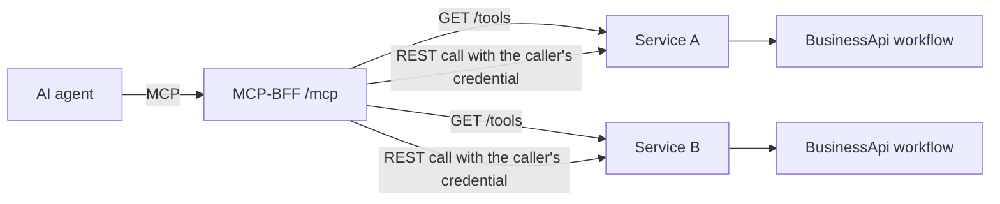

# Service tool registry

A generated service runs no MCP server. It publishes its callable tools as a plain JSON
**tool registry** at `GET /tools`, and the project's [MCP-BFF](mcpbff.md), the one MCP
endpoint of a generated project, reads every service's registry and turns it into MCP
tools. This page is about that per-service registry and the one blueprint switch that
controls it, `apiOptions.blockMcp`.

## Two things called "MCP"

- **Service tool registry** (this page). `GET /tools` on each generated service (every
  service except the agent hub, whose `/tools` is its own agent tool catalogue):
  protocol-neutral JSON with no MCP vocabulary.
- **[MCP-BFF](mcpbff.md).** The project-level MCP server. It discovers the tools from every
  service's registry and presents one catalogue to external agents, at
  `<project host>/mcpbff-api/mcp`.

An AI client connects to the MCP-BFF. A service itself cannot be reached as an MCP server.

## What gets exposed

Every `BusinessApi` with a REST controller is a tool unless its `apiOptions.blockMcp` is
`true`. No opt-in is needed: `apiOptions.mcpExposed` is retired and does not decide what
the registry lists. Internal `_fetchList*` helpers are left out. A service with no tool
answers the empty registry `{ "service": "<name>", "tools": [] }` with a 200.

Default coverage on a typical service:

- Generated CRUD APIs (create / get / update / delete / list).
- Custom BusinessApis (filtered queries, aggregations, batch operations).
- File operations when `RemoteBucket` / `DbBucket` are configured: the generated
  upload-URL and signed-read APIs are themselves BusinessApis.
- Payment-flow APIs when `CheckoutConfig` / `SubscriptionConfig` are configured.
- Auth-management APIs (on the auth service).

Set `blockMcp: true` on the API to keep it out of MCP entirely. This is useful for
browser-only flows that need 3DS or credit-card input the agent should not impersonate,
or for webhook endpoints whose contract is "the provider calls this."

```json
{
  "apiOptions": {
    "name": "confirmCardPayment",
    "crudType": "update",
    "dataObjectName": "order",
    "blockMcp": true
  }
}
```

`blockMcp` hides the tool only: the REST route and the other controllers stay mounted with
their normal auth. See [`ApiOptions`](../../spec/ApiOptions.md).

### System-service APIs

The framework's own APIs on a generated system service follow one more rule: a framework
API with `crudType: delete` or a non-empty `checkRoles` is blocked from MCP unless it is on
the compiler's reviewed exposure list. On the auth service that list holds the
user-management APIs `createUser`, `updateUser`, `listUsers`, `listUsersByRole` and
`updateUserRole`: they are tools, and their admin role gate still refuses a caller without
the role at call time. The delete APIs (`deleteUser`, `deleteUserSession`, ...) and the
other admin APIs stay hidden. An agent reaches the reviewed tools only with the acting user's own
identity: the agentHub refuses them on a run with no caller token, and an agent's machine
(`m2mTools`) arm refuses them always. They are tools only on runtimes that enforce that rule
(nodejs today); in a build with a backend service in another language they stay hidden. An API you author in `authentication.businessLogic` is not a
framework API: it is a tool like any other API unless it sets `blockMcp: true`, whatever
its `checkRoles`.

## The registry document

`GET /tools` needs no login: it is capability metadata. Calling a tool still goes through
the API's REST route and that route's own auth.

```json
{
  "service": "workManagement",
  "tools": [
    {
      "name": "createTask",
      "description": "Create a task",
      "inputSchema": {
        "type": "object",
        "properties": { "subject": { "type": "string" } },
        "required": ["subject"]
      },
      "http": {
        "method": "POST",
        "path": "/tasks",
        "paramLocations": { "subject": "body" }
      },
      "auth": { "loginRequired": true }
    }
  ]
}
```

- `name`: the API name. The MCP-BFF publishes the tool as `<serviceName>__<apiName>`.
- `description`: the API's `apiOptions.apiDescription`, else its name.
- `inputSchema`: a JSON Schema of the declared `requestParameters` (minus `hidden` and
  session-bound ones), the route's own `:segments` (required path arguments) and, on a
  `list` API, the data object's filter properties (optional query arguments). It also
  carries an `x-mb` member naming the service and the API.
- `http`: the method, the route path the service mounts and each argument's location
  (`body`, `query`, `path` or `header`).
- `auth`: `loginRequired`, the allowed roles and the ownership flag; omitted for a fully
  public API.

## Authentication

An MCP client authenticates against the [MCP-BFF](mcpbff.md#connecting-an-external-mcp-client)
with a user session JWT or a secret API key. The MCP-BFF forwards that credential, as it
arrived, to the service's REST route on every tool call, and the route runs its normal
auth: the session is the caller's, so session-scoped MScript (`this.session.userId`, ABAC
predicates), roles, ownership and permissions decide a tool call exactly as they decide
the same caller's REST call.

## How a tool call dispatches

The MCP-BFF calls the API's REST route (`http.method` and `http.path`, each argument
placed per `paramLocations`) with the caller's credential, and the API runs the same
pipeline as for any REST caller. There is one implementation of the API and the tool is
one more caller of its route, which is why `blockMcp` works at the BusinessApi level.



The MCP-BFF re-reads the registries on a refresh interval, so a regenerated service's new
or changed APIs appear without rebuilding the MCP-BFF.

## Use cases

- **AI-coded frontends.** AI coding tools can call MCP tools while scaffolding the
  frontend: read schemas, list records, generate forms.
- **Automated workflows.** Agents compose tool calls to drive multi-step business
  operations (create order, start payment, check status).
- **Data exploration.** Natural-language access to filtered queries and aggregations
  without writing the corresponding REST glue.
- **Admin chat surfaces.** Internal chat UIs that expose admin operations through an
  agent.
- **Integration scripts.** Backend automation that prefers MCP's typed tool catalogue over
  hand-written REST clients.

## See also

- [MCP-BFF](mcpbff.md): the project's MCP server, built from every service's tool
  registry.
- [Authentication](authentication/overview.md): JWT and API-key validation shared by REST
  and MCP.
- Patterns: [`BusinessApi`](../../spec/BusinessApi.md), [`ApiOptions`](../../spec/ApiOptions.md).
- How the generated service builds the registry: [the compiler specification](../../compiler/index.md).
