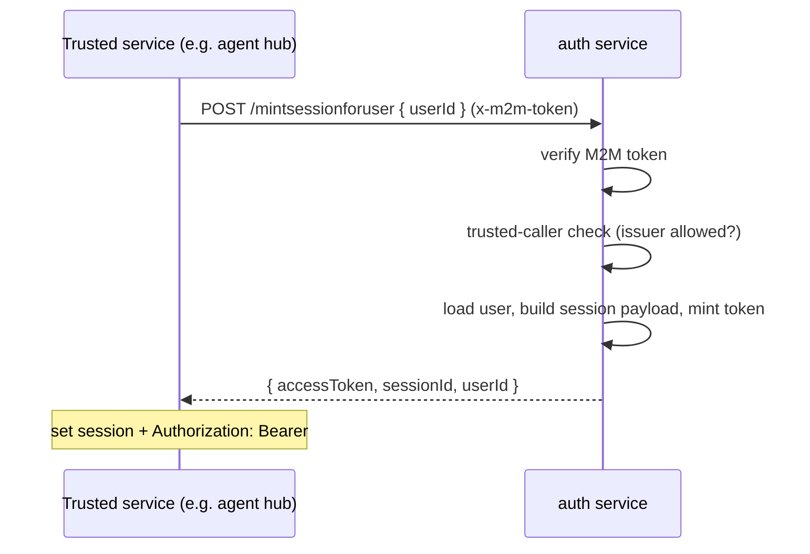

# Machine-to-machine (M2M)

OpenAPPL supports **Machine-to-Machine authentication** for secure inter-service
communication without user session tokens. M2M tokens are signed with **EdDSA (Ed25519)**
service-identity keys; each one is pinned to one target service
(`aud = svc:<target>@<projectId>`) and lives for seconds, so a captured token cannot be
replayed against another service or for long.

This is a distinct surface from the user session JWT on the
[Access tokens](./access-tokens.md) page: that token is also EdDSA, but it is minted by the
auth service and verified against the auth service's `/publickey`, while an M2M token is
verified against the issuing service's key in the hosting platform's JWKS.

## Enabling M2M on Business APIs

To let a Business API accept M2M tokens, set `M2MAllowed: true` in the API's
[`authOptions`](../../../spec/ApiAuthOptions.md):

```json
{
  "authOptions": {
    "M2MAllowed": true,
    "loginRequired": true
  }
}
```

When `M2MAllowed: true`:

- Services can call the API with an M2M token in the `x-m2m-token` header (REST, and gRPC
  metadata). A Kafka message is read for one under its `headers['x-m2m-token']` or an
  `M2MToken` field, but the framework's own publishers attach none.
- If `loginRequired: true`, **either** an M2M token **or** a user session is acceptable,
  including a user session with no roles declared beside it. `M2MAllowed` widens the login
  gate; it never narrows it.
- If `loginRequired: false`, the API is **public**: the whole authorization pipeline is off
  and `M2MAllowed` beside it demands nothing, so an anonymous caller with no token is
  served. An M2M token is not required in that case.

`M2MAllowed` cannot express "machine callers only"; that is
[`requiredCallerKind`](../m2m-communication.md#refusing-human-callers-requiredcallerkind),
the flag that refuses a human session with 403 `M2M_CALLER_REQUIRED`, and whose four-caller
table covers the case a "machine vs human" reading cannot predict: an end-user identity
forwarded on an interservice hop.

See [Business API authentication](./business-api-auth.md) for the full `authOptions` model.

## The M2M default policy

You rarely need to set `M2MAllowed` on the standard CRUD APIs. The compiler applies a
default split:

| API kind | Default `M2MAllowed` |
|----------|----------------------|
| **Auto-generated system-object CRUD** (`get` / `create` / `update` / `delete` / `list` on the object itself) | **`true`**: a peer service reaches standard data access over a verified `x-m2m-token` out of the box, **including auth's `createUser`** and the userGroup CRUD family. |
| **Custom BusinessApis** | **`false`**: the author opts in per API. Custom auth APIs (`login`, `register`, `changePassword`, `searchUsers`) stay closed. |

An explicit blueprint `M2MAllowed` (`true` **or** `false`) always wins over the default. The
split means a sibling service can read/write your objects service-to-service without
ceremony, while your custom business logic stays opt-in.

A **self-issued** `x-m2m-token` (issuer is this service) verifies against the service's own
public key, with no JWKS fetch, so possession of the private key is the trust root. Peer
issuers still resolve via the project's JWKS endpoint; a foreign-key-signed token is always
rejected.

## `mintSessionForUser`: trusted proxy-login

`mintSessionForUser` is a custom auth API (`POST /mintsessionforuser`) that lets a
**trusted** peer service obtain a real user session **on behalf of a user**, without that
user's password. It is the seam behind chat surfaces (an inbound WhatsApp / Telegram message
is resolved to a user, then the agent runs as them; see the
[AI chat surfaces](../../capabilities/ai-chat-surfaces.md) guide).

Only **auth** may mint a session (every service verifies session JWTs against auth's public
key), so a service that needs to act as a user asks auth to mint:



Two gates protect it:

- **`M2MAllowed: true` + `loginRequired: true`**: only a verified `x-m2m-token` peer passes.
- **The trusted-caller check**: 403s (`errMsg_UntrustedProxyLoginCaller`) unless the request
  carries a verified `x-m2m-token` whose issuer the verifier recorded. By default **any
  verified in-project issuer** may mint: every service of the project holds the same M2M
  signing key, so a named allowlist was never a privilege boundary (the key is), and the
  minted session carries the target user's OWN role, so the called API re-checks it exactly
  as for that user. Set `PROXY_SESSION_TRUSTED_SERVICES` (comma-separated service names) to
  NARROW the issuers that may mint; it is a restriction knob, not the gate. Minting a
  session as an arbitrary user is only ever a trusted-service operation.

It runs the same path as the auth service's auto-login after registration (an EdDSA token, a
session that lives for the configured `tokenPeriodInDays` capped by the 24-hour delegated
bound) and returns `{ accessToken, sessionId, userId }`. An unknown `userId` gives 404, an
M2M caller excluded by `PROXY_SESSION_TRUSTED_SERVICES` gives 403, a plain user session gives
403, anonymous gives 401.

> The chat-identity `bindChatIdentity` / `resolveChatIdentity` APIs and auth's `commVerified`
> register path (auto-verify a channel-asserted phone, no OTP) use the same gate but keep the
> **tight default** allowlist `agentHub,mcpbff`: binding a chat surface to an account has no
> "any issuer" ruling.

Because the route refuses every user session, an API test suite cannot call it with a user
token; it needs a machine token addressed to the auth service (how a test deployment mints
one is a compiler feature).

## `machineSessionRetirement`: a machine ends one user's sessions

A machine caller has no session, so the session store's "log out everywhere" (self or admin)
refuses it. An authored auth API that must end a user's sessions from a machine (typically a
machine-only `blockAccount` update that writes the blocked state) declares the capability on
itself:

```json
{
  "basics": {
    "apiOptions": { "name": "blockAccount", "crudType": "update", "dataObjectName": "user" },
    "authOptions": { "loginRequired": true, "M2MAllowed": true, "machineSessionRetirement": true }
  }
}
```

Only an API in `authentication.businessLogic`, a `get` or an `update` on `user`, with
`M2MAllowed: true` and `loginRequired` left on, may declare it (the validator refuses every
other shape and the flag outside auth). The generated service performs a retire right after
the main operation, so every successful call retires every session of the user that
operation resolved (access sessions, refresh families, owner index, invalidation epoch; a
best-effort mirror marks the userSession rows `loggedOut`). The retired user is never a
request value. A verified, admitted `x-m2m-token` that names no user may retire only within
the user's own tenant (the request's resolved tenant, and the token's signed
`callerTenantId` when it carries one, must be the user's), never a `superAdmin`; a refusal is
**403** `MACHINE_SESSION_RETIREMENT_REFUSED` and writes nothing. A person calling the same
API keeps the self / admin gate. Not every target language emits it; auth services in the
other languages are refused at design time until they do.

The retirement is part of the API's session contract on every target: when it is refused
(403 `MACHINE_SESSION_RETIREMENT_REFUSED`) or fails (503) after the update was written, the
API answers that status, never a 2xx with `actionFailures`. Your own post-write actions on
the same API keep the ordinary contract; as for every session-contract API, an error in its
output stage is answered as an error instead of being reported under `actionFailures`.

## `subjectGivenPermissions`: permission rows for peer services

When PBAC is active, auth also exposes `POST /subjectgivenpermissions`. A service other than
auth calls it to resolve a `permissionCheck`: it posts the scope, the permission name and its
caller's identity slots (`userId`, `ownerUserId`, `roleIds`, `tenantId`) with its own
`x-m2m-token`, and auth answers `{ rows }`: the caller's `givenPermission` rows, read with
the query auth's own resolver runs (rows keyed to another user are dropped). Any verified
peer service of the project may call it; a user session is refused with 403. The caller
caches an answer for 30 seconds and refuses the request with a 503 when auth cannot answer.
It is an internal read and raises no api event: no `...-givenpermissions-subjected` topic is
published or listed in the project's topic scope. See
[PBAC](./pbac.md#checks-in-services-other-than-auth).

## The search read-model: `getUserByIdentity`

Every DataObject (including auth's `user`) is written to the search read-model, and user info
is open to every service. So **any service can look up a user without an M2M round-trip**
through the generated auth helper:

- `getUserById(id)`
- `getUserByIdentity({ email?, phone? })` (first match, any verification state)
- `getUserByIdentityVerifiedMobile(phone)` (the one active user whose verified `mobile` is
  the number, else `userId: null` with a reason)

These query the project's user index through the shared search client, fail-soft, and return
a normalized read-model. Because the index naming is project-wide, a notification service (or
any service) hits the *same* index the auth service wrote; the notification recipient
resolver, for example, reads the contact handle straight from the read-model instead of
calling auth `getUser` over M2M. The WhatsApp chat surface's phone auto-bind uses
`getUserByIdentityVerifiedMobile(phone)`, never the first-match lookup: it binds only a
unique, active user with `mobileVerified: true`.

For the read-model to be complete, **seed rows must reach the search index too**. The seeded
superAdmin/user is written straight to the database and is not touched by the create-time
write path, so every service runs a full re-index of its search-indexed objects on boot
(idempotent, fail-soft, never blocks boot, on by default through `ELASTIC_REPAIR_ON_BOOT`).
Without it, a freshly-seeded admin would be absent from the user index and `getUserById`
would miss it. See [indexes](../../data-modeling/indexes.md) for the mapping-drift case and
[the compiler specification](../../../compiler/index.md) for the repair itself.

## Which calls carry an M2M token

A token is signed and attached only on the inter-service client:

- Every [`InterserviceCallAction`](../../../spec/InterserviceCallAction.md) call, and every
  framework call that goes through the same client (the payment layer's calls to the auth
  service, the agent hub's cross-service tool calls), sends a fresh token in `x-m2m-token`:
  `iss = svc:<caller>@<projectId>`, `aud = svc:<target>@<projectId>`, a 60-second lifetime.
- Custom code can sign one with `signServiceToken` (default lifetime 5 minutes); see
  [Signing and verifying tokens directly](../m2m-communication.md#signing-and-verifying-tokens-directly).

These attach **no** M2M token:

- [`ApiCallAction`](../../../spec/ApiCallAction.md) sends only the static token configured on
  its request (`tokenValue` at `tokenLocation`) and, with `signBody: true`, a signature
  header carrying the project key's signature over the body.
- [`PublishEventAction`](../../../spec/PublishEventAction.md) and the service publisher put
  no token on a Kafka message. An event alias listed in `serviceOptions.secureEvents` is
  published inside a project-signed envelope
  (`{ _secure, alias, payload, sig, kid, jwks_url }`) instead, and a subscriber that lists
  the same alias drops a message that does not verify.
- The CRUD actions ([`CreateCrudAction`](../../../spec/CreateCrudAction.md),
  [`CreateBulkCrudAction`](../../../spec/CreateBulkCrudAction.md),
  [`UpdateCrudAction`](../../../spec/UpdateCrudAction.md),
  [`DeleteCrudAction`](../../../spec/DeleteCrudAction.md)) write through the service's own
  data layer only; a `childObject` of another service is refused at design time
  (`CRUD_ACTION_CHILD_OBJECT_NOT_LOCAL`). Write to another service with an
  `InterserviceCallAction` instead.

## Service-level access control

Configure M2M access control at the service level via
[`ServiceOptions`](../../../spec/ServiceOptions.md):

```json
{
  "serviceSettings": {
    "serviceOptions": {
      "blockedM2MClients": ["legacyImporter"],
      "allowedM2MClients": ["billing", "reporting"]
    }
  }
}
```

### The canon

If an API is open to M2M (`M2MAllowed: true`), the service reads the M2M token; when the
token is present and **verifies** and the call carries no user identity, the login, role and
permission gates are passed. The only thing that further guards those gates on an M2M-open
API is the caller-service list.

**Ownership is the exception.** A machine token authorizes the calling SERVICE, never a user,
and an ownership gate asks which user owns the row. So a verified, session-less machine
caller on an api that declares `ownershipCheck` (any crudType except `create`, where the
caller becomes the owner) or `parentOwnershipChecks` is **refused**:

```json
403 { "detail": "A service call that carries no user identity cannot act on user-owned records. ...",
      "errorCode": "M2M_SUBJECT_REQUIRED" }
```

(The body above is an abridged response sample.) Two fixes, depending on whether the flow has
a user:

- **It has one**: forward it with `forwardCallerToken: true` on the
  `InterserviceCallAction` (or `forwardCallerToken` + `incomingAuthHeader` on a hand-written
  inter-service call). The target then compares the row owner against that user, exactly as
  for a direct call.
- **It has none** (a kafka consumer, a cron job, a webhook): call a machine-only api instead:
  `requiredCallerKind: machineWithoutUserIdentity` with `M2MAllowed: true` and no
  `ownershipCheck`. The framework's own subject-less payment flows do exactly that: the
  webhook method sync and a server-side payment start call the auth service's `...ForMachine`
  identity apis (`getPaymentCustomerByUserIdForMachine`,
  `getPaymentCustomerByProviderForMachine`, `getPaymentCustomerByCustomerIdForMachine`,
  `detachPaymentMethodForMachine`), which refuse every human caller. Their role list is
  `superAdmin` only, a second gate for targets that do not enforce `requiredCallerKind` yet.
  The row-id writes `updatePaymentCustomerById` and `setDefaultPaymentMethod` have no machine
  twin: they are only ever called with the user's token. One more machine-only api is not a
  twin: `setPaymentCustomerCardStorageKeyForMachine` stores the provider-minted card storage
  key (iyzico's `cardUserKey`, one per buyer) on `sys_paymentCustomer.cardStorageKey` after
  the buyer's first card save. The payment router calls it with NO forwarded token, it stores
  the key only while the mapping has none, an empty or whitespace-only key is refused `400`
  before the write, and no buyer-reachable api (`createPaymentCustomer`,
  `updatePaymentCustomerById`) accepts the column. And one machine-only WRITE files a payment
  method for a user the call never names: `attachPaymentMethodByCustomerIdForMachine`,
  `POST /machine/paymentcustomerbycustomerid/:customerId/:providerName/paymentmethods` with
  the method id, its brand (`platform`) and its display descriptors in the body. It reads the
  (customerId, providerName) payment-customer mapping and writes the `sys_paymentMethod` row
  for the mapping's user, customer and provider (the ordinary `attachPaymentMethod` stamps the
  row's user from the caller's session, which a session-less machine call does not have). The
  webhook method sync calls it for a provider's `method.attached` / `method.updated`, and the
  iyzico hosted-form settle calls it for a card the buyer saved while paying, both with NO
  forwarded token. An unknown mapping or one that belongs to no user is refused `404`, a
  method id already filed for another user or provider customer `409` (never moved), card
  material in `cardInfo` or a card number in the holder text `400`; a re-delivery writes
  nothing twice. Same gates as the twins: `machineWithoutUserIdentity`, `superAdmin` role
  list, no MCP tool.

Design-time validation warns on the first shape with
`INTERSERVICE_SUBJECTLESS_OWNERSHIP_TARGET`: an `InterserviceCallAction` that forwards no
caller token into an `M2MAllowed` target with an ownership gate.

The two lists are a **second-level guard, never authentication**. A caller with no token, or
with a token that does not verify against the issuing service's published JWKS, is refused by
the token check and never reaches the lists. Only after verification succeeds does the
service narrow which services may proceed, using the **JWKS-verified issuer**, never a
header.

| `allowedM2MClients` | `blockedM2MClients` | result |
| --- | --- | --- |
| empty | empty | every caller with a valid M2M token is allowed |
| set | empty | only the listed callers are allowed |
| empty | set | all callers allowed except the listed ones |
| set | set | **block wins**: a caller on the block list is refused even if it also appears on the allow list |

A refused caller answers **403** with an RFC 9457 problem body carrying
`errorCode: "M2M_CLIENT_NOT_ALLOWED"`.

The gate applies to the **M2M path only**. A blocked service still reaches this service's
public APIs (`loginRequired: false`) and still works through a user token: it loses the
machine identity, not the request.

Names are matched case-folded (both fields are declared `codeName`).

> **`machineToMachineBlockList` is read as `blockedM2MClients`.** A
> `serviceOptions.machineToMachineBlockList` key is renamed to `blockedM2MClients` in place
> when the blueprint is validated, and the report carries a `RENAMED_M2M_BLOCK_LIST`
> warning; the blueprint still builds. When both keys are present, the `blockedM2MClients`
> value wins and the other key is dropped.

## The tenant of a machine call

On a multi-tenant project a machine call acts in ONE tenant, and it is the tenant the token
signs. The inter-service call takes a tenant argument, signed into the `x-m2m-token` as the
`callerTenantId` claim (the agent hub client signs the caller session's tenant, the agent
harness runner's machine arm signs the event's tenant). The receiving business api reads it
from the VERIFIED payload only, never from a header or the body, at one place, right after
the token is verified and before the login check:

| the call carries | the target api runs in |
|---|---|
| a `callerTenantId` claim and no user session | the claimed tenant, exactly as a session tenant would scope it (where-clause pin, create stamp, search-index pin, cache key, authorization tenant). A tenant header that resolved to a different, non-root tenant is refused `403 M2M_TENANT_MISMATCH`. |
| a forwarded user session (`forwardCallerToken`) | the user's tenant. A claim naming another tenant is refused `403 M2M_TENANT_MISMATCH`. |
| no claim, a tenant codename header | the header's tenant, as before. |
| no claim, no header, no session tenant | refused `403 M2M_TENANT_REQUIRED` when the api's service reads the session tenant (its object is tenant-level and the api is not SaaS-level: the apis the API document declares the tenant header on). A platform-level object (`objectDataIsInTenantLevel: false`) and a SaaS-level api keep the root floor. The framework's own payment machine twins (`<api>ForMachine`, called session-less from the webhook and 3-D Secure paths) are armed too: their generated callers sign the persisted ticket, order or mapping tenant as the claim, so a twin call that names no tenant is refused instead of reading or writing the root tenant. A machine-only api you declare yourself (`requiredCallerKind`) is not exempt: it is armed like any other api, so its caller signs or names the tenant. |
| a cross-project forwarded identity (`x-project-m2m-token`, the sibling's user claim) | that identity's tenant (carried under the generic `tenantId`), exactly as a session tenant; a claim naming another tenant is refused `403 M2M_TENANT_MISMATCH`. |

The hub's agent tools on the machine arm (`toolSettings.m2mTools`) sign the run's tenant the
same way: the caller session's tenant for a user-started run, the event tenant for a
kafka-started run. A run that has no tenant in a multi-tenant project signs no claim, so an
armed tenant-level api refuses it (`403 M2M_TENANT_REQUIRED`) rather than serving the root
tenant. The framework's own machine calls into tenant-level auth apis sign the tenant they
act for too: the user arm's delegated mint (`mintSessionForUser`, the actor's tenant) and a
PBAC peer's permission fetch (`subjectGivenPermissions`, the subject's tenant).

The generated callers sign the tenant they act for by themselves:

- An [`InterserviceCallAction`](../../../spec/InterserviceCallAction.md) hop that declares no
  `tenantContext` and forwards no caller token signs the calling service's own verified
  tenant (the session's tenant, a Kafka event actor's tenant, a forwarded identity's tenant,
  a verified machine caller's claim, a superAdmin's validated named tenant), on the REST and
  the gRPC transport. It is only ever the caller's own tenant, so a hop cannot escalate into
  another tenant; a caller with no verified tenant (the root floor, a tenant named only by an
  anonymous request's header) signs nothing, and the receiver decides as above. A declared
  `tenantContext` wins and rides the codename header; a forwarded caller token carries the
  user's tenant inside the bearer.
- The hub's dynamic / MCP tool catalog hop forwards the caller's bearer when the run has one;
  a token-less run signs the run session's tenant, exactly as the machine arm does.
- The agent chat surfaces (Telegram, WhatsApp): auth's `resolveChatIdentity` and
  `bindChatIdentity` answer the bound user's tenant beside the userId
  (`{ userId, tenantId }`, null on a single-tenant project or for a user without one), and
  the surface signs it on its `mintSessionForUser` call, so a chat user of any tenant is
  minted in their own tenant. A user with no tenant signs nothing and the armed mint refuses.

A caller you write yourself either forwards the user's bearer or signs the tenant: the
inter-service call's tenant argument (a tenant id), or an `InterserviceCallAction`
`tenantContext` expression (the codename header). A rewritten claim does not verify, so a
forged tenant never scopes anything. Single-tenant projects are unaffected.

## See also

- [Machine-to-machine communication](../m2m-communication.md): the full guide covering REST,
  gRPC, and Kafka patterns.
- [Business API authentication](./business-api-auth.md): the `M2MAllowed` / `loginRequired`
  interaction.
- [API keys](./api-keys.md): the API-key vs password vs M2M comparison.
- Spec: [`ServiceOptions`](../../../spec/ServiceOptions.md),
  [`ApiCallAction`](../../../spec/ApiCallAction.md),
  [`PublishEventAction`](../../../spec/PublishEventAction.md).
