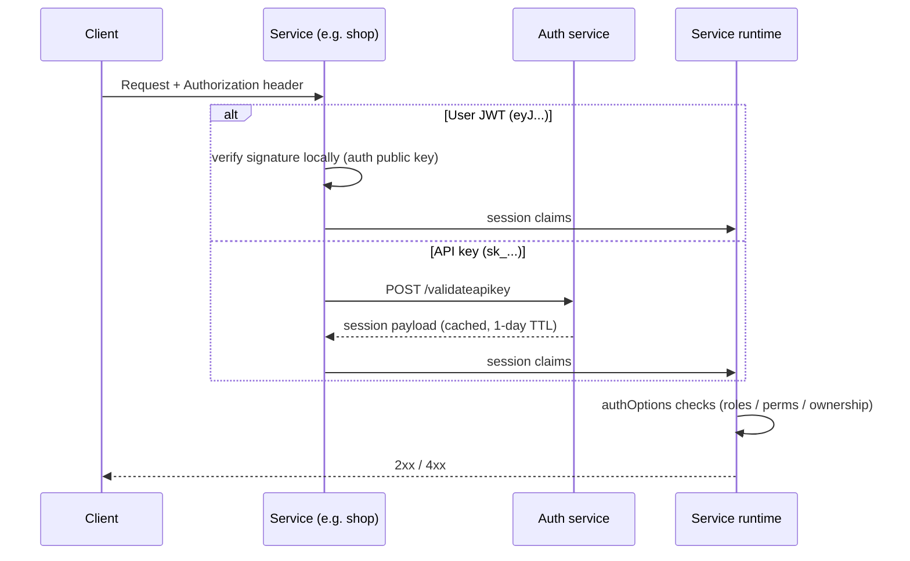

# Authentication overview

The `auth` service owns user identity, sessions, verification flows, API keys, and the
project-wide access-control vocabulary. You configure it once on the project root under
[`authentication`](../../../spec/ProjectAuthentication.md); the compiler generates the
matching `auth` service from that single chapter.

Unlike user-defined services, the auth service is not declared under `services[]`: its
entire shape lives at `authentication.*`. Reads, writes, and validation use the same
mechanisms as any other slice of the blueprint.

## What the auth service provides

Once the Authentication chapter is configured, the generated `auth` service manages:

1. User and user-data management ([Users](./users.md)).
2. User-group management ([User groups](./user-groups.md)).
3. Login and logout operations ([Login](./login.md), [Social logins](./social-logins.md),
   [SSO](./sso.md)).
4. Verification services: email, mobile, 2FA, password reset
   ([Verification services](./verification-services.md)).
5. Role management: RBAC ([RBAC](./rbac.md)).
6. Permission management: PBAC and advanced access control ([PBAC](./pbac.md)).
7. Multi-tenancy management ([Multi-tenancy](./multi-tenancy.md)).

You should not redesign these features in additional modules. You *can* reimplement them
by hand, but relying on the compiler-provided `auth` service lets the compiler wire the
related flows across every other service automatically, saving time and avoiding errors.

### Extending auth

- **Through configuration.** Add user / tenant properties, define custom roles, configure
  permissions, all from the Authentication chapter.
- **Through additional services.** When your identity model spans many objects, create an
  extra service (e.g. `userProfile`) and link it to the auth `user` via `userId`.
- **Through `businessLogic[]`.** `authentication.businessLogic[]` carries extra
  [`BusinessApi`](../../../spec/BusinessApi.md) entries generated into the auth service
  alongside the framework defaults (`login`, `register`, `verify`, `resetPassword`, ...).
  Use this slot for `inviteUser`, `revokeSession`, `impersonate`, or any
  project-specific operation on `User` / `Tenant`. The framework names are reserved and
  cannot be overridden.

## The `ProjectAuthentication` tree

[`ProjectAuthentication`](../../../spec/ProjectAuthentication.md) has six chapters plus
the custom-property and custom-API slots:

| Chapter / slot | Class | Purpose |
|---|---|---|
| `authenticationEssentials` | [`AuthBasics`](../../../spec/AuthBasics.md) | JWT / SSO / API-key / refresh-token / HTTP / cookie settings. |
| `loginDefinition` | [`LoginDefinition`](../../../spec/LoginDefinition.md) | User & tenant data-object shape, registration policy, login identifiers. |
| `verificationServices` | [`VerificationServices`](../../../spec/VerificationServices.md) | Email / mobile / 2FA / password-reset flows. |
| `accessControl` | [`AccessControl`](../../../spec/AccessControl.md) | RBAC / OBAC / ABAC vocabulary and rules. |
| `socialLogins` | [`SocialLoginSettings`](../../../spec/SocialLoginSettings.md) | The legacy location of the Google / Apple / GitHub / etc. OAuth providers; new projects configure them as the provider family `projectSettings.socialLoginProvidersSettings` ([Social logins](./social-logins.md)). |
| `userProperties`, `tenantProperties` | [`DataProperty`](../../../spec/DataProperty.md)[] | Custom fields on the `User` / `Tenant` objects. |
| `businessLogic` | [`BusinessApi`](../../../spec/BusinessApi.md)[] | Custom auth APIs. |

```json
{
  "ProjectAuthentication": {
    "authenticationEssentials": "AuthBasics",
    "loginDefinition": "LoginDefinition",
    "verificationServices": "VerificationServices",
    "accessControl": "AccessControl",
    "socialLogins": "SocialLoginSettings",
    "userProperties": ["DataProperty"],
    "tenantProperties": ["DataProperty"]
  }
}
```

(The block above is a schema outline, not a blueprint: each value names the pattern
that fills the slot.)

## Authentication essentials

The authentication modes are declared under `authenticationEssentials`
([`AuthBasics`](../../../spec/AuthBasics.md)) and can run together:

```json
{
  "authentication": {
    "authenticationEssentials": {
      "JWTAuthentication": {
        "useJWTForAuthentication": true,
        "configuration": {
          "tokenPeriodInDays": 30
        }
      },
      "apiKeyAuthentication": {
        "useAPIKeyForAuthentication": true
      },
      "ssoAuthentication": {
        "useSSOForAuthentication": false
      },
      "httpSettings": { "httpPort": 4001 },
      "cookieSettings": { "allowedDomains": ["app.example.com"] }
    }
  }
}
```

- **JWT** is the default: the auth service issues a signed access token on login and
  downstream services verify it (see [Access tokens](./access-tokens.md)).
- **SSO** replaces the native login routes with an external identity provider
  ([SSO](./sso.md)).
- **API keys** add a second credential channel ([API keys](./api-keys.md)).
- **Cookies** are always `httpOnly`; `Secure` and `SameSite` come from the runtime
  environment (`COOKIE_SECURE`, `SESSION_COOKIE_SAMESITE`).
  `cookieSettings.allowedDomains` is provided to the deployed services as
  `COOKIE_DOMAINS` and controls both the `Domain` attribute and whether the host may
  receive the cookie at all ([Login](./login.md)).

## Request flow



## See also

- [Users](./users.md): the `user` data object and registration.
- [Login](./login.md): identifier model, password login, 2FA.
- [Access tokens](./access-tokens.md): token lifetime and key rotation.
- [RBAC](./rbac.md) / [PBAC](./pbac.md): access-control vocabulary.
- [Business API authentication](./business-api-auth.md): per-API enforcement via
  `authOptions`.
- Spec: [`ProjectAuthentication`](../../../spec/ProjectAuthentication.md),
  [`AuthBasics`](../../../spec/AuthBasics.md),
  [`LoginDefinition`](../../../spec/LoginDefinition.md),
  [`AccessControl`](../../../spec/AccessControl.md).
