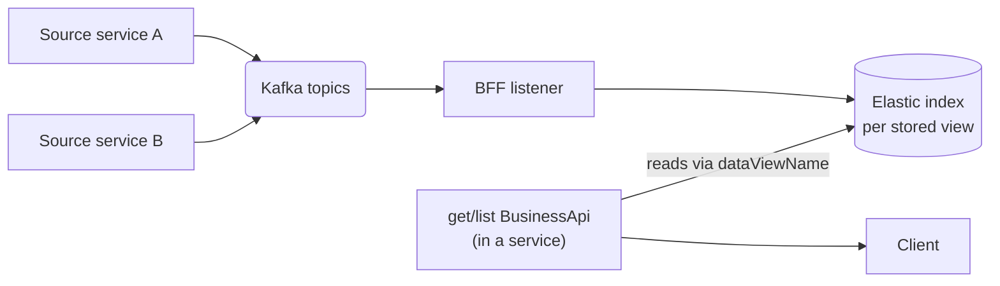

# BFF service

The **BFF** service is a **builder of read-optimized DataViews**: cross-service,
denormalized read models assembled from the data spread across your microservices. It is
**not** a client-facing service: it does not expose DataView endpoints to browsers. It
builds and indexes the views; the get/list BusinessAPIs in your services then **consume**
those views to return enriched, page-shaped data. You configure it once at the project
level as a list of **DataViews**; the compiler generates the matching service.

If `bffService.dataViews` is empty, the BFF service is not generated: you don't pay for it
until you need it.



Stored DataViews are populated by event-driven indexers and served from Elasticsearch.
Dynamic DataViews are assembled at request time by reading the source data directly.
Either way, the BFF **builds** the view: a service's get/list BusinessApi is what
**serves** it to a caller (see [Consuming a DataView](#consuming-a-dataview) below).

## Where it lives in the blueprint

```json
{
  "bffService": {
    "serviceSettings": {
      "documentation": { "...": "page-generation hints" }
    },
    "dataViews": [ "..." ]
  }
}
```

`serviceSettings.documentation` is a [`ModuleDocumentation`](../../spec/ModuleDocumentation.md)
block: UX prompts the generated UI reads when wiring DataView consumers into pages
(density, KPI vs row, drill-down cues). It doesn't change the runtime shape; it only steers
the generated UI.

## DataViews: stored vs dynamic

`viewBasics.properties` is the **only projection boundary** view-backed data has. It is
applied when the document is WRITTEN (the aggregator projects the main object through it),
so a column outside the list never reaches the index and no reader of the view can see it.
A consuming api cannot narrow further on its own: `query.selectClause.selectProperties` is
lowered onto the query on the database engines only, and a read served from Elasticsearch
takes no column list, so declaring one beside `dataViewName` is reported at design time
(`DATAVIEW_SELECT_PROPERTIES_INERT`) instead of quietly doing nothing. An audience that must
see less needs a narrower view, not a narrower api. (An empty `properties` list means the
whole source document, not none of it.)

That last parenthetical is load-bearing on a **public** surface, and validation says so
rather than leaving it to be read: a view with no `properties` list behind a
`loginRequired: false` consumer is `DATAVIEW_PUBLIC_UNPROJECTED` (warning), and a view
projecting columns such a consumer's `selectProperties` withholds is
`DATAVIEW_PUBLIC_PROJECTION_LEAK` (error). Both are reported on the view. The shape they
exist for is a guest catalogue that served an AI moderation rejection text, an owner id and
a moderation round to anonymous callers with both sides validating clean.

Each entry under `dataViews[]` is one DataView shape:

```json
{
  "viewBasics": {
    "name":        "userDetailsView",
    "isStored":    true,
    "mainObject":  "user",
    "properties":  ["id", "fullname", "email", "createdAt"]
  },
  "aggregates": [
    {
      "name":        "roles",
      "childObject": "role",
      "parentKey":   "id",
      "childKey":    "userId",
      "oneToMany":   true,
      "properties":  ["id", "name"]
    }
  ],
  "stats": [ "..." ]
}
```

`viewBasics.isStored`:

- `true`: the view is persisted in **Elasticsearch**, populated from the source objects'
  events. Filterable, sortable, indexed. Right for cross-service filtered views, dashboards,
  and collected data that exceeds what SQL serves well.
- `false` (the default): the view is **dynamic**: nothing is indexed, it is computed when
  read. Right for responses where indexing latency would lie (a liveness read such as
  remaining capacity) and for binding a composed query to an api without paying the disk
  and the index.

The choice is per-view, not project-wide. Mix freely.

### Consuming a view

A DataView is a reusable query definition first; `isStored: true` adds the materialisation
on top. Both kinds have the same consumers:

| Consumer | Stored view | Dynamic view |
|---|---|---|
| get/list api with `apiOptions.dataViewName` | reads the view index | **read-time binding**: the api reads its object from the DATABASE with its own where clause as authored (never compiled to an ES query), and the view's aggregates/stats are joined onto each row per request |
| custom code, `LIB.dataViews.<view>(filter?, { page, limit, session \| scoped }?)` | reads the view index | computes the rows (main object from its source index, joins applied) |
| notification `eventDataSettings.dataViewName` | fetches the view document | computes the view document when the event arrives |
| admin `GET /admin/views/:viewName/schema` | the index's live mapping | the view's declared shape, `computedOnDemand: true` |
| admin `POST /admin/views/:viewName/repair` | rebuilds the index | answers the no-op it is (`computedOnDemand: true`, zero counts) |

`LIB.dataViews` is available in a service's custom code for the views that code NAMES
(`LIB.dataViews.<name>` or `LIB.dataViews['<name>']`); a computed key cannot be resolved at
compile time, and an undeclared name is an error at design time (`LIB_DATAVIEW_UNKNOWN`). A
dry run and the validation of the service or the project report it as an error until the
view is declared in the `bffService` module, and a save of the whole project is refused.
The finding is the same at every validation root: a save or dry run of only the library
function or api whose code makes the call reports it, and a call stored elsewhere in the
service never refuses an unrelated save. A notification's `eventDataSettings.dataViewName`
is held to the same catalog (`DATAVIEW_NOT_FOUND`), also when the `bffService` declares no
view at all.

**`LIB.dataViews` has two forms; code serving a caller uses the SCOPED one.**

- **Scoped**: `LIB.dataViews.<view>(filter?, { session: this.session })`, or
  `{ scoped: true }` to take the tenant of the api request the code runs in. The read is
  pinned to the caller's tenant on the view's tenant column (the `id` when the view's main
  object is the tenant entity itself) and returns active rows only unless `filter` names
  `isActive`: the same tenant and soft-delete terms the consuming api's where clause
  applies. A caller with no tenant reads nothing, and `{ scoped: true }` outside an api
  request (a cron script, an edge function) is refused with `DATA_VIEW_SCOPE_UNAVAILABLE`
  rather than read unscoped. On a view whose object is not tenant-level, only the
  active-only default applies. Ownership is not a view term: filter for it in `filter`.
- **Unscoped**: no `session` / `scoped` option: a SYSTEM read with no tenant term and no
  ownership filter, every tenant's rows (a dynamic view still reads active rows unless
  `filter` names `isActive`; a stored view reads its index as is). That is the trust level
  of the db-layer functions custom code already calls, not of an api: use it for system
  work, never to answer a caller.

An api that must honour the caller's tenant can also bind the view with
`apiOptions.dataViewName`, which applies its where clause. `filter` is
`{ field: value, ... }`, one `match` per key; `page` is 1-based and `limit` defaults to 50,
clamped to [1, 1000]. The registry entry is async: call it from a library function or an
action that awaits it.

A read-time api's response record carries what the view DOCUMENT would: the view's
projected properties, `id`, and each aggregate/stat, plus the api's own `selectJoins`: the
same shape its stored twin answers. The manager's own row (`this.<object>`) stays whole, so
ownership and tenant checks read every column.

Because a view-bound api answers the VIEW's row (stored or read-time), two declarations on
the api can say something the response will not do, and validation warns on both:

- `EXPOSE_SECRETS_NOT_IN_VIEW`: `apiOptions.exposeSecrets` names a column the view does not
  project; the exposure is inert.
- `DATAVIEW_JOIN_NAME_SHADOWED`: a `selectJoins[]` entry has the same name as one of the
  view's aggregates/stats. The select-join runs after the main operation, so it wins and the
  view's join is discarded.

## Aggregates: joins across services

`aggregates[]` is the join clause. Each entry pulls records from a child object into the
view under a property name:

```json
{
  "name":        "orders",
  "childObject": "order",
  "parentKey":   "id",
  "childKey":    "userId",
  "oneToMany":   true,
  "properties":  ["id", "total", "status", "createdAt"]
}
```

`properties[]` is required: only the listed child fields are pulled into the view.
Optional `condition` / `checkIn` MScript clauses gate when the aggregate runs and which
child rows make it in.

Either way the join reads the child object's Elasticsearch index: no per-request
cross-service call. A stored view pays it when the document is written; a dynamic view pays
it on every read.

`oneToMany: true` returns an array under the aggregate's `name`; `false` embeds one record.

An aggregate whose `childObject` is moderated with
[`objectModeration`](../capabilities/object-moderation.md) in `mode: onPlace` embeds the
child's `moderationStatus` and author columns automatically, and the consuming api drops
the embedded rows its caller may not see (a single embedded row the caller may not see is
unset; a `oneToMany: false` aggregate prefers an `accepted` candidate). Embedded rows of a
view indexed before that rule stay hidden from non-privileged callers until the view is
re-projected. A `stat` over such an object is refused, see below.

The join key does not have to be a listed view property. Every aggregate's and stat's
`parentKey` (usually `id`) is fetched from the main object even when
`viewBasics.properties` leaves it out, and dropped again before the document is stored, so
the view keeps its declared shape. `id` is the one key that stays: every stored view's index
declares it.

## Stats: precomputed analytics

`stats[]` are `ViewStat` entries: sum, count, avg, min, max over the aggregated dataset,
precomputed into the view. Right for "show me the total revenue per customer" alongside the
customer record. The full list of stat-aggregation options lives on
[`ViewStat`](../../spec/ViewStat.md).

A stat item can never aggregate a `hashed` / `isSecret` column of its child: a min / max /
sum over it stores a result that can equal the secret value, and the column is not in the
child's Elasticsearch index anyway. Validation refuses such an item
(`VIEW_STAT_SECRET_AGGFIELD`, an error). A view built before that rule keeps no such
bucket: the item's `<stat>.<item>` path is one of the view's excluded paths, so the view
writer drops it and a once-per-boot removal pass deletes it from existing documents.

A stat over an object moderated `onPlace` is refused
(`OBJECT_MODERATION_UNGATEABLE_VIEW_STAT`): it is computed with no caller, so it would
count hidden rows for everyone. A view whose main object or aggregate child is such an
object carries the moderation columns automatically and the consuming api drops the rows
the caller may not see. See
[Object content moderation, the onPlace read gate](../capabilities/object-moderation.md).

## Stored-view dependencies

When one DataView reads from another (an aggregate whose `childObject` is itself a stored
view, a stat over a derived view), the generator orders the view graph topologically before
emitting indexers. Cycles are rejected at validate time; the dependency order is then used
to rebuild downstream indexes when an upstream index changes.

How a downstream view hears about an upstream change: a stored view that another stored
view reads from (as its `mainObject` or as an aggregate / stat `childObject`) publishes its
own sync events, `elastic-index-<codename>_<view>-created|updated|deleted`, whenever the BFF
listener writes or removes one of its documents. The event carries the document (with its
`id`), the same envelope a DataObject's index-sync event uses, and the downstream listener
consumes it like an object event; an `updated` event also carries, under `old`, the prior
values of the join keys the downstream views read it through, so a row that moved to
another parent recomputes the old parent too. A view nothing depends on publishes nothing.
These topics are part of the project's produced-topic census, so the boot census does not
report the downstream subscription as producerless.

A repair walk (`POST /admin/views/:viewName/repair`) and the boot backfill do not publish:
after repairing an upstream view, repair the views that read it too.

A stat whose `childObject` is a stored view searches that view's index, so its `select`,
and each aggregate item's `filterValue` and `aggField`, can only read what that view
stores: its properties, `id`, and its own aggregate and stat outputs. Every stored view
document carries its own `id`, whether or not the view lists it in
`viewBasics.properties`, so a `count` over `id` of a child view counts its rows. Validation
warns about any other field (`VIEW_STAT_SELECT_FIELD_NOT_IN_CHILD_VIEW`,
`AGGREGATE_ITEM_FIELD_NOT_IN_CHILD_VIEW`).

## Consuming a DataView

DataViews are **not** queried directly by clients. A DataView is consumed by a **get/list
BusinessApi inside a service**, which points at the view through `apiOptions.dataViewName`
(see [Business APIs: reading from a DataView](../business-apis/overview.md#reading-from-a-dataview)).
The service API does the route, auth, pagination, and filtering; it reads the enriched data
out of the DataView the BFF built, and returns it to the caller. Its where clause reaches
both read shapes (a `get` applies the compiled clause beside the document address, not
instead of it), so a document the api's clause excludes is a 404 rather than a hit. The
list-query surface (filters / runtime filters / sort / pagination) matches the DataObject
list contract: see the [list API](../business-apis/list-api.md) for the operator vocabulary
and request shape.

So the responsibilities split cleanly:

- **BFF**: *builds* the view (event-driven Elastic index, or dynamic assembly).
- **A service's get/list BusinessApi**: *serves* the view to a caller via `dataViewName`.

### Admin endpoints

The only HTTP surface the BFF exposes itself is **admin**: operational endpoints for
managing the indexes, not client data access. These include:

- `POST /admin/views/:viewName/repair`: rebuild a stored view's Elasticsearch index from
  scratch. Its name is case-sensitive.
- `POST /admin/views/repair-all`: run a reconcile pass now over every stored view, every
  `complete` view diffed in full, and answer the per-view summary. It admits a session
  holding a platform operator role of the project (`superAdmin`, `admin` and `saasAdmin` in
  a single-tenant project; `superAdmin` and `saasAdmin` in a multi-tenant one, where
  `admin` is a tenant's administrator; a machine session is refused), or an admin grant
  with scope `logs:read`, or the static admin token. Anything else gets `403`. It answers
  `200` with the pass result (`views[]`) once the pass ends, or `503` when Elasticsearch is
  not available. A view the pass's time budget cut off reads `truncated: true`; call it
  again to continue.
- `GET /admin/http-logs`: the BFF's request log.
- `GET /admin/views/:viewName/schema`: the view's mapping.

The schema and repair endpoints return their service payload at the body root (HTTP 200
and 201 respectively). The ordinary HTTP log list keeps `_type: "bffHttpLog"` on each row
under `data`, alongside `paging`. These are administrative, not page-serving, endpoints.

### Knowing whether a view needs a repair

A view whose index **does not exist** and a view whose index exists but holds **no rows**
answer a read identically: an empty result set. That is deliberate on the read path (an
absent index answers empty rather than erroring), but it means the two states are
indistinguishable from outside, even though only the first is an action item.

`GET /admin/health` therefore carries a per-view census. It is on the **gated** admin
health only, never the public `/health`: index names carry the project codename and the
full view inventory.

```json
{
  "dataViews": {
    "views": [
      { "view": "orderSummary", "index": "demo_ordersummary", "state": "present", "docs": 4210 },
      { "view": "customerFeed", "index": "demo_customerfeed", "state": "present", "docs": 0 },
      { "view": "auditRollup",  "index": "demo_auditrollup",  "state": "absent" }
    ],
    "absent": 1,
    "empty": 1,
    "unknown": 0
  }
}
```

Each `index` is `<codename>_<view name, lowercased>`. Every Elasticsearch index in a project
lives in ONE flat namespace keyed by the project codename, shared by DataViews,
ES-indexed DataObjects, declared ElasticLogs and the framework's own stores. Three bases in
it are **reserved** by the framework: `idempotency` (the api replay store),
`notificationlog` and `mcpchat`. A DataView named after one of them resolves to the same
physical index as the framework store, so each producer's documents come back from the
other's reads. Validation reports that as `ELASTIC_INDEX_BASE_SHARED` against the author's
declaration: an **error that blocks generation** when this project actually creates that
framework index, and a warning when it does not (the collision appears the moment the
feature behind it is switched on). Rename the view; the framework index cannot be renamed.

`state` is one of:

- `present`: the index exists; `docs` is its document count. `docs: 0` is the "exists but
  empty" case, which is usually legitimate.
- `absent`: the index is not there. **This is the one to act on**: repair the view, or find
  out why the boot bootstrap skipped it (it is switchable off, or the boot ran with no
  Elasticsearch).
- `unknown`: the cluster could not be asked, or did not answer; the entry carries the reason
  in `error`. Deliberately **not** reported as `absent`, so a cluster outage does not read
  as "every view is missing".

The census is measured per request, so an index created by a repair a minute ago shows as
present. A service with no stored views carries no `dataViews` key at all. The walk is
bounded by a deadline (default 5 s): views it does not reach answer `state: "unknown"`.

### Keeping stored views consistent

A conforming BFF keeps every stored view's index in line with its sources through four
mechanisms. The exact algorithms, markers and tuning variables are compiler behaviour; see
[the compiler specification](../../compiler/index.md). What an author can rely on:

- **Boot bootstrap.** A stored view's index is ensured and backfilled on start, after the
  HTTP server is listening, so a view added over source rows that already exist is
  populated without any source event. A boot setting can disable it. Whether a view has
  been backfilled is recorded in the index itself, and a changed projection or mapping
  re-walks the view once.
- **Event-driven recompute.** A source `created` / `updated` event re-reads the row,
  re-runs the joins and rewrites the projection. Reordering is harmless in general because
  a recompute re-reads current source state rather than applying the event payload.
- **Scheduled reconcile.** Some source changes publish no event (a write that failed while
  the cluster was blocked, a source service's own repair or rebuild). The BFF therefore
  reconciles every stored view after the boot walk and on a schedule (default hourly):
  cheap count and watermark probes decide whether a view is in sync, and an id-by-id
  comparison re-projects missing or stale rows and removes the documents of rows deleted
  from the source (refusing to delete a whole populated view, or more than a bounded
  fraction of it). Work per pass is bounded and resumes on the next pass.
- **Source repair events.** A source service publishes
  `elastic-index-<index>-repaired` after every repair walk of one of its indexes, and the
  BFF queues a full comparison of every view that reads that index (and of the views built
  on those views), coalesced over a short quiet window. This covers a BFF that starts
  before, or together with, its source services.

After an Elasticsearch outage, in order: make sure the cluster takes writes again; bring
each source index back in line (restarting a source service runs its boot repair); the views
follow by themselves once the source repairs publish their events. To be sure, or for a
source that predates the repair event, call `POST /admin/views/repair-all`, repeating while
any view answers `truncated: true`. For a single view,
`POST /admin/views/:viewName/repair` rebuilds it from scratch.

### Index mapping and migration

Stored view indexes carry a **declared** Elasticsearch mapping, derived from the same
property types the source DataObject indexes use. A changed mapping is applied additively
(new fields land, identical fields are a no-op), so a redeploy that adds a view property
reaches Elasticsearch on its own. A change of the type of a field that is **already
mapped** cannot be applied in place; a conforming runtime that supports index migration
rebuilds the view into a fresh backing index and swaps it in behind the view's stable
logical name, so readers and writers keep addressing the same name before and after, and a
failed migration leaves the old index serving. A runtime without migration logs the
incompatible mapping and keeps the old mapping serving until the index is rebuilt by hand.
Every index is created with a configurable shard and replica count.

### Deleted rows leave the index

Every other source change is answered by a **recompute**: re-read the row, re-run the
joins, re-write the projection. A deletion cannot be, because a recompute of a row that no
longer exists reads nothing and writes nothing, which leaves the row's last projection
sitting in the index.

So a `deleted` event on the view's **main object** removes that row's document from the
view index instead. Consequences worth knowing:

- **A soft delete is a delete here.** Archiving a row (`isActive: false`) still drops it
  from the source index and still raises `deleted`, so the projection it would recompute to
  is empty and its view document goes. A soft-deleted row is **absent** from the view index
  rather than present and flagged: do not reach for an `isActive` filter to hide it. What
  such a filter DOES depends silently on one thing, in opposite directions: where the view
  projects `isActive` every document carries it and every one is true, so the term matches
  everything and the filter is a no-op; where the view does not project it, the field is
  absent and the term matches NOTHING, emptying the page. Most projections do not carry it.
  Either way it hides nothing, because the archived row is already gone. See
  [list-api](../business-apis/list-api.md).
- **A deleted aggregate/stat child is not a deleted row.** The parent row survives and is
  recomputed without that child.
- **A child that moves to another parent recomputes both parents.** When a child row's join
  key changes (an order line moved to another order), its `updated` index-sync event carries
  the prior value of that key in the envelope `old` slot, and the listener recomputes the
  parent the row left as well as the one it joined. Only the child join keys that stored
  views read the object through travel in `old` (never the prior row). If that read fails,
  the event goes out without `old` and the old parent stays stale until the next event on it
  or a repair walk.
- **An incomplete source answer never deletes.** The recompute removes the document of a
  requested id only when the source search is COMPLETE (not timed out, not terminated
  early, no failed shard, an array of hits). Any other answer is not evidence that a row is
  gone: the rows it did return are still written, no document is removed, and the next
  event or repair walk finishes the job.
- **A repair rebuilds and then sweeps.** `POST /admin/views/:viewName/repair` walks the
  source index and re-projects what it finds, then walks the VIEW index and removes the
  documents whose source row is explicitly gone: a sweep that would delete every document
  of a populated view, or more than a configurable fraction of it (default `0.25`), is
  refused and deletes nothing. A source or view page that comes back incomplete fails the
  repair as `partial` rather than ending the walk early, so the next boot walks it again.

The event stream itself carries no ordering guarantee between `created`, `updated` and
`deleted`: they are separate topics. Reordering is harmless in general, because a recompute
re-reads current source state rather than applying the event payload, so a stale `updated`
for a deleted row finds nothing and removes the document. The one exception is a stale
`updated` whose source read lands before the row's own removal from the source index has
become visible: it re-projects a row that is already gone.

## Roadmap

> **Planned, not yet available.** The two items below are on the BFF roadmap. Do not author
> against them today.

1. **BusinessAPIs on the BFF service.** Just as the auth service carries its own
   `businessLogic`, the BFF will be able to host BusinessAPIs directly, so an application
   could call the BFF for consolidated data access without routing through an individual
   service.
2. **Call-sequence composition.** A feature letting authors call several service APIs
   **in parallel or in sequence** at the BFF layer, using the **output of one call as the
   input to the next**: orchestrated multi-call composition.

## When you don't need it

Three healthy cases for skipping the BFF entirely:

- **Single-service projects**: the source service IS the data source; there is nothing
  cross-service to build.
- **Aggregation done outside the cluster** (for example a separate GraphQL gateway): the
  read model lives there, not in the generated system.
- **Pure write APIs**: nothing to aggregate.

Leave `bffService.dataViews` empty and the compiler skips the BFF service.

## See also

- [Business APIs: overview](../business-apis/overview.md#reading-from-a-dataview): how a
  get/list BusinessApi consumes a DataView via `dataViewName`.
- [List API](../business-apis/list-api.md): list-query filters/sort/pagination contract.
- [Object content moderation](../capabilities/object-moderation.md): DataViews over
  moderated objects, and a cross-service review-queue view.
- [MCP-BFF](mcpbff.md): an unrelated service, a hub for agents to reach every service's MCP
  tools. It has nothing to do with DataViews.
- Patterns: [`BFFService`](../../spec/BFFService.md),
  [`BffServiceSettings`](../../spec/BffServiceSettings.md),
  [`DataView`](../../spec/DataView.md), [`ViewBasics`](../../spec/ViewBasics.md),
  [`ViewAggregate`](../../spec/ViewAggregate.md), [`ViewStat`](../../spec/ViewStat.md).
