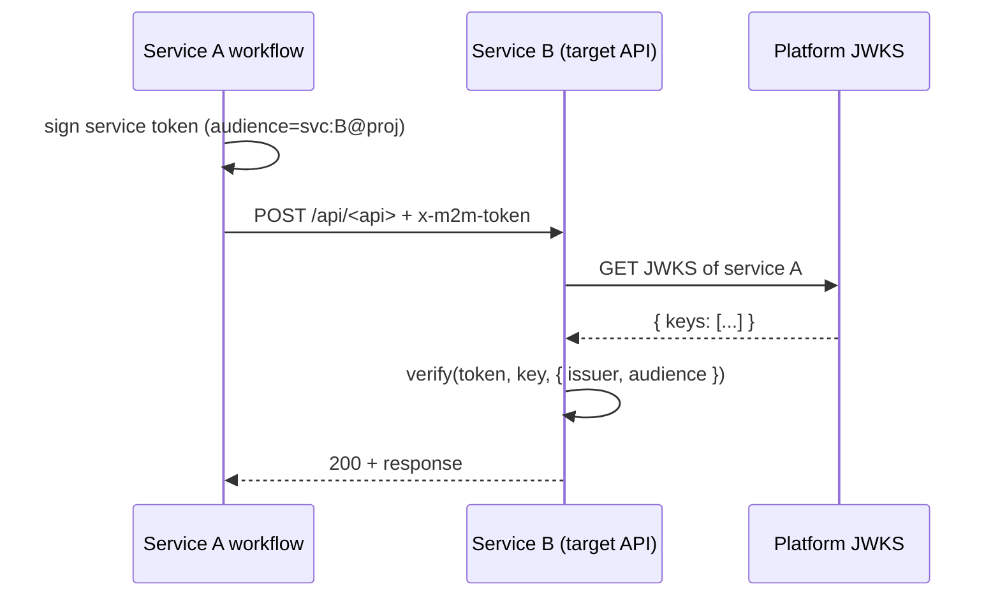

# Machine-to-machine communication

**M2M** is the trust layer that lets one service call another inside the same project without
a user session. Every generated service owns an **Ed25519** keypair; the public half is
published as a JWKS by the hosting platform, the private half is delivered to the service at
start-up. Outbound calls sign a short-lived JWT and ride it as `x-m2m-token`; receivers verify by
pulling the issuer's JWKS once and caching the key.

Used for:

- `InterserviceCallAction`: typed cross-service Business API calls (the one action that signs and
  sends an M2M token).
- Framework calls that use the same inter-service client (the payment layer's calls to the auth
  service, the agent hub's cross-service tools).
- Edge controllers with `M2MAllowed: true`: surfaces a sibling service calls with a verified
  `x-m2m-token` (M2M-only when `loginRequired: false`).
- Custom code that signs a token itself (see [Signing and verifying tokens
  directly](#signing-and-verifying-tokens-directly)).

`ApiCallAction` and `PublishEventAction` / the service publisher attach no M2M token (see [Which
calls carry an M2M token](./authentication/m2m.md#which-calls-carry-an-m2m-token)), and the CRUD
actions never leave their own service (see [Cross-service writes](#cross-service-writes)).

## Two JWT surfaces: don't conflate them

| Surface | Issuer | Algorithm | Verifier resolves via |
|---------|--------|-----------|------------------------|
| **M2M (service identity)** | The calling generated service | **EdDSA** (Ed25519) | The project's service-key (JWKS) endpoint, per issuer |
| **User session** | The auth service | **EdDSA** (Ed25519), the auth service's own service-identity key | Auth service `GET /publickey?keyId=<kid>` (the auth service address + `/publickey`; an explicit `JWT_PUBLIC_KEY_URL` overrides it) |

A generated service holds its **own** Ed25519 private key for signing outbound M2M tokens, and it
fetches the auth service's public key for verifying inbound user JWTs. The two checks are
independent: an inbound request can carry just an M2M token (service-to-service), just a user
bearer (a browser hit), or both (an interservice call that forwards the caller; see
`forwardCallerToken` below).

## Keypair lifecycle

Each service of the project gets one Ed25519 keypair, minted by the hosting platform on first
deploy (and lazily for a service that has none yet). The platform exposes three things:

| What | Access | Content |
|----------|------|-----------------|
| The service's JWK Set | open | `{ keys: [ { kty, crv, x, kid, alg, use } ] }`. |
| The service's public key | open | A bare envelope: `{ kid, alg, publicKeyJwk }`. |
| The service's private key | write access | `{ kid, alg, privateKeyPem, publicKeyJwk, keyCreatedAt }` (PKCS#8 PEM). |

The deployer pulls the private key once at start-up and injects it into the service as
`SERVICE_PRIVATE_KEY_PEM`, `SERVICE_KID`, `PROJECT_ID`, `SERVICE_NAME` and the platform's base URL
(`FRAMEWORK_URL`). There is no HTTP rotation endpoint: revoke the key in the platform's storage
and the next request lazily re-mints. The routes, their paths and the deployer contract belong to
the hosting platform and are not part of the language (see [the compiler
specification](../../compiler/index.md)).

JWKS responses are cacheable for ten minutes, so remote-JWKS verifiers do not need a separate cache
layer.

## Start-up environment

The signing and verifying code reads these environment variables lazily. A generated service also
checks `SERVICE_KID` + `SERVICE_PRIVATE_KEY_PEM` at start-up (present, and the PEM parses as an
Ed25519 key), plus the project key where the service signs or verifies with it, and logs one typed
`SERVICE_IDENTITY_MISSING` error line naming the missing variables. Every service that **mints
login tokens** runs degraded without its key (a generated service never exits at start-up: the port
binds, `/health` carries `IDENTITY_KEY_MISSING`, every other request answers 503
`SERVICE_DEGRADED`, and nothing is retried because the key is environment, which only changes with
a new deployment), because it signs those tokens with it (the rule follows token issuance, not the
service name). That is the **auth** service, a service with
`serviceOptions.serviceAllowsUserToLogin: true`, and a service that declares an OAuthFlow (its
callback mints the session token). Every other service only verifies user tokens; it keeps serving
and reports it on `/health` as `identity: { kid, status }` (`status: "missing"` / `"invalid"`). A
login that reaches a mint without a key answers `503 AUTH_SIGNING_KEY_MISSING`.

| Variable | Purpose |
|----------|---------|
| `SERVICE_PRIVATE_KEY_PEM` | PKCS#8 PEM of this service's Ed25519 key. |
| `SERVICE_KID` | UUID `kid` that matches the published JWK. |
| `PROJECT_ID` | Project this service belongs to (for the `iss` claim). |
| `SERVICE_NAME` | This service's logical name in the project. |
| `FRAMEWORK_URL` | Base URL of the hosting platform. Used to fetch peer-service JWKS. |

### Service URL env names

Every generated service carries exactly one environment name per service URL, in every environment
configuration:

| Variable | Value |
|----------|-------|
| `SERVICE_URL` | This service's own public URL. |
| `AUTH_SERVICE_URL` | The project's login service (the service with `serviceAllowsUserToLogin`, the injected `auth` service when the project has an `authentication` block). |
| `AUTH_SERVICE_NAME` | The login service's blueprint name. Not a URL: an `InterserviceCallAction` to that service is sent to `AUTH_SERVICE_URL`. |
| `SERVICE_<NAME>_URL` | Every other service of the project: the blueprint name with every run of non-alphanumerics replaced by `_`, upper-cased (`orderManagement` -> `SERVICE_ORDERMANAGEMENT_URL`, `order-mgmt` -> `SERVICE_ORDER_MGMT_URL`). |
| `SERVICE_MCPBFF_URL` | The project's tool-hub service, where the compiler provisions one. |

`InterserviceCallAction` resolves its target from these names without a service catalogue at
runtime; the deployer overwrites them for a custom domain. The public key URL is derived as
`AUTH_SERVICE_URL` + `/publickey` in every language; a non-blank `JWT_PUBLIC_KEY_URL` still
overrides it.

**Retired names.** The older spellings `<NAME>_SERVICE_URL` (and its camelCase-split form,
`ORDER_MANAGEMENT_SERVICE_URL`) and `SERVICE_<LOGIN>_URL` for the login service are no longer
generated. Write `SERVICE_<NAME>_URL` and `AUTH_SERVICE_URL` in your blueprint (library code,
MScript, headers). A blueprint that still mentions a retired name keeps working: the name is still
emitted for that project with its old value, and validation reports the warning
`SERVICE_URL_ENV_NAME_RETIRED` naming the replacement. The names stay reserved, so a custom
variable cannot claim them.

## Allowing M2M on a Business API

Set `M2MAllowed: true` on the API's [`ApiAuthOptions`](../../spec/ApiAuthOptions.md), **beside a
`loginRequired: true`**:

```json
{
  "basics": {
    "authOptions": {
      "loginRequired": true,
      "M2MAllowed":    true
    }
  }
}
```

Effect:

- `loginRequired: true` + `M2MAllowed: true`: **both-accepted, and NOT machine-only**. The login
  gate stays armed, so an anonymous caller gets a 401; a verified `x-m2m-token` peer with no user
  session passes through the `M2MAllowed` + machine bypass, and so does **every logged-in user**,
  because the same login gate opens for a user bearer. With no `checkRoles` beside it, any
  logged-in user of any tenant reaches such an API. To refuse human callers, declare
  [`requiredCallerKind`](#refusing-human-callers-requiredcallerkind) beside it. The session-less
  peer passes the login, role and permission gates only: on an api that also declares
  `ownershipCheck` (any crudType except `create`) or `parentOwnershipChecks` it is refused **403
  `M2M_SUBJECT_REQUIRED`**, because a machine token names no user to own a row. Forward the
  caller's token, or call a machine-only api (see [M2M: the
  canon](./authentication/m2m.md#the-canon)). A token whose signed payload NAMES a user (`userId`,
  else `sub`) is not a session-less peer: it runs as that user: the role, permission and tenant
  gates find no grant in the token, and the ownership gates compare that user. Only a token that
  names nobody takes the machine bypass.
- `loginRequired: true` + `M2MAllowed: false`: user session only. Server-to-server callers are
  rejected.
- `loginRequired: false` + `M2MAllowed: true`: **PUBLIC, not M2M-only**. `loginRequired: false`
  switches the whole authorization pipeline off, the login check returns on that flag *before* it
  consults the machine identity, and `M2MAllowed` is read only to BYPASS a gate, never to demand
  one. The endpoint answers anonymous callers with no token at all. Blueprint validation reports
  the pair as `PUBLIC_API_WITH_M2M_ONLY_INTENT` and the generated service carries a banner saying
  the route answers anonymous callers. There is no M2M-ONLY gate for a Business API; use the
  `loginRequired: true` form above.

When the blueprint does not declare `M2MAllowed` at all, the default policy decides: an object's own
auto-generated CRUD APIs (`getOrder` / `createOrder` / `updateOrder` / `deleteOrder` /
`listOrders`) default to `true` so standard data access is reachable from a peer service out of
the box, and **every custom Business API defaults to `false`**. A declared `M2MAllowed` (`true` or
`false`) always wins, even on a CRUD API.

Edge controllers read the same two flags but NOT the same way: there `loginRequired: false` +
`M2MAllowed: true` is a real **M2M-only** gate. The generated adapter verifies the caller's
`x-m2m-token` (or an `Authorization: Bearer` that verifies as a service token) through the same
verifier and caller lists a Business API uses before the handler runs, and
`loginRequired: true` + `M2MAllowed: true` accepts a session OR such a verified token. See
[`EdgeController`](../../spec/EdgeController.md) and
[`EdgeControllerOptions`](../../spec/EdgeControllerOptions.md).

## Refusing human callers: `requiredCallerKind`

`M2MAllowed` only ever **widens** the login gate. `requiredCallerKind` is the flag that **narrows**
it: the way to say that this API has no human caller at all:

```json
{
  "basics": {
    "authOptions": {
      "loginRequired":      true,
      "M2MAllowed":         true,
      "requiredCallerKind": "machine"
    }
  }
}
```

The caller-kind check runs immediately after the login check, so a refused caller never reaches the
role gate, the waiting-room token consume, or any author-defined action. An `absoluteRoles` entry
does **not** bypass it: an absolute role names a person, and the point of the flag is that no
person may call. Cron and in-process `internal` triggers are exempt: they have no HTTP caller. A
Kafka dispatch counts as a machine caller for this gate only: no human stands behind a consumed
event and framework-published events carry no `x-m2m-token`, so `machine` admits it; the login,
role, permission and ownership gates still run for Kafka (see [Kafka
controllers](../business-apis/kafka-controllers.md)).

### Four callers, not two

"Machine vs human" is two rows; the generated service distinguishes four, and the fourth is the one
authors actually hit. The inter-service client attaches `x-m2m-token` to every call an
`InterserviceCallAction` makes and forwards the caller's bearer when `forwardCallerToken` is set, so
an ordinary end user proxied through a service-to-service hop arrives carrying **both** signals:

| caller | machine identity verified | session owner | `loginRequired:true` + `M2MAllowed:true` | `+ requiredCallerKind: machine` | `+ requiredCallerKind: machineWithoutUserIdentity` |
|---|---|---|---|---|---|
| anonymous | `false` | null | 401 | 401 | 401 |
| an INTERACTIVE user session | `false` | set | **passes** | 403 `M2M_CALLER_REQUIRED` | 403 `M2M_CALLER_REQUIRED` |
| a session-less machine token | `true` | null | passes | passes | passes |
| a user FORWARDED on an InterService hop | `true` | set | passes | **passes** | 403 `M2M_CALLER_WITHOUT_USER_IDENTITY_REQUIRED` |

A fifth caller has no HTTP request at all: a **Kafka dispatch**. The caller-kind gate treats it as a
machine whatever the token check says, so `machine` admits it and `machineWithoutUserIdentity`
admits it only when the event's `actor` names no user; the login gate before it is unchanged and
judges the session the event carries.

`machine` is the recommended value for "machine callers only": it draws its line at a verified
machine identity or a Kafka dispatch, refusing the interactive session while leaving the forwarded
hop intact. That is not a compromise; it is the line real interservice traffic needs. Measured on a
reporting project, the narrow line would have broken invitation-accept and job publishing, which
reach these APIs through exactly such a hop.

`machineWithoutUserIdentity` is the labelled exception: a machine caller carrying **no user identity
at all**, which therefore also refuses that hop. Declare it only for an API that must never run on
behalf of a person, and expect it to refuse any internal caller that forwards its bearer. If you are
unsure which you want, you want `machine`.

Two blueprint rules keep a declaration from meaning nothing:

- **`MACHINE_CALLER_KIND_WITHOUT_M2M_ALLOWED`** (error): a machine kind on a `loginRequired: true`
  API without `M2MAllowed: true` refuses *every* caller: the human by the caller-kind gate, the
  machine by the login gate one step earlier, because the M2M login bypass requires `M2MAllowed`.
- **`MACHINE_CALLER_KIND_WITH_ROLE_GATE`** (warning): a `checkRoles` list beside a machine kind can
  admit nobody: every caller that reaches the role gate has already been proved a machine, and a
  machine holds no role.

Incoming verification is live on both ends. The generated service resolves the machine identity as
the first authentication step: it JWKS-verifies the incoming `x-m2m-token`, evaluates the issuer
against this service's `allowedM2MClients` / `blockedM2MClients`, and treats the call as machine
only on a verified, allowed caller. The login check then bypasses the login requirement on
`M2MAllowed` + machine and otherwise raises `401 Authentication required`. Verification failure is
non-fatal but logged (`M2MTokenVerificationFailed`); a refused caller is logged as
`M2MClientRefused` and answers `403`.

A token that could not be verified **yet** is not a refused token. When the issuer's JWKS fetch
fails transiently (the 5 s timeout, a network error, 5xx / 408 / 429) and no usable last-good key
set holds the token's kid (typically the first M2M call a freshly started service receives) the
request that has no other identity answers **`503` `M2M_VERIFICATION_UNAVAILABLE`** with
`"retryable": true` instead of the `401` (a `requiredCallerKind` machine api answers the same 503
instead of its `403`). A real refusal (bad signature, a kid the successfully fetched document does
not publish, an authoritative 4xx, an expired token) keeps its `401` whenever the key set can be
read. While the key set is unreachable the receiver cannot check the token at all, so ANY token it
would have to fetch keys for (an expired or forged one included) answers the same `503`; the retry
answers the `401` once the key set is back. The `503` never grants anything: the api does not run. A
public api, or a request that also carries a forwarded user bearer, is answered as before. The
inter-service client (the one every `InterserviceCallAction` uses) retries a hop answered this 503
**once**, with the same token; a second 503 fails the hop as usual.

The same answer covers the other M2M doors:

- **Cross-project calls** (`x-project-m2m-token`, `interProjectCallActions`). When the platform
  cannot answer the caller project's JWKS request, or this project's own org-claim JWKS request
  (timeout, network error, 5xx / 408 / 429, an unreadable body), the sibling answers the same `503
  M2M_VERIFICATION_UNAVAILABLE` instead of `401`. A forged token, a key the answered document does
  not publish, an authoritative 4xx and another organization keep their `401`. The generated
  `interProjectCallAction` re-sends the call **once** on that 503 with the same project token (logged
  `InterProjectCallRetry`); any other failure, and a second 503, fail the action as before. The
  receiver logs every cross-project verification failure as
  `CrossProjectM2MTokenVerificationFailed` (server side only). The caller project's and this
  project's own JWKS documents follow the same retry and last-good rule as the peer JWKS below: a
  kid the last good caller document published still verifies for up to 6 hours while the platform
  cannot answer, and the organization check reads the `orgClaim` of that same document, so a stale
  answer never admits another organization.
- **The session-gated M2M surfaces**: edge functions (`m2m` / `both` auth mode), the payment routes
  that admit machine callers, JobStream enqueue (its login gate and its machine-only caller-kind
  gate), the agent-hub control surface and the per-agent REST routes answer the same retryable 503
  where they would have answered their `401` (or the caller-kind `403`) for want of an identity. The
  agent-run approval routes keep their `401`: a machine session is never an approver, so a retry
  could only end in `403`.
- **OAuth state tokens** are signed and verified by the same service, on the local-key path with no
  JWKS fetch, so a JWKS outage never reaches them.

### Diagnosing a `503 M2M_VERIFICATION_UNAVAILABLE`

The `detail` sentence of this 503 never changes. The body also carries a short `cause` member that
names the JWKS host the **receiver** fetched and how the last attempt failed:

```json
{
  "status": 503,
  "errorCode": "M2M_VERIFICATION_UNAVAILABLE",
  "retryable": true,
  "detail": "The machine-to-machine token could not be verified: the issuing service key set is temporarily unavailable. Retry the call.",
  "cause": "jwks keys.example.com: timeout"
}
```

(A response sample, not a blueprint.) `cause` holds the host and a failure class, nothing else. It
carries no path, no query string, no credentials in the URL, no token and no key material. Note that
the host (with its port, when `FRAMEWORK_URL` names one) is shown to any caller that presents an
`x-m2m-token`, verified or not: a self-hosted deployment whose `FRAMEWORK_URL` uses an internal
hostname exposes that name. Every surface that answers this 503 carries it: business APIs,
cross-project calls, edge functions, payment routes, JobStream gates and the agent hub. The calling
service's retry log line repeats it as `receiverCause`, so the caller's own log shows why the hop
was refused.

| Class | Meaning | What to check from the receiver's side |
|---|---|---|
| `dns` | The platform host did not resolve (`ENOTFOUND`, `EAI_AGAIN`). | The cluster DNS, and the `FRAMEWORK_URL` spelling. |
| `connect` | The connection was refused, reset or unroutable (`ECONNREFUSED`, `ECONNRESET`, `EHOSTUNREACH`). | The egress policy or firewall, and hairpin routing to a host served by the same cluster. |
| `timeout` | No answer within the 5 s budget (the fetch timeout, `ETIMEDOUT`, a connect or headers timeout). | Egress, and a proxy that accepts the connection but never answers. |
| `tls` | The TLS handshake or certificate check failed. | The certificate chain the service sees, or a TLS-intercepting proxy. |
| `http 5xx`, `http 429`, `http 408` | The platform, or an edge in front of it, answered with that status. | The edge or WAF rate limits for the cluster's egress IP, and the platform itself. |
| `unreadable body` | A 2xx whose body was not a JWKS document. | A captive portal or proxy answering instead of the platform. |
| `other <CODE>` / `other` | Any other network failure, with its error code when it has one. | Search for the code. |

The receiver also logs one structured `PeerJwksUnavailable` warning per issuer, at most once a
minute, and at most 20 such lines a minute across all issuers. It carries the issuer, the token's
kid, the JWKS location, the ordered `attempts` (an HTTP status or a failure class each), the
`cause`, whether a last-good copy existed (`lastGood`, with `lastGoodAgeMs` when one was present but
could not answer the token: older than 6 hours, or not publishing the token's kid) and how many
failures were suppressed (`suppressedSinceLastWarn`, `suppressedAcrossIssuers`). The issuer is read
from the token before its signature is checked, so a flood of tokens naming made-up issuers cannot
flood the log; issuer and kid are cut to 200 printable characters. A request that the last-good copy
did answer logs `PeerJwksServedFromLastGood` with the same details. Without logs, the gated
`/admin/health` shows the last peer-JWKS outcome per issuer under `peerJwks` (`issuer`, `url`, `at`,
`ok`, `attempts`, and `served`, which is `fresh`, `lastGood` or `none`); the public `/health` does
not show it.

To reproduce the receiver's view, run the same JWKS fetch from inside the receiving service's
network: a success from your workstation proves nothing about the service, because the failure is on
the path from the cluster to the platform.

> Design-time consequence: a `M2MAllowed: false` target is unreachable over M2M no matter how good
> the token is. An `interserviceCallActions` entry pointed at such a target without
> `forwardCallerToken: true` is refused by validation with `INTERSERVICE_TARGET_UNREACHABLE` rather
> than shipping a call that 401s on every request.

## Calling another service: `InterserviceCallAction`

The typed surface for service-to-service Business API calls. See
[`InterserviceCallAction`](../../spec/InterserviceCallAction.md) for the full spec; the
M2M-specific bits:

- The M2M token always rides on `x-m2m-token`. The action signs at call time with a 60-second TTL
  and the audience claim pinned to `svc:<targetService>@<projectId>`.
- `forwardCallerToken: true` adds the *user's* bearer onto `Authorization` so the downstream sees
  both signals; useful when the call should preserve `session.userId` / `roleId` / ownership checks.
  Default is false: M2M-only, downstream sees no user.
- Tenancy: a hop runs in its caller's own tenant by default. A hop that forwards the caller's token
  runs in the tenant of that session; a hop that forwards nothing signs the calling service's own
  verified tenant into its machine token as the `callerTenantId` claim (only that tenant, never
  another; a caller with no verified tenant signs nothing and a tenant-level target refuses it). To
  run the call inside a named tenant instead, set `tenantContext` (an MScript expression yielding
  the tenant codename), which goes out as the tenant codename header (or the header named by the
  project's `tenantNameHeaderName`). See [the tenant of a machine
  call](./authentication/m2m.md#the-tenant-of-a-machine-call).

```json
{
  "actionType":   "InterserviceCallAction",
  "name":         "decreaseStock",
  "targetService": "inventory",
  "targetApi":    "decreaseStock",
  "isArray":      false,
  "apiParameters": [
    { "name": "productId", "value": { "js": "this.productId" } },
    { "name": "quantity",  "value": { "js": "this.quantity" } }
  ]
}
```

## Cross-service writes

No per-object M2M endpoints are generated: a service exposes another service's data only through the
Business APIs it declares. The CRUD actions
([`CreateCrudAction`](../../spec/CreateCrudAction.md),
[`CreateBulkCrudAction`](../../spec/CreateBulkCrudAction.md),
[`UpdateCrudAction`](../../spec/UpdateCrudAction.md),
[`DeleteCrudAction`](../../spec/DeleteCrudAction.md)) write through the service's own data layer
only; a `childObject` that names another service's data object is refused at design time with
`CRUD_ACTION_CHILD_OBJECT_NOT_LOCAL`.

To write into another service, call one of its Business APIs with an `InterserviceCallAction`. An
object's own CRUD APIs default to `M2MAllowed: true` (see the default policy above), so a declared
`createOrder` / `updateOrder` / `deleteOrder` of the target is reachable from a peer service without
extra configuration. When the name of the field to update is itself data, use the action's
`applyField` (supported only by some target languages): it sends one whitelisted field to the
target's typed update API; see [`InterserviceCallAction`](../../spec/InterserviceCallAction.md).

An **edge controller** is the one surface where `loginRequired: false` + `M2MAllowed: true` is a
real M2M-only gate: the compiler derives an `authMode` from the two flags and generates a verified
token check for the `m2m` mode (the shared verifier plus the caller lists). The pair is not
transferable to `ApiAuthOptions` on a Business API, where it is public (see the effect list above).

## Signing and verifying tokens directly

The generated service's runtime exposes a signing function and a verifying function for code that
needs the trust signal outside of `InterserviceCallAction` (custom edge functions, MScript-driven
webhooks, etc.). The contract:

- **Sign** (outbound, identifying THIS service): takes the target audience (pin the target, for
  example `svc:inventory@proj_abc`), a short lifetime in seconds (default 5 minutes for a hand-signed
  token; an `InterserviceCallAction` token lives 60 seconds) and optional extra claims.
- **Verify** (inbound, claimed to be from another service in the same project): takes the incoming
  token and an optional `allowedIssuers` list of service names (defense in depth) and returns the
  verified issuer service and payload.

Claim shape: `iss = svc:<serviceName>@<projectId>`, `aud = svc:<target>@<projectId>`, `iat` / `exp` /
`kid` set automatically, `alg = EdDSA`. The JWKS for the issuer is fetched on demand from the
platform's per-service key endpoint (`{FRAMEWORK_URL}/.well-known/jwks/services/{projectId}/{serviceName}`)
and cached in-process for 10 minutes. The token's `kid` is read from its protected header: a kid the
cached document does not publish always forces a refetch, which is how a rotated-in key is picked up.

A refetch that fails transiently (HTTP 5xx, 408 or 429, or a network error) is retried up to 3
attempts, waiting 100 ms and then 250 ms. A timed-out attempt (5 s) is not retried. When every
attempt fails, a kid that the last successfully fetched document published is still verified against
that document, for up to **6 hours** after it was fetched, so a platform deploy does not turn every
M2M call into a 401. After such a stale answer, known kids skip the refetch for 30 s.

The limits of that fallback: an unknown kid still fails; a successful refetch replaces the whole
document, so a key rotated out of it stops verifying at once; any other 4xx (for example `404
service_not_found`) evicts the document instead of falling back. These limits hold for a request
that is already waiting on its own refetch too: the fallback answers only from the issuer's current
document, read again after the refetch fails. If another request stored a newer document in the
meantime, the token is verified against that newer document; if another request's 4xx evicted the
issuer, the token is rejected. The trade-off is that while the platform's JWKS endpoint keeps
failing, a verifier can accept a key it last saw published up to 6 hours earlier, even if that key
has since been rotated out.

The project-key verifiers apply the same rule to the project JWKS
(`{FRAMEWORK_URL}/.well-known/jwks/projects/{projectId}`): the cross-project token check, the
project signature check of a signed event or signed call, and the admin-grant gate of the generated
admin routes. An admin grant the gate cannot verify is still refused with `403`; the fallback only
keeps a grant signed by a key the platform published verifiable while the platform is down.

Conforming generated services in every target language use this document policy for cross-project
tokens, signed envelopes and admin grants. Concurrent refreshes for one URL share one bounded fetch
sequence. An unknown `kid` still forces a refresh during the fresh window or stale cooldown; a
successful response replaces both keys and the organization claim together. Valid JSON with a
non-object root (such as `null`, `[]` or a scalar) is a successful empty key document and replaces
the cached keys and organization claim. Invalid JSON and failed body reads remain transient failures
eligible for the last-good rule. The warning `ProjectJwksServedFromLastGood` records a stale answer
without extending the document's six-hour maximum age.

User login tokens follow the same rule. A service that verifies a login token by its `kid` fetches
the signing key from the auth service's `/publickey?keyId=<kid>` endpoint (the auth service address +
`/publickey`, or an explicit `JWT_PUBLIC_KEY_URL`) and caches it for 10 minutes. When a refetch
fails transiently (HTTP 5xx, 408 or 429, a network error, or an unreadable response), the cached key
is still used for up to **6 hours** after it was fetched, with a warning, and the kid skips the
refetch for 30 s. Past 6 hours the token is rejected. Any other 4xx (the endpoint answers 404 for a
kid the auth service no longer signs with) or a response without a key evicts the cached key and
rejects the token. A service with no public key URL (neither `JWT_PUBLIC_KEY_URL` nor
`AUTH_SERVICE_URL` set) never falls back to a cached key.

## Kafka: signed events instead of tokens

A Kafka message carries no M2M token. Cross-service event fan-out is signed at publish time instead,
with the **project** key, when the event alias is listed in `serviceOptions.secureEvents`. See [Kafka
controllers](../business-apis/kafka-controllers.md) for the topic-resolution side: the publisher
wraps a matching outbound payload in `{ _secure: true, alias, payload, sig, kid, jwks_url }`, and a
consuming service that lists the same alias verifies the signature and drops a message that is not
wrapped or does not verify.

Events on aliases nobody lists (no envelope) publish and consume normally: the secure-event
mechanism is opt-in per alias.

## Flow



## See also

- [Event subscriptions](../capabilities/event-subscriptions.md): client-facing read channels (not
  M2M; user-token gated).
- [Kafka controllers](../business-apis/kafka-controllers.md): server-side event consumers; pairs
  with M2M for cross-service event trust.
- [`InterserviceCallAction`](../../spec/InterserviceCallAction.md): the typed cross-service call
  surface.
- [Authentication](authentication/overview.md): user-session auth alongside M2M.
