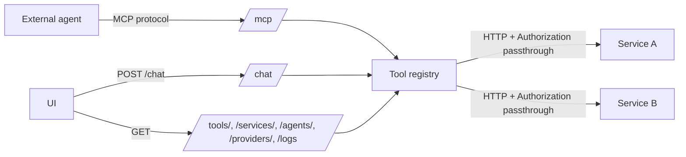

# MCP-BFF service

The **MCP-BFF** is a project-level service with these roles:

1. **A hub for agents to reach every service's MCP tools.** It aggregates every service's
   business APIs into one MCP endpoint, so an external agent (or the project's chat
   surface) can discover and call tools across the whole project through a single
   connection.
2. **A chat and tool gateway for UIs.** A generated UI can use it for chat, tool and agent
   exploration, and provider discovery. Auth, user/group/tenant administration,
   notifications, and payments use their owning REST services.
3. **The native full-API chat assistant.** It hosts its own in-process chat agent
   (`POST /chat`) that runs a tool loop over the project-wide tool registry, and can expose
   it over messaging channels.
4. **A code bridge for other target languages.** When a compiler targets a service
   language that cannot run the project's script-resident code in-process, the MCP-BFF can
   host and execute it on that service's behalf. See
   [Code bridge for other target languages](#code-bridge-for-other-target-languages).

> **The MCP-BFF has nothing to do with the [BFF service](bff.md) or DataViews.** The two
> are unrelated services; the name collision is historical. The BFF builds read-optimized
> DataViews; the MCP-BFF is a tool hub and chat gateway.

The MCP-BFF is the only MCP server of a generated project:

| Layer | Where | Audience |
|---|---|---|
| [Service tool registry](application-mcp.md) | Per-service `GET /tools`: plain JSON, no MCP protocol. | What the MCP-BFF reads to build its tools. |
| **MCP-BFF** (this page) | A dedicated project-level service generated from the blueprint. | Project-wide tool hub for external agents, and the chat gateway. |

## What an author configures

The MCP-BFF has **no service root of its own** in the blueprint: authors do not write an
`mcpbffService` block. The compiler walks the blueprint and generates a fixed service that
loads a manifest of what it found. The blueprint inputs that shape it are:

| Input | Effect |
|---|---|
| `apiOptions.blockMcp` on a BusinessApi | Keeps that API out of the tool catalogue (see [What gets exposed](#what-gets-exposed)). |
| `projectSettings.aiProvidersSettings.aiProviders[]` | The AI providers the chat assistant can use (see [AI provider manifest](#ai-provider-manifest)). |
| `agentHub.aiAgents[]` | Agents listed at `GET /agents` (see [Agent hub](agent-hub.md)). |
| `projectSettings.mcpbffSettings.chatSurfaces[]` | Messaging channels the native assistant is exposed over. |
| `projectSettings.mailAccountsSettings.mailAccounts[]` | Mailboxes the service owns and listens to (see [Mail listener](#mail-listener-for-connected-mailboxes)). |

`mcpbffSettings.chatSurfaces[]` has one entry per channel provider, the same
[`ChatSurfaceSettings`](../../spec/ChatSurfaceSettings.md) shape an agent surface uses:

```json
"projectSettings": {
  "mcpbffSettings": {
    "chatSurfaces": [
      { "provider": "mainTelegram", "identityStrategy": "link", "typingIndicator": true },
      { "provider": "mainWhatsapp", "identityStrategy": "phone" }
    ]
  }
}
```

`provider` names a notification provider of kind `whatsapp` or `telegram`; that provider
supplies the surface type and all credentials. A Telegram exposure is a webhook of the
MCP-BFF (`/chat/<provider>/webhook` unless `webhookPath` overrides it) verified with the
provider's `telegramWebhookSecret`. A WhatsApp exposure has no route here: the Meta
callback lands on the provider's door on the notification service and the MCP-BFF consumes
the routed inbound messages (see
[the notification service](notification.md#whatsapp-inbound-dispatcher-one-door-per-provider)).
Replies use the provider's credentials. The items must have distinct `provider` names, and a
provider may back at most one conversational consumer project-wide. See
[AI chat surfaces](../capabilities/ai-chat-surfaces.md) and
[`McpbffSettings`](../../spec/McpbffSettings.md).

## What gets exposed

The MCP-BFF exposes one MCP tool per visible `BusinessApi` with a REST controller, across
every service in the project. An API is **visible** when its
[`apiOptions.blockMcp`](../../spec/ApiOptions.md) is unset or `false`; no opt-in is needed.
Set `blockMcp: true` to exclude an API explicitly: useful for payment flows that require
browser-side 3DS, or any API an agent should never invoke directly.

The tools are discovered at runtime: at boot, on a refresh interval and on
`POST /tools/refresh`, the MCP-BFF reads every service's public
[`GET /tools` registry](application-mcp.md) and projects its entries into MCP tools. A
service that does not answer keeps its last-known tools (at the first boot, the ones in
the MCP-BFF's generated manifest), so a restarting service does not empty the catalogue.

Each tool entry carries:

- `name`: `<serviceName>__<apiName>`, reduced to letters, digits, `_` and `-`, starting with
  a letter, at most 64 characters (a longer name ends in a hash), and made unique across
  the catalogue.
- `description`: the API's `apiOptions.apiDescription` (the API name when it has none).
- `inputSchema`: derived from the API's declared `requestParameters`, plus the route's own
  `:segments`, plus (on a `list` API) every
  [`isFilterParameter`](../../spec/PropertyBasicSettings.md) column of its data object,
  advertised as an optional query argument, so a tool call can filter by those names.
- `surfaces`: `['mcp', 'chat']` (one signal per consumer).
- `http`: method, path, parameter locations. The HTTP path is the one the upstream service
  mounts.
- `auth`: `loginRequired`, optional role list, ownership flag.

Agents defined under [`agentHub.aiAgents[]`](agent-hub.md) ride the same manifest and are
surfaced through `GET /agents`.

## Mounted endpoints



| Endpoint | Purpose |
|---|---|
| `POST /mcp`, `GET /mcp`, `DELETE /mcp` | MCP StreamableHTTP transport for external clients (coding agents, desktop assistants, custom orchestrators). Session-scoped through the `mcp-session-id` header. See [MCP sessions](#mcp-sessions). |
| `POST /chat`, `POST /chat/stream` | The chat surface (also usable by external chat UIs). Routes the prompt through a configured AI provider, lets the model invoke MCP tools, and returns `frontendActions` a UI can render; the stream variant answers SSE. Request body and history: [The chat API](#the-chat-api). **Rejects anonymous callers by default**: see [Chat access and spend controls](#chat-access-and-spend-controls). |
| `POST /chat/<provider>/webhook` | Telegram chat webhook, one per `mcpbffSettings.chatSurfaces[]` exposure naming a telegram provider. Verified with the provider's `telegramWebhookSecret`; fails closed on an unset or wrong secret token. A WhatsApp exposure has no route here. |
| `GET /tools`, `POST /tools/:name` | Caller-filtered tool catalogue and per-tool invocation. Summaries include declared input schemas, upstream HTTP method/path/parameter locations when present, and approval guidance. |
| `GET /services` | Discovered service catalogue (each service's base URL, OpenAPI link). |
| `GET /agents`, `POST /agents/:name` | Per-AI-agent metadata and direct invocation. |
| `GET /providers` | AI provider manifest (no secrets: env-var prefixes only). |
| `GET /logs` | In-memory request ring buffer. **Admin-gated**: see [Non-relay routes](#non-relay-routes-are-gated). |
| `GET /admin/credentials` | Per-slot credential-completeness report: absent vs **placeholder** vs present, per AI provider and per MailAccount. Names only, never values. **Operator-gated**. |
| `GET /health` | Liveness check: public, unauthenticated, constant for the life of the process: `{"status":"ok","build":{...}}`. `build` identifies the deployed build. |
| `GET /health/details` | The operational snapshot: default model, provider booleans, tool count, upstream services, and the mail-listener status blocks. **Operator-gated**. |

The legacy SSE transport is not emitted; StreamableHTTP is the single external-MCP entry
point.

### MCP sessions

- The MCP transport **requires a verified caller**: the admission gate runs before the
  session lookup, so an anonymous caller gets a 401 that neither lists tools nor reveals
  whether a session id is live.
- **Each session is BOUND to the principal that initialized it.** Every lookup on every verb
  requires the current request's verified subject to equal the one stamped at `initialize`,
  and a *different* verified caller presenting a live id is answered exactly the 400 an
  unknown id gets, so ownership never becomes an existence oracle. Tool execution takes its
  upstream caller context from the CURRENT JSON-RPC request, so the credential forwarded
  upstream is always the one that made the `tools/call`.
- **The session map is BOUNDED**: a caller that loops `initialize` and never sends `DELETE`
  cannot grow the process. The global cap is derived from a memory budget (default 256 MB)
  and the size of the tool catalogue, clamped to [2, 200], and can be overridden outright. A
  per-principal cap (default 8) bounds one caller's share and is at most half the global
  cap.
- **A caller can only ever displace ITSELF.** Eviction draws exclusively from the inserting
  principal's OWN least-recently-active sessions; when the map is full of OTHER principals'
  live sessions the new session is REFUSED with a JSON-RPC 503 rather than evicting a
  stranger. Both caps are reserved against, not merely checked, so a caller opening many
  sessions at once gets a 503 rather than an overrun.
- An idle TTL (default 2 hours) is swept on the request path and on an interval, and a
  per-principal rate limit (default 60 per minute, `0` disables) sits behind the gate.

## Connecting an external MCP client

Through the gateway the MCP-BFF answers at `<project host>/mcpbff-api`, and the MCP endpoint
of a generated app is:

```
https://<project host>/mcpbff-api/mcp
```

Configure it in the client as a StreamableHTTP server and send the caller's credential on
every request:

- `Authorization: Bearer <access token>`: a user session JWT from the auth service's
  `POST /login`; or
- a secret API key, as `Authorization: Bearer <key>` when the project reads API keys from
  the bearer header, or in `X-Api-Key`.

The MCP-BFF verifies the credential with the auth service before it opens a session, and
forwards it to the upstream service on every tool call, so the agent can do exactly what
that user (or key) can do over REST. See [API keys](authentication/api-keys.md) for issuing
a key.

## Browser origins

The gateway supports cookie-less browser bearer/API-key transport from origins listed in
its CORS allowlist deployment setting (`MCPBFF_CORS_ORIGINS`). Use comma-separated explicit
HTTP(S) origins; wildcards, credentials, paths and queries are rejected. An unset or empty
value permits no cross-origin browser access. Same-origin routing needs no allowlist entry.

Valid preflights finish before route admission. Actual requests still pass the existing
credential, tenant, operator and owning-service checks. Supported headers include
Authorization, API/session keys, the configured tenant header, idempotency and API approval
headers, and MCP protocol/session headers. Cookie credentials are not enabled; MCP
session/protocol response headers are exposed. This gateway policy does not configure the
native services' REST origins.

## Authentication

The MCP-BFF relays credentials **on the relay routes** (`/tools`, `/mcp`, `/services`,
`/agents`, `/providers`), but every one of them sits behind the admission gate first: a
request must present a verifiable credential before any relaying happens. Past the gate it
does not validate credentials itself: it forwards them to the upstream service that owns the
tool's BusinessApi, and that service enforces its own `auth.loginRequired`. The headers it
propagates per call:

- `Authorization`: passes through verbatim (`Bearer <jwt>` for user sessions, a bearer key
  for API keys).
- `X-Api-Key`: alternate API-key location.
- `X-Tenant-Id`: explicit tenant override (multi-tenant projects). For an anonymous or
  unverified caller it is an UNVERIFIED claim: it is forwarded upstream (where the owning
  service applies its own tenant rules) and keys a separate best-effort chat budget, never
  the verified tenant's ledger (see "Unverified X-Tenant-Id and the tenant ceiling" below).
- `X-Session-Id`: opaque session identifier.

Each tool entry's `auth.loginRequired` mirrors the upstream API's
`ApiAuthOptions.loginRequired`. External agents that want to act as a specific user need a
valid JWT or API key for that user; the MCP-BFF just relays.

### Non-relay routes are gated

Several route groups do **not** relay to an upstream: the MCP-BFF itself performs the
action, with its own resources, so the transparent model does not apply and the MCP-BFF
gates them directly:

- **`POST /chat` / `POST /chat/stream`** run the agent loop on the **operator's** LLM API
  keys, or on the caller's or the tenant's own key when the provider entry sets
  `credentialScopes` (a `required` scope with no stored key answers
  `428 AI_PROVIDER_CREDENTIAL_REQUIRED`; see
  [`AiProviderCredentialScopes`](../../spec/AiProviderCredentialScopes.md)). Anonymous
  callers are rejected with a `401` unless public mode is explicitly enabled, and every call
  is rate-limited and budget-governed: see
  [Chat access and spend controls](#chat-access-and-spend-controls). While `/chat/stream` is
  open it writes an SSE comment, `: ping`, every 15 seconds, so an idle-timeout proxy does
  not drop a turn that is waiting on a long model or tool call; the pings stop at `done`, on
  `error` and on client disconnect. A disconnect does not cancel the turn: it finishes and,
  when the request named a `conversationId`, lands in the conversation history. A failure
  during `/chat/stream` ends the stream with an `error` event `{ message, code }`: `code` is
  the machine code (for example `TOO_MANY_REQUESTS` for a spent budget) and `message` the
  text. An AI provider failure answers the same codes as a generated service's agent stream:
  `AGENT_PROVIDER_UNAVAILABLE` with the generic message "The AI provider could not be
  reached" (provider down, rate-limited, auth refused, no API key, or the provider's stream
  broke off while the answer was arriving), or `AGENT_PROVIDER_REQUEST_INVALID` when the
  provider rejected the request itself (a non-auth 4xx), never the provider's own status. A
  rejected request reads "The AI provider rejected the request (provider HTTP <status>)" and
  never carries the provider's own error text. The separate `providerErrorType` /
  `providerErrorCode` keys appear only when the provider failure carries a parseable JSON
  error body whose `error.type` / `error.code` is well-formed (lower-case letters, digits,
  `_` `.` `-`, at most 64 characters, for example `invalid_request_error`,
  `model_not_found`). The non-stream `POST /chat` answers a provider failure the same way
  (`error` = that message, plus `code` and the same optional keys), and any other
  server-side failure as "Internal server error". Only a failure of the provider call itself
  counts: a failing tool, a budget denial or usage recording keeps its own code.
- **`GET /logs`** serves the MCP-BFF's request ring buffer (request/response previews). It
  sits behind the **admin gate**: only a short-lived **admin-grant JWT**
  (`Authorization: Bearer <grant>`, scope `logs:read`) opens it. The static `x-admin-token`
  / `LOGS_ADMIN_TOKEN` break-glass is retired: it is not read, and a still-set
  `LOGS_ADMIN_TOKEN` costs one boot warning and is otherwise ignored. Fail-closed: without a
  valid grant the routes return `403`.
- **The direct-invoke and control routes.** Declared tool metadata (`auth.loginRequired`,
  the chat-only surface tag) filters catalogues; it enforces nothing. The admission policy:

  | Route | Admission |
  |---|---|
  | `GET /tools` | verified caller: full catalogue; anonymous: **only tools declared public**; rejected: `401`; unverifiable: `503` |
  | `POST /tools/:name` | public tools stay anonymously callable; everything else needs a verified caller. Unknown names answer exactly like private ones, so the catalogue cannot be enumerated |
  | `POST /tools/:name` where the tool runs on **MCP-BFF-owned credentials** (`mail-op`) | **not direct-invocable**: `403 TOOL_NOT_DIRECT_INVOCABLE`, unless explicitly enabled (`MCPBFF_DIRECT_LOCAL_TOOLS=true`), and then operator-only |
  | `POST /tools/refresh`, `POST /test/send-notification`, `GET /admin/credentials`, `GET /health/details` | **operator**: a verified caller satisfying the operator-role policy (`MCPBFF_OPERATOR_ROLES`), or the `MCPBFF_ADMIN_TOKEN` break-glass. Insufficient role: `403 INSUFFICIENT_ROLE` |

  The operator-role policy is read once at startup. Empty/unset closes session-based
  operator access; `*` deliberately admits every VERIFIED caller, never anonymous callers; a
  comma-separated role list admits matching role ids. Empty and wildcard policies each
  produce one explanatory startup warning. A nonmatching verified user can still use the
  admin-token path. Deployments must configure roles or `*` explicitly.

  `GET /admin/credentials` is on this bar because it names every environment value the
  deployment is short of, which is a map of what to attack. `GET /health` therefore keeps
  answering liveness and gains **no** credential detail, and `GET /providers` keeps
  answering a bare `configured` boolean computed by the same placeholder-aware predicate the
  report uses, so a key still holding an authoring placeholder does not read as configured.
  The chat resolver asks the same predicate, so such a provider is refused before any vendor
  call (502 `AGENT_PROVIDER_UNAVAILABLE`).

  `/mcp` registers only `mcp`-surface `http-api` tools, which relay the caller's credential
  for the owning service to authorize; local-credential tools can never reach it. The
  transport itself is admission-gated like the other relay routes, so the tool inventory is
  not readable anonymously.

- **`GET /health` vs `GET /health/details`.** `GET /health` is liveness only (no credential,
  no auth round-trip, so a load-balancer probe never becomes auth-service load); the snapshot
  with provider booleans, the tool count, the whole `upstreamServices` list and the
  mail-listener blocks (which name mailbox addresses and listen topics) is on the operator
  bar above.
- **The frontend mail routes** `POST /mail/:account/{check,read,send,reply}`. These reach
  the mail operations directly, not through the tool layer. They answer two questions
  separately.

  **Who are you**: the same credential verifier `/chat` uses. Rejected: `401
  CREDENTIAL_INVALID`; unverifiable: `503 CREDENTIAL_VERIFICATION_UNAVAILABLE` (fail
  closed); nothing presented: `401 MAIL_AUTH_REQUIRED`. There is no public-mode bypass.

  **Is this mailbox exposed here at all**: the question is about the *mailbox*, not the
  caller, because a project account is "a REAL MAILBOX the PROJECT owns" with no per-user
  owner to compare a session against. `MailAccount`'s top-level key set is closed (`name`,
  `ownerScope`, `address`, `platform`, `authKind`, `autoListen`, `listenTopic`, `markAsSeen`,
  `sendEnabled`, `replyEnabled`, `maxMailboxesPerOwner`, `inlineBody`, `configuration`): a
  top-level `ownerUserId` is rejected `UNKNOWN_PROPERTY`, and one parked inside the free-form
  `configuration` map (where unknown keys only warn) is read by nothing. The tools set no
  allowed-role or owner check either. The routes serve project accounts only (`ownerScope`
  absent or `project`): a mailbox template (`ownerScope` `tenant` / `user`) has no route or
  tool here (its connected mailboxes are listened to, see
  [Mail listener for connected mailboxes](#mail-listener-for-connected-mailboxes)). So the
  boundary is **custody**, not ownership: a shared project identity any verified user could
  otherwise send mail *as*.

  > **Neither door to a mailbox is reachable without its own explicit opt-in.** With no
  > mail setting configured, both the frontend routes and the `mail_*` tools answer `403` to
  > every caller, operators included.

  | Account | Admission |
  |---|---|
  | Not named in the frontend-accounts setting (`MCPBFF_MAIL_FRONTEND_ACCOUNTS`, the default) | **closed to everyone**: `403 MAIL_ACCOUNT_FORBIDDEN` |
  | Named in it | any **verified** caller: the user-facing mailbox UI this surface exists for |

  Mailbox access requires its own opt-in, independently of operator admission; configuring
  operator roles or `*` does not grant mailbox access. There is no admin-token break-glass on
  this mailbox route. An operator needing headless mailbox access uses `POST /tools/mail_*`
  behind its own opt-in, or the M2M-signed `/bridge/mail`. Capability gating is unchanged and
  independent: a `sendEnabled: false` account still has no `/send` route at all.

### Chat access and spend controls

`POST /chat` is **secure by default**, and the credential is **verified**, not merely
observed. A presented `Authorization` / `X-Api-Key` is checked against the project's auth
service (`GET /currentuser` for a session bearer, `POST /validateapikey` for an API key)
*before* the provider runs, before the authenticated tool catalogue is assembled, before an
MCP-BFF-local tool dispatches, and before any ledger or conversation write:

| Caller | Answer |
|---|---|
| Credential the auth service accepts | admitted; the **verified** identity selects the tool surface, the quota bucket and conversation ownership |
| Credential the auth service rejects (expired, revoked, forged, wrong project) | `401 CREDENTIAL_INVALID` |
| Verification cannot be performed (peer unconfigured/unreachable, timeout, 5xx) | `503 CREDENTIAL_VERIFICATION_UNAVAILABLE`: **fail closed**, never admitted |
| No credential at all | `401` unless public mode is on, then a **guest**: explicitly public tools only |

The credential is still relayed transparently to upstream `http-api` tools; verification
governs what the MCP-BFF itself does on the caller's behalf. Successful verifications are
cached briefly per credential (default 30 s); rejections never are. A local-development
escape hatch that skips verification exists but is honoured only in development-family
deployment slots and ignored everywhere else; a request for it that the slot refuses logs
one line naming the slot.

To open the chat to anonymous callers (public chat widgets), opt in explicitly with
`MCPBFF_CHAT_PUBLIC=true`. Public mode is always bounded by a **global daily spend ceiling**
that defaults to **$10/day** when not configured.

Both modes are governed per call, *before* every provider round-trip (deny-before-spend),
with approximate $/token accounting (the same price table, cache rates included,
overridable via `projectSettings.aiProvidersSettings.modelPrices` or the `AGENT_MODEL_PRICES`
deployment setting; see [Token usage and cost](agent-hub.md#token-usage-and-cost)):

| Setting | Meaning | Default |
|---|---|---|
| `MCPBFF_CHAT_PUBLIC` | `true` admits anonymous callers. | off |
| `MCPBFF_CHAT_IP_RATE_LIMIT_PER_MINUTE` | **Pre-verification** requests/minute per client IP, in front of the credential check. `0` disables. | `300` |
| `MCPBFF_CHAT_RATE_LIMIT_PER_MINUTE` | Per-caller requests/minute (user/API-key identity, or IP when anonymous), after verification. `0` disables. | `30` |
| `MCPBFF_CHAT_DAILY_TOKEN_BUDGET_PER_USER` | Daily token ceiling per caller scope (`user:<sub>` / `key:<hash>` / `anon:<ip>`). | unlimited |
| `MCPBFF_CHAT_DAILY_COST_CEILING_USD` | Daily USD ceiling per tenant scope: `tenant:<id>` for a tenant taken from a verified caller, `hdr:<id>` for a tenant named only by an unverified caller's `X-Tenant-Id`, or project-wide (`tenant:global`) when untenanted. Set to `off` to disable. | `$5` (every mode) |
| `MCPBFF_CHAT_GLOBAL_DAILY_COST_CEILING_USD` | Daily USD ceiling for the whole MCP-BFF. Set to `off` to disable (at your own risk). | `$10` (every mode) |

The two cost ceilings default on in **every** mode, not just public. They are **defence in
depth**, not the admission control: credential verification is what decides who gets in,
while the ceilings bound what any admitted caller, including a compromised session rotating
fresh per-user/per-tenant buckets, can spend.

**Unverified X-Tenant-Id and the tenant ceiling.** The tenant a chat call is charged to comes
from the verified caller when the credential check resolved one. An anonymous (public mode)
or unverified caller can only NAME a tenant through the `X-Tenant-Id` header, and that name
is not trusted: its spend goes to its own `hdr:<id>` scope, which is never merged with,
promoted into or read by the verified `tenant:<id>` ceiling of the same id. So unverified
traffic naming a real tenant cannot spend that tenant's daily ceiling or lock its verified
users out; it is still bounded by the `hdr:<id>` ceiling (shared by every unverified caller
naming that id), by its own caller scope (token budget and rate limit) and by the
service-wide ceiling. Header scopes are evicted least recently used under ledger pressure;
when the ledger is full of today's verified tenants, a new header tenant is charged to
`tenant:global`.

A breached ceiling returns `429` with a human-readable reason. The ledgers and rate limiter
are **per replica** (in-process): every replica bounds its own spend, so multiply ceilings
by replica count when capacity-planning.

### The two rate limiters, and why there are two

Credential verification is a network round-trip to the project's auth service for every
credential that is not already in the positive cache, and a **denial is never cached**:
deliberately, so a revoked token cannot be pinned as "valid" or "invalid" by an earlier
answer. That makes the check itself something an attacker can spend: rotating fresh forged
bearers would buy one auth round-trip each, unbounded.

`MCPBFF_CHAT_RATE_LIMIT_PER_MINUTE` cannot bound it, because its key is derived **from the
verified subject**: it only exists once the round-trip has already been paid for. Moving
that limiter in front of verification is explicitly *not* the fix: it would key on an
unverified credential, letting an attacker exhaust a **victim's** bucket by replaying their
identifier.

So `/chat` and `/chat/stream` run a **second, separate** limiter first, keyed on the client
IP, sharing one bucket across those surfaces (they share one verifier):

- It keys on the **transport peer**, never on `X-Forwarded-For`, and the service does not
  trust proxy headers. Trusting that header would let the same attacker rotate a forged
  value per request and walk straight past the limiter.
- The cost of that choice: behind **NAT**, a mobile carrier gateway, or any **load balancer
  / ingress / service mesh** that terminates the connection, the peer is the proxy, so many
  callers, and in the load-balancer case *all* of them, share one bucket.
- The default (`300`) is therefore an order of magnitude above the per-caller default: it is
  an abuse ceiling, not a fairness quota, and only bites when one source address exceeds
  roughly what ten concurrently-active callers generate. If you terminate TLS at a shared
  ingress, raise it to match your real fan-in, or set it to `0` and bound forged-credential
  cost at the auth service instead.

A request refused by this limiter answers `429` with `Rate limit exceeded for this source.`,
distinct from the per-caller limiter's `... for this caller.`

## The chat API

`POST /chat` and `POST /chat/stream` take the same body:

```json
{
  "messages": [{ "role": "user", "content": "Show me all orders from last week" }],
  "conversationId": "optional-client-chosen-id",
  "providerName":   "optional-aiProviders-name",
  "model":          "optional-model-override",
  "systemPrompt":   "optional-system-prompt-override",
  "maxSteps":       8
}
```

- `messages`: required, at least one `{ role: "user" | "assistant", content }` with a
  non-empty `content`.
- `conversationId`: optional, 1 to 128 characters; turns on stored history (below).
- `providerName`: an entry of `projectSettings.aiProvidersSettings.aiProviders[]`; omitted,
  the first LLM provider is used. `model` defaults to that provider's default model.
- `maxSteps`: the most tool-call rounds of the turn, 1 to 20.

A body that does not match answers `400 { "error": "Invalid request body", "details": [...] }`.
`POST /chat` answers the whole turn,
`{ reply, steps, frontendActions, model, usage, conversationId? }`. `POST /chat/stream`
answers SSE with the events `start` `{ model, family }`, `text` `{ delta }`, `tool_start`
`{ tool }`, `tool_executing` `{ tool, args }`, `tool_result` `{ tool, success, result, error }`,
`done` (the same object `POST /chat` answers) and `error` `{ message, code }`. The
MCP-BFF's own errors are plain JSON `{ error, code? }`, not problem+json.

Tool results can include `frontendActions`: a side-channel of `frontend-action` payloads (an
`actionType` plus props) that a UI renders or triggers. These have no MCP analogue and are
dropped from the external `/mcp` surface.

**Conversation history.** Without a `conversationId` the chat is stateless: send the whole
history in `messages` on every turn. With a `conversationId`, and when the MCP-BFF has
Elasticsearch configured, the MCP-BFF keeps the history: send only the new messages, and the
stored turns are replayed in front of them (at most the last 40 messages and 24,000
characters). The conversation is one document in the `<codename>_mcpchat` index, keyed by the
caller's verified identity and the `conversationId`, so the same id under another caller is
another conversation. A document keeps at most 200 messages. Without Elasticsearch the chat
is stateless whether or not a `conversationId` is sent; omit it unless the deployment is
known to persist.

## AI provider manifest

`projectSettings.aiProvidersSettings.aiProviders[]` is exposed through `GET /providers` and
used by `POST /chat` to pick a model. Secrets are stripped when the manifest is generated
(`apiKey`, `awsSecretAccessKey`, `serviceAccountJson`): the manifest carries only the
env-var prefix (`AI_PROVIDER_<NAME>_<KEY>`); the runtime reads the value from its
environment at startup.

The chat surface picks an entry via `providerName` in the request body, falling back to the
first LLM-family provider. See the [agent hub](agent-hub.md) for how agents bind to
providers. The Google provider requires usable explicit credential JSON; ambient application
default credentials alone do not configure this service.

## Mail listener for connected mailboxes

The MCP-BFF owns every mailbox connection. A project account (one mailbox the project owns)
runs one listener per `autoListen` entry, on one replica. A mailbox TEMPLATE (`ownerScope`
`tenant` / `user`) with `autoListen` runs a second control plane over the mailboxes its
owners connected (the auth service seals each one in the scoped-credential store):

- the set comes from the store's machine listing, re-read on a short interval (default
  30 s): new mailboxes start, a disconnected one stops at the next listing sync, a
  reconnected one restarts, an `invalid` one is skipped, a failed listing changes nothing;
- each mailbox runs on the one replica holding its lease in a shared store (without one the
  state is in memory and the service must run as one replica), at most a configured number
  of mailboxes per replica;
- push first (a Gmail watch or a delegated Microsoft Graph subscription per mailbox, IMAP
  IDLE within a connection limit), with polling underneath; a push that reaches a replica
  not holding the mailbox is ignored (the holder's poll delivers);
- persisted cursors (`markAsSeen: false`), a public-host guard before every connect to an
  owner-named server, a rotated refresh token sealed and written back, `invalid_grant`
  marking the mailbox invalid, per-mailbox exponential backoff.

The full behaviour, the settings and the health block:
[Connected mailboxes](../capabilities/connected-mailboxes.md).

## Tenant routing

For multi-tenant projects, the caller picks the tenant either via the `X-Tenant-Id` header
or via a token whose claims carry it. The MCP-BFF does not synthesize a tenant: it relies on
whichever upstream service the tool routes to honour the same multi-tenancy rules it would
for a direct REST call.

## Code bridge for other target languages

General integrations (third-party adapter classes invoked through `IntegrationAction`) are
authored as script code stored in the blueprint. A service generated in the compiler's
primary runtime executes that code in-process. A service generated in another target
language cannot run opaque script code in-process, and no automatic translation exists. A
compiler may therefore make the MCP-BFF the project's single **script execution host**: the
non-primary-language services call it over a **signed machine-to-machine** call
(`POST /bridge/integration/:provider/:action`, body `{ params }`) and it executes the same
code on their behalf, so behaviour is identical across languages. Every result returns the
same envelope:

```json
{ "ok": true,  "data": { } }
{ "ok": false, "error": { "code": "UNKNOWN_PROVIDER", "message": "…" } }
```

An unknown provider returns the `UNKNOWN_PROVIDER` envelope with status `404`; an adapter
error returns the `INTEGRATION_ERROR` envelope with status `502`. Arguments are evaluated in
the caller's native language and cross the wire as plain JSON; every call is M2M-signed and
the MCP-BFF rejects unsigned and cross-project calls. Two consequences matter to authors:
when a bridged integration is referenced, the MCP-BFF is forced into the deployed service
set, and the integration's credentials must be available to the MCP-BFF rather than the
consuming service. Edge functions are not bridgeable. How the bridge is selected and built
is compiler behaviour: see [the compiler specification](../../compiler/index.md).

## Not related to the BFF service

Despite the shared name, the MCP-BFF and the [BFF service](bff.md) are **unrelated**: they
solve different problems on independent generation pipelines:

| | BFF | MCP-BFF |
|---|---|---|
| Purpose | Builds read-optimized DataViews (read models) | Tool hub for agents, chat gateway |
| Output | Elastic-indexed / dynamic DataViews, consumed by services' get/list APIs | MCP tools, a chat surface, agent + provider catalogues |
| Configured by | `bffService.dataViews[]` | Derived from the project (no service root); `mcpbffSettings.chatSurfaces[]` for chat channels |
| Touches DataViews? | Yes: that is its whole job | No |

Both services can run in the same project, but neither depends on the other.

## How it relates to the service tool registries

A generated service speaks no MCP: it publishes its tools as plain JSON at `GET /tools` and
serves their calls over its normal REST routes. The MCP-BFF reads those registries, projects
them into MCP tools and is the one MCP endpoint of the project; there is no per-service
`/mcp`. See [Service tool registry](application-mcp.md).

## See also

- [BFF service](bff.md): an unrelated service that builds DataViews.
- [Service tool registry](application-mcp.md): the per-service `GET /tools` the MCP-BFF
  reads.
- [Agent hub](agent-hub.md): where agents (and what the chat surface invokes) are defined.
- Patterns: [`McpbffSettings`](../../spec/McpbffSettings.md),
  [`ChatSurfaceSettings`](../../spec/ChatSurfaceSettings.md),
  [`MailAccount`](../../spec/MailAccount.md), [`AiProvider`](../../spec/AiProvider.md).
