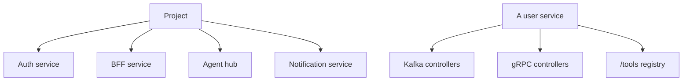

# System services — overview

OpenAPPL distinguishes two categories of framework-owned runtime. The distinction is
structural: it changes where you configure them, what the compiler emits, and how
downstream services talk to them.

**Project-level singletons.** Configured once on the project root. Each is generated as
its own standalone service. There is exactly one of each per project (or none, if you
opt out by omitting the config).

| Service | Project field | What the compiler emits | Detail |
|---|---|---|---|
| Authentication | `authentication` | the auth service: users, sessions, login flows, verifications, API keys | [authentication/overview.md](authentication/overview.md) |
| BFF | `bffService` | the BFF service: builds DataViews (search indexers, listeners) and admin endpoints | [bff.md](bff.md) |
| Agent hub | `agentHub` | an agent runtime hosting the project's AI agents with cross-service tools | [agent-hub.md](agent-hub.md) |
| Notification | `notificationService` | the notification service: templates, providers, event-driven sends | [notification.md](notification.md) |

The **agent hub** is a system service: AI agents are defined under
`agentHub.aiAgents[]` (not per service), and the hub gives them tools discovered from any
service in the project. See [agent-hub.md](agent-hub.md).

A compiler may generate further infrastructure for a project that has no blueprint
config root of its own, for example a tool hub that reads every service's tool registry
(`GET /tools`) and exposes one MCP tool per REST `BusinessApi` that does not set
`apiOptions.blockMcp`, a documentation site, or an administration UI. Such components
are compiler features rather than part of the language, and you do not opt in or out of
them in the blueprint. A business service itself serves no MCP endpoint (see the
[service tool registry](application-mcp.md)).

**Service-shaped capabilities.** Declared *inside* a user-defined service in
`services[]`. They are not separate services: they augment the owning service's
generated code with extra runtime features. A typical project mixes several.

| Capability | Declared on a service as | What the compiler emits | Detail |
|---|---|---|---|
| Kafka controllers | `controllers.kafkaSettings` on a BusinessApi | Kafka consumer dispatching to the API workflow | [Kafka controllers](../business-apis/kafka-controllers.md) |
| gRPC controllers | `controllers.grpcSettings` on a BusinessApi | a service definition and handler alongside REST | [gRPC controllers](../business-apis/grpc-controllers.md) |
| Service tool registry | nothing to declare: every REST BusinessApi is listed unless `apiOptions.blockMcp: true` | public `GET /tools` JSON registry that tool hubs read to build their MCP tools | [application-mcp.md](application-mcp.md) |

Several runtime features are documented elsewhere:

- **Realtime hubs**, **event subscriptions**, **payment workflow**, and the **shopping
  cart** are covered under the capabilities guides: realtime is a feature, not a
  separate service; payments and cart are data-object capabilities.
- **gRPC** and **Kafka controllers** are transport controllers of a BusinessApi and live
  under [Business APIs](../business-apis/grpc-controllers.md).

File storage is **not** a system service. The language provides two data-pattern
alternatives: `RemoteBucket` (cloud-provider-backed, typically S3) and `DbBucket`
(stored in the owning row's database). The provider catalogue lives at
`projectSettings.bucketProvidersSettings.bucketProviders[]`. The compiler emits
upload-URL endpoints and signed-read URLs directly into the owning service's routes. See
the data-modeling pages for usage.

## Layout

The singletons sit at the project root. The capabilities decorate whichever user
services need them.

## How a service mounts a capability

Each service-shaped capability has a property on the `Service` pattern (or one of its
chapters) that declares the opt-in (for the tool registry, the opt-out):

- `services[].businessLogic[].controllers.kafkaSettings` — see
  [`ApiKafkaSettings`](../../spec/ApiKafkaSettings.md).
- `services[].businessLogic[].controllers.grpcSettings` — see
  [`ApiGrpcSettings`](../../spec/ApiGrpcSettings.md).
- `services[].businessLogic[].apiOptions.blockMcp` — keeps an API out of the tool
  registry and the tool hubs built on it.

Singletons mount themselves once you set the matching project field (`agentHub`,
`bffService`, `notificationService`, `authentication`).

## Different things called "MCP"

The word covers two distinct surfaces. They share a name but not a purpose.

- **Application MCP / tool registry** ([application-mcp.md](application-mcp.md)). The
  endpoint each generated service exposes. Tools are the service's `BusinessApi`s.
- **Tool hub.** A project-level component a compiler may generate that discovers and
  unifies every service's tool registry into one catalogue for agents and operator
  tools.

A separate MCP server that a hosting platform offers to AI agents for *editing*
blueprints at design time is not part of the generated system and is not described in
this specification.

## When to opt out

Most projects use most of these. Cases where omitting a capability is correct:

- **No auth.** A purely public API. Omit `authentication`; the compiler refuses to
  generate session-scoped APIs.
- **No BFF.** A single-service project, or aggregation done outside the cluster. Leave
  `bffService.dataViews` empty; the service is not generated.
- **No agents.** A project with no AI surface. Omit `agentHub` and
  `aiProvidersSettings`.
- **No notifications.** All notifications routed externally. Omit
  `notificationService`.

The service tool registry and Kafka outbound events are generated when there is
something to expose; you do not opt out of them per se, there is just no surface if
there is nothing to expose.

## See also

Each page below is a deep dive for the matching row above. Read them in order if you are
auditing a project blueprint; jump straight to one if you know what you need.

- [Authentication overview](authentication/overview.md)
- [Service-to-service (M2M) communication](m2m-communication.md)
- [BFF service](bff.md)
- [Agent hub](agent-hub.md)
- [Notification service](notification.md)
- [Application MCP / tool registry](application-mcp.md)
