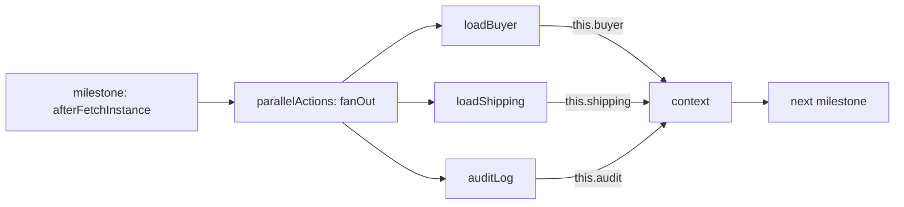
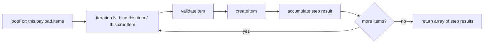

# Parallel and loops

Workflow milestones are sequential by default: actions in an array
run one after another, awaiting each. Three composition primitives
break out of that default:

| Primitive | Action class | Job |
|---|---|---|
| Fan-out | `parallelActions[]` | Run a named set of other actions concurrently. |
| Iterate | `loopActions[]` | Run a named set of actions per item in an array. |
| Stream | `iteratorActions[]` | Yield from an async iterable; used by SSE streaming. |

Race-condition hazards live on the sibling
[Race conditions](race-conditions.md) page; this page is the
how-to.

## `parallelActions`: fan-out

```json
{
  "name":             "fanOut",
  "actions":          ["loadBuyer", "loadShipping", "auditLog"],
  "writeToResponse":  false
}
```

[`ParallelAction`](../../spec/ParallelAction.md) holds a flat list of
**action names** that must already be declared elsewhere in the
store. The service fires every named action concurrently and waits for
all of them.



After all children settle, each child's result lands on the context
under its own `contextPropertyName` (or its `name` when not set).

### Behaviour

- All children start together. Order of completion is not
  deterministic.
- The action completes when every child has resolved. A single
  child failure makes the whole parallel action fail; the outer
  `onActionError` decides whether the API aborts or continues.
- Children with a `condition` field that evaluates falsy are
  skipped; their result is not added.
- The service does not auto-namespace child results. If two
  children declare the same `contextPropertyName`, the later one
  in the array wins. Use distinct names; see [Race
  conditions](race-conditions.md).

### When to reach for it

- Independent reads from different services or different tables.
- Independent side effects (send email + send push + write audit
  log).
- Composing a response from sources with no ordering dependency.

When branch B needs branch A's output, the two are not independent.
Sequentialise instead: sequential is both correct and simpler.

## `loopActions`: iterate over a list

```json
{
  "name":         "processItems",
  "loopFor":      { "js": "this.payload.items" },
  "loopItemName": "item",
  "isParallel":   false,
  "actions":      ["validateItem", "createItem"],
  "writeToResponse": false
}
```

[`LoopAction`](../../spec/LoopAction.md) iterates over the result of
`loopFor` (an MScript expression that must evaluate to an array). For
each item it runs the named inner actions in declared order.

The service binds the current item under **two** names on the
context: `this.<loopItemName>` (configured by the action) and
`this.crudItem` (a fixed alias used by `ApiAggregateData.dataValue`
templates). The alias is skipped when `loopItemName === "crudItem"`.



### Sequential vs parallel

A loop iterates one item at a time, awaiting each step before binding
the next, and that holds for `isParallel: true` too whenever the loop
has inner actions. Every step publishes its item and
step context on the shared `this` (`this.<loopItemName>`,
`this.crudItem`, `this.stepIndex`, `this.stepResults`), so concurrent
steps would read each other's item; the generated loop therefore never
runs them concurrently. Only a loop with no inner actions maps its items
concurrently, and such a loop does no per-item work. For
concurrency use `parallelActions`.

### Step results

Each iteration returns a record keyed by the inner action's `name`
with that action's result. When an inner action declares a
`contextPropertyName`, the service publishes the step's result both on
the context as `this.<innerContextPropertyName>` (the documented
access path, naming the last step in which that action RAN: the
CURRENT step, unless a `condition` skipped it, in which case the slot
still holds the previous iteration's value, so after the loop it
holds the last such step's value) and, for an object item, back onto
the loop item itself, so a downstream MScript reads
`this.<loopItemName>.<innerContextPropertyName>` for the just-
completed step. The outer loop's return value is the array of these
per-iteration records, one record per item.

## `iteratorActions`: async-iterable streams (SSE source)

```json
{
  "name":          "streamCompletion",
  "sourceScript":  { "js": "LIB.openaiStream({ prompt: this.prompt, model: 'gpt-4o' })" },
  "writeToResponse": false
}
```

[`IteratorAction`](../../spec/IteratorAction.md) wraps an async
iterable (an async generator, a readable stream, an external SSE
source). It is not a workflow scope. Placed at a workflow milestone, it
is consumed item by item: when the API runs over SSE each yielded item
is written as a `chunk` frame, and otherwise the items are collected
into `this.<contextPropertyName>` (strings joined into one string).
There are no inner actions and no per-item `this.<name>` binding. See
[SSE streaming](../business-apis/sse-streaming.md).

## Error propagation

- A `parallelActions` failure (any single child throws)
  surfaces as a failure of the outer parallel action. The outer
  action's `onActionError` then decides: `throwError` (default)
  aborts the workflow; `completeApi` catches and stores the error
  under `this.<parallelActionName>Error`. No sibling-result
  assignment happens in the failed path.
- A `loopActions` failure (an inner action throws) propagates
  out of the iteration immediately (subsequent iterations do not run),
  and the loop's own `onActionError` decides whether the workflow
  aborts or stores the error.
- To tolerate per-item failures inside a loop, set
  `onActionError: "completeApi"` on the inner action. The error
  lands on `this.<innerActionName>Error` for that iteration, the
  iteration completes, and the loop continues.

For the full failure-path story see
[Error handling](error-handling.md).

## When to use which

| Need | Pick |
|---|---|
| Multiple independent unknowns | `parallelActions` |
| Uniform iteration | `loopActions` (sequential) |
| Per-item independent side effects | `loopActions` (one item at a time) |
| Async iterable / streaming | `iteratorActions` |
| Sequential by default | A plain milestone array; no special action needed |

## See also

- [Race conditions](race-conditions.md),
  [Workflow context](workflow-context.md),
  [Error handling](error-handling.md)
- [Overview](overview.md)
- [SSE streaming](../business-apis/sse-streaming.md)
- [MScript step context](../mscript/step-context.md)
- Specification: [`ParallelAction`](../../spec/ParallelAction.md),
  [`LoopAction`](../../spec/LoopAction.md),
  [`IteratorAction`](../../spec/IteratorAction.md).
- Result composition across lists:
  [`CollateListsAction`](../../spec/CollateListsAction.md), useful
  after a loop has built one list and you want to attach it back to a
  parent collection.
