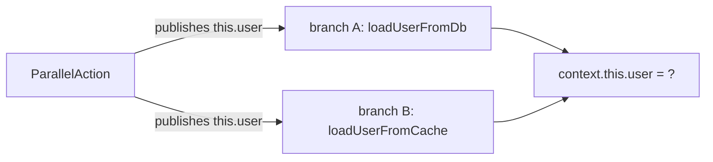

# Race conditions

A `parallelActions[]` entry runs its named children concurrently. All
children read and write the same `this` context. This page lists the
hazards and the mitigations.

Hazards #2 (conflicting DB writes) and #4 (external side-effect
duplication) also apply to two concurrent requests racing against the
same row or external resource: `this`-context hazards are confined
to a single request, but row-level and external-side-effect hazards
cross requests. Hazards #1 (context writes) and #3 (ordering
assumptions on `this`) are strictly per-request.

## The four hazards

### 1. Conflicting context writes

Two parallel children publish under the same property name on
`this`. The service assigns each child's result to its
`contextPropertyName` after all children have settled, walking the
results in declaration order. If two children declare the same
`contextPropertyName`, the later one in the array wins; the earlier
one is overwritten before any downstream action sees it.

**Mitigation.** Give each parallel child a distinct
`contextPropertyName`. Use a downstream `arrowFunctionActions` or
`addToContextActions` entry to merge the two results when needed.

### 2. Conflicting DB writes

Two parallel children update the same row (or two concurrent
requests do). Either the engine's last write wins silently, or the
second write hits a uniqueness / version constraint and fails.

**Mitigations:**

- **Atomic numeric mutation** for counters, stock and capacity. A
  `dataClause` value of `{ $inc: n }`, `{ $dec: n }` or
  `{ $incIf: { by, when } }` is lowered into ONE statement,
  `SET x = COALESCE(x, 0) + n WHERE <row> AND <when>` (a NULL counter
  counts as 0), so the database does the
  arithmetic and no other request can interleave. The `when` guard
  can reference another column of the row through `$col`
  (`{ soldCount: { $lte: { $col: 'capacity', $minus: '$by' } } }`
  reads as `soldCount + by <= capacity`), and a guarded write that
  changes no row raises a typed **409 `CONDITIONAL_UPDATE_REFUSED`**
  rather than a silent empty result. It rides the ordinary db-layer
  update path, so the search projection and the db event
  still happen. Library or custom code reaches the same primitive through
  `updateWhere(objectName, predicate, { inc, when })`. See
  [Numeric mutation](../mscript/numeric-mutation.md).
- **Gated compare-and-write** for anything that is not additive.
  Compute the new value from a value you already hold and gate the
  `whereClause` on that same precondition (an exact match on the
  read-time value). A stale write then matches zero rows instead of
  corrupting the row; check the returned array's length yourself
  (or set `onNoRows: "throwError"`). See [Array mutation: what this
  DSL does not
  cover](../mscript/array-mutation.md#what-this-dsl-does-not-cover).
- **Optimistic locking.** Declare an ordinary `Integer` property
  (e.g. `version`) on the data object; there is no dedicated
  `objectSettings` feature for this. Gate the `whereClause` on the
  read-time version and increment it in the `dataClause`; treat a
  zero-row result the same way as the counter case above (there is no
  built-in 409-on-conflict behavior; the calling action must detect
  and report the conflict itself).
- **Redis-backed lock.** Acquire a key with TTL before the
  critical section (a `writeToRedisActions` entry early in the
  workflow), release it in `afterSendResponse`. The generated service
  gives library code a Redis client; build the lock pattern on top of
  it (SET-NX-with-TTL via the client, release via a delete). There is
  no purpose-built distributed-lock helper ready-made.
- **Sequentialise.** When in doubt, drop the parallel: sequential
  is faster *and* simpler if any child reads what another writes.

### 3. Ordering assumptions

A parallel child reads `this.X` while a sibling is about to publish
`this.X`. The reader gets whatever was on the context before the
parallel started, usually `undefined`. The hazard is that the bug
is invisible in slow tests (the would-be writer happens to finish
first when the box is unloaded) and only fires under load.

**Mitigation.** If branch B needs branch A's output, they are not
independent. Hoist the dependency above the parallel (run A
sequentially first, then fan out the rest) or sequentialise
entirely.

### 4. External side-effect duplication

Two parallel children call the same external API (an email send, a
payment intent, a webhook). Each call costs money or produces a
visible artefact; the second call duplicates the first.

**Mitigation.** Use idempotency keys. Most native action types
(`paymentActions`, `sendMailActions`) accept a deduplication key;
set it from a stable input (e.g. `this.order.id`). For
`apiCallActions` / `integrationActions`, pass an `Idempotency-Key`
header explicitly.

## Mitigations: quick reference

| Pattern | When to reach for it |
|---|---|
| Per-child distinct `contextPropertyName` | Mandatory whenever children publish; the easiest fix for hazard 1. |
| Gated compare-and-write (compute + WHERE precondition) | Counters, stock, quotas. |
| Optimistic locking (version column) | General-purpose update conflicts. |
| Redis lock (`writeToRedisActions`) | Multi-action critical sections that the DB can't atomically guard. |
| Sequentialise | Default. Parallel is an opt-in optimisation. |
| Idempotency key on external calls | External side effects. |

## ParallelAction merge semantics

The service behaves as follows:

- All listed children fire concurrently (each gated by its own
  `condition`, if set).
- The action returns when **all** children have settled. A single
  failure from one child makes the parallel action fail and bubble
  out of it; the outer action's `onActionError` decides whether the API
  aborts or continues.
- Successful children's results are assigned to the context only on
  the all-resolved path. If a sibling fails, the failure short-circuits
  the action and none of the results are assigned.
- Results are assigned in declaration order, each under the child's
  `contextPropertyName` (or its `name` when not set).
- The service does **not** namespace results under a per-branch
  key; collisions on `contextPropertyName` overwrite.

## Diagnosing

Symptoms that point to a race:

- Intermittent test failures, especially under concurrent test runs
  or production load.
- Counts off by one (lost decrement / lost increment).
- Stale context reads: a downstream action sees `undefined`
  where a parallel sibling clearly published a value.
- Duplicate side effects in logs (two payment intents for one
  order).

Treat any of these as a race condition until proven otherwise.
Inspect the structured logs for the request: the service stamps
`requestId` on every log line, which is enough to reconstruct the
order of operations across actions.

## When parallel is worth it

Three patterns where the win is real:

- **Independent external calls**: email + push + audit log; no
  ordering dependency, no shared state.
- **Independent fetches across services**: fan out to two
  `interserviceCallActions` reading different services.
- **Independent validations**: two `validationActions` with
  `checkType: storedCheck` that each populate their own context flag,
  then a sequential `arrowFunctionAction` collates the result.

Anything else, default to sequential. The service does not
auto-parallelise; sequential within a milestone is the rule.

## See also

- [Parallel and loops](parallel-and-loops.md),
  [Workflow context](workflow-context.md),
  [Error handling](error-handling.md)
- Specification: [`ParallelAction`](../../spec/ParallelAction.md),
  [`LoopAction`](../../spec/LoopAction.md),
  [`WriteToRedisAction`](../../spec/WriteToRedisAction.md),
  [`UpdateCrudAction`](../../spec/UpdateCrudAction.md)
- MScript: [Array mutation](../mscript/array-mutation.md),
  [Numeric mutation](../mscript/numeric-mutation.md)
- Best practices: [Anti-patterns](../best-practices/anti-patterns.md)
