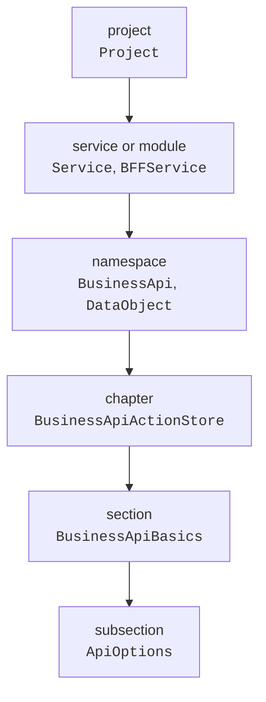

# Ontology

Part 1 is the conceptual map of OpenAPPL: which patterns exist, what each one is for, and
how they nest inside each other to form a blueprint.

A **pattern** is a named, typed building block, such as a service, a data object, a
property or a business API. A blueprint is a tree of patterns: the project at the root,
then modules and sections, down to leaf settings. Every pattern has a page that states its
purpose, its place in the tree and the patterns it contains.

## Where to start

The sidebar opens with the patterns most blueprints are built around:

- [Service](./Service.md): a deployable unit that owns data objects and APIs.
- [DataObject](./DataObject.md): an entity, its properties, relations and access rules.
- [BusinessApi](./BusinessApi.md): an operation on a data object, with its parameters,
  checks and workflow.

Below them, **Chapters** and **Sections** group the larger patterns, and
[All Patterns](./all-patterns.md) lists every pattern alphabetically.

Two generated pages show the whole map:

- The [ontology tree](./tree.md): every pattern under the pattern that holds it, from the
  root down.
- The [pattern families](./families.md): the patterns grouped by domain (a service, a
  module, a data object, a business API) and by family (the chapter that configures one
  concern).

## The six levels

Every pattern has a **level** that says how deep it sits in the blueprint tree. The level
is the first line of every pattern page.

| Level | Purpose | Example |
|---|---|---|
| `project` | The root of a blueprint. Exactly one. | `Project` |
| `service` / `module` | A deployable unit. `Service` is the per-project service you design. `module`-level patterns are the system services every project can switch on: the BFF, notifications, the agent hub and project authentication. | `Service`, `BFFService` |
| `namespace` | A category inside a service: the business APIs, the data objects. | `BusinessApi`, `DataObject` |
| `chapter` | A top-level grouping inside a namespace: the action store, the access-control catalogue, the agent hub settings. | `BusinessApiActionStore`, `AccessControl` |
| `section` | A sub-grouping inside a chapter: request parameters, controllers, query clauses. | `BusinessApiBasics`, `BusinessApiQuery` |
| `subsection` | A leaf-level configuration block. The bottom of the tree. | `ApiOptions`, `RestSettings` |

`service` and `module` are two names for one level. They differ in who owns the unit: a
`Service` is the one you declare, while a `module` is a system service whose shape the
language defines (the BFF, notifications, the agent hub, project authentication). Both
sit directly under the project.

A property name that appears on a pattern page is a real property of the language. A name
that does not is not one: a blueprint that uses it is invalid. Ground every key in the
pattern page instead of inventing one.

## What a pattern page shows

- **Level** and **Family**: where the pattern sits in the tree.
- **Contained in** and **Contains**: the patterns that hold it and the patterns it holds,
  with the property that holds each one.
- **References** and **Referenced by**: properties whose value *names* another pattern
  instance (a data object, a property) instead of containing it.
- A link to its page in the specification, with the full property table.

## How it relates to the other parts

- The [specification](../spec/index.md) (Part 2) documents every property of every
  pattern: types, defaults, allowed values and constraints.
- The [schema](../spec/openappl-json.md), `openappl.json`, is the machine-readable form
  both parts are generated from.
- The [compiler specification](../compiler/index.md) (Part 3) says what each pattern must
  cause in a running system.
